# 支持的机器人类型

NexDroid 控制系统可支持包括但不限于以下所列举的机器人类型。型号代码中 C、B 表示旋转轴，Z 表示直线轴，X 表示直角坐标轴，A 表示旋转轴。

## 七轴串联

| 型号代码 | 说明 | 图片 |
| :--- | :--- | :--- |
| CBCBABC | 七轴串联机器人 |  |
| CBCBCBA | 七轴串联机器人 | 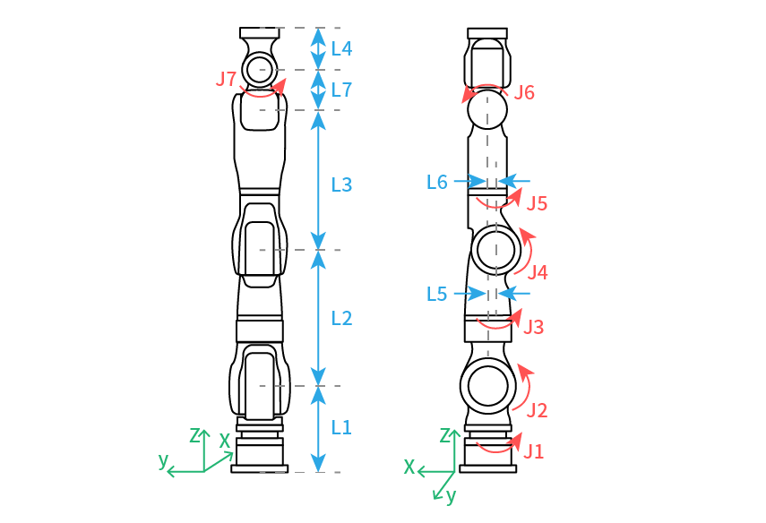 |
| CBBBCBC | 七轴串联机器人 | 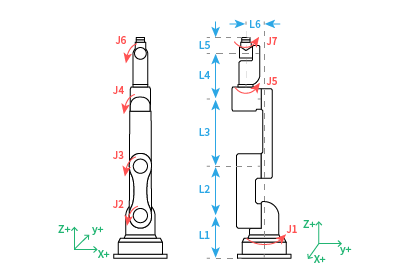 |
| CACACAC | 七轴串联机器人 | 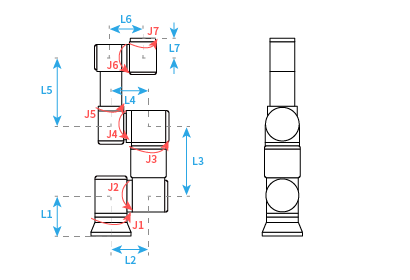 |
| XCCCABB | 七轴串联机器人 | 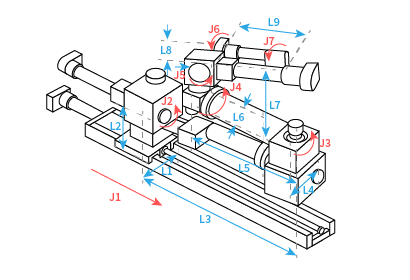 |

## 六轴串联

| 型号代码 | 说明 | 图片 |
| :--- | :--- | :--- |
| CBBABC | 标准六轴串联 |  |
| CBBBAC | 六轴串联（UR 构型） |  |
| CBBBCA | 六轴串联（喷涂机型） |  |
| CCBABC | 六轴串联 |  |
| XYZCAC | 六轴串联（龙门焊接构型） |  |
| ZCCABC | 六轴串联机器人 | 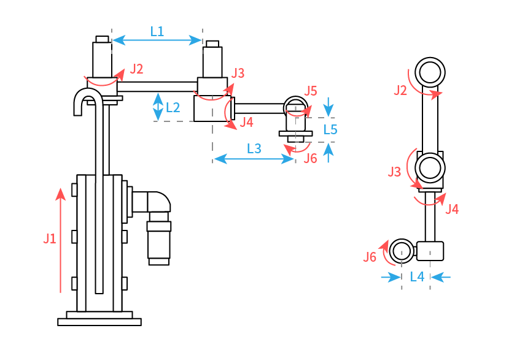 |
| XYZBAC | 六轴串联机器人 | 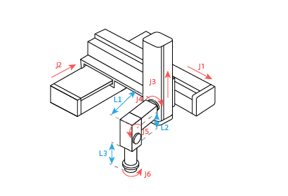 |
| XYZCAB | 六轴串联（龙门构型） | 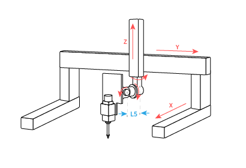 |
| CBBARA | 六轴串联机器人 | 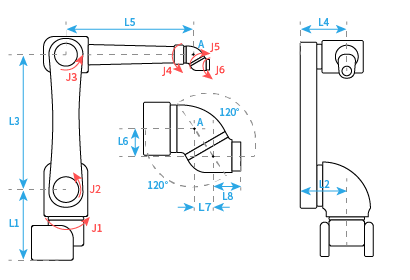 |
| 六轴协作 | 六轴协作机器人 | 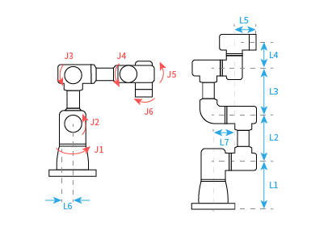 |
| 六轴喷涂 | 六轴喷涂机器人 | 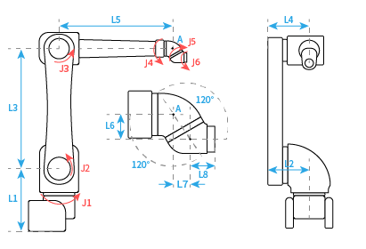 |
| 122 | 编号 122（协作构型） | 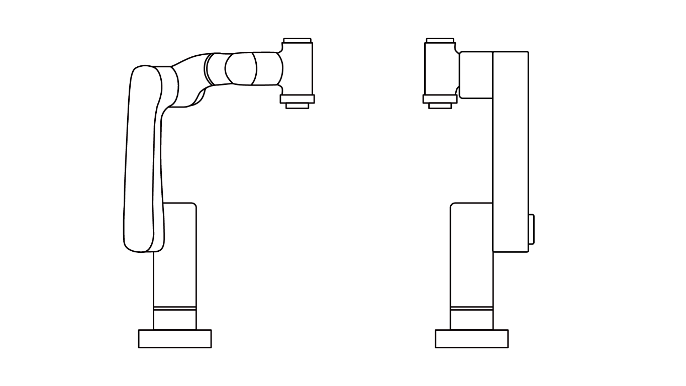 |

## 五轴串联

| 型号代码 | 说明 | 图片 |
| :--- | :--- | :--- |
| CBBAB | 五轴串联 |  |
| XYZAB | 五轴串联（直角坐标） |  |
| XYZAC | 五轴串联（直角坐标） |  |
| XYZBC | 五轴串联（龙门焊接构型） |  |
| CBBBA | 五轴串联机器人 | 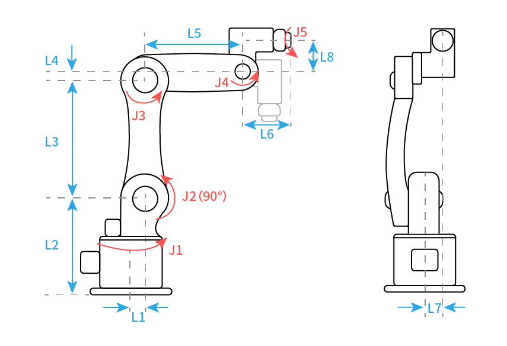 |
| XYZCB | 五轴串联（龙门构型） | 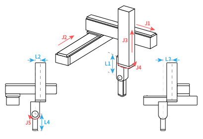 |
| 5-34 | 编号 5-34（五轴协作构型） | 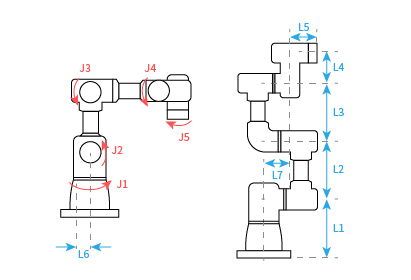 |
| XYZAC-双转台 | 五轴双转台构型 | 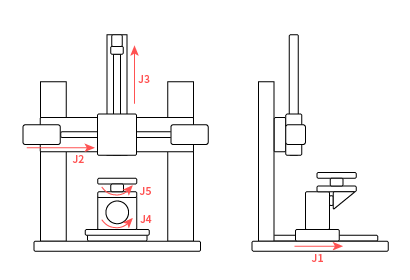 |

## 四轴串联

| 型号代码 | 说明 | 图片 |
| :--- | :--- | :--- |
| CCZC | 四轴串联 |  |
| ZCCC | 四轴串联 |  |
| CBBC | 四轴串联 |  |
| CZXC | 四轴串联 |  |
| CBBB | 四轴串联 |  |
| XYZC | 四轴串联（直角坐标） |  |
| XCCZ | 四轴直角 |  |
| XCZC | 四轴串联（SCARA 异型） |  |
| XYZA | 四轴串联（XYZA 构型） | 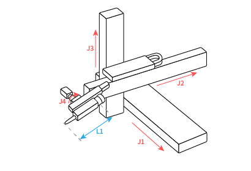 |
| XYZB | 四轴串联（XYZB 构型） | 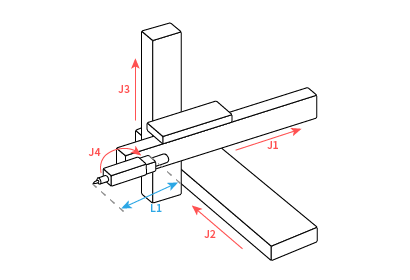 |
| YZCC | 四轴串联机器人 | 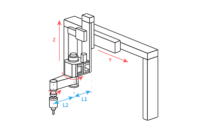 |
| 四轴 SCARA 异型一 | 四轴 SCARA 异型机器人 |  |
| 四轴 SCARA 异型二 | 四轴 SCARA 异型机器人 | 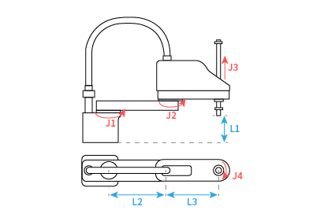 |
| 重载立柱旋转四轴 | 重载立柱旋转四轴机器人 | 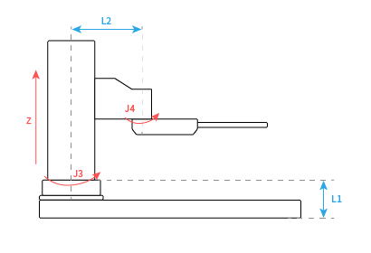 |
| 四轴堆叠 | 四轴堆叠机器人 | 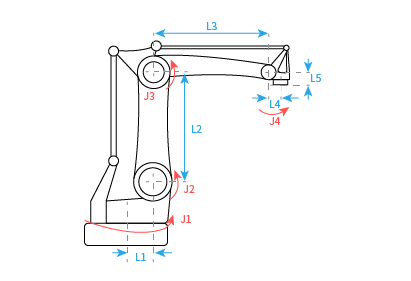 |
| 四轴直角异型 | 四轴直角异型机器人 | 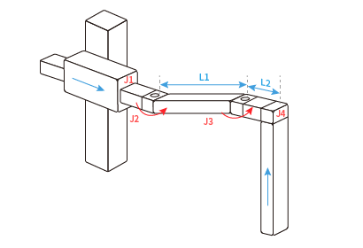 |

## 三轴串联

| 型号代码 | 说明 | 图片 |
| :--- | :--- | :--- |
| CCZ | 三轴串联 |  |
| XYZ | 三轴串联（直角坐标） |  |
| CCA | 三轴串联（SCARA 异型） |  |
| BBB | 三轴串联 |  |
| CZC | 三轴串联多关节机器人 | 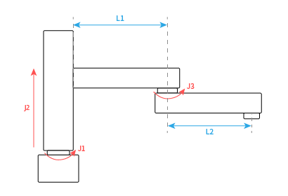 |
| 三轴 SCARA 异型 | 三轴 SCARA 异型机器人 |  |
| 三轴直角旋转 | 三轴直角旋转机器人 | 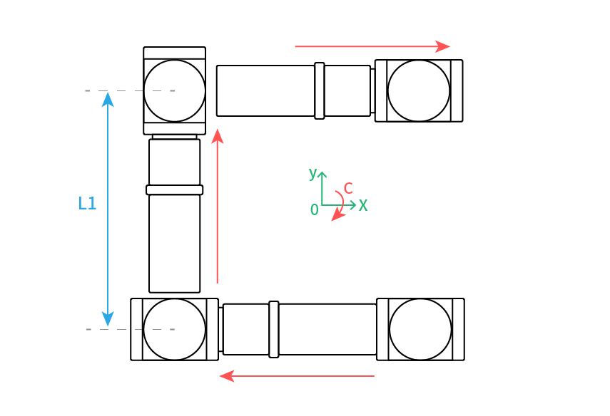 |
| 三轴 SCARA | 三轴 SCARA 机器人 | 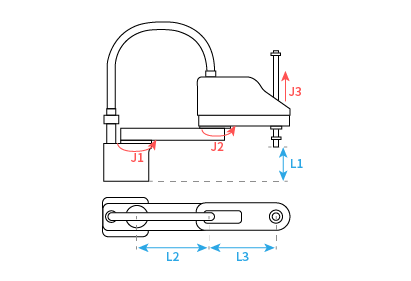 |

## 二轴串联

| 型号代码 | 说明 | 图片 |
| :--- | :--- | :--- |
| CC | 二轴串联 |  |
| 二轴 SCARA | 二轴 SCARA 机器人 | 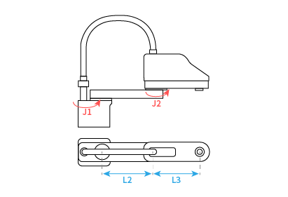 |

## 并联与混联

| 类型 | 说明 | 图片 |
| :--- | :--- | :--- |
| 三轴直角 | 三轴直角坐标机器人 |  |
| 五轴混联 | 五轴混联机器人 |  |
| Delta 并联 | Delta 并联机器人 |  |
| 四轴并联 | 四轴并联机器人 |  |
| Tricept | Tricept 并联混联加工机构 |  |
| 五轴混动 | 五轴混动机器人 | 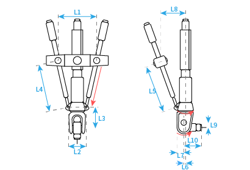 |
| 五轴协作 | 五轴协作机器人 | 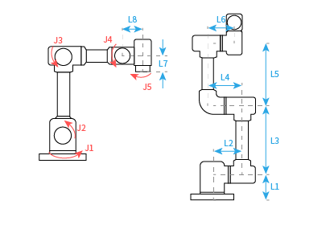 |
| CBBCBA | 六轴混联机器人 |  |
| 六轴 Stewart 并联 | 六轴 Stewart 并联机器人 | 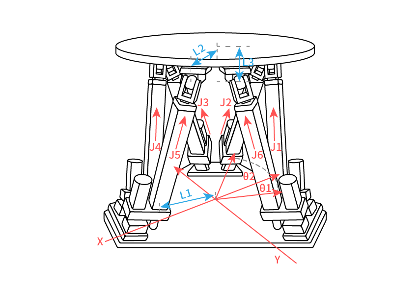 |
| 六轴并联 | 六轴并联机器人 | 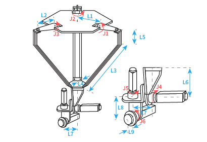 |
| R-Theta | R-Theta 型晶圆搬运机器人 | 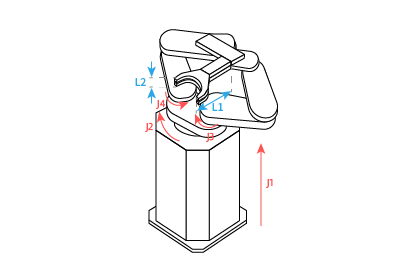 |
| 晶圆搬运机器人 | 晶圆搬运构型 | 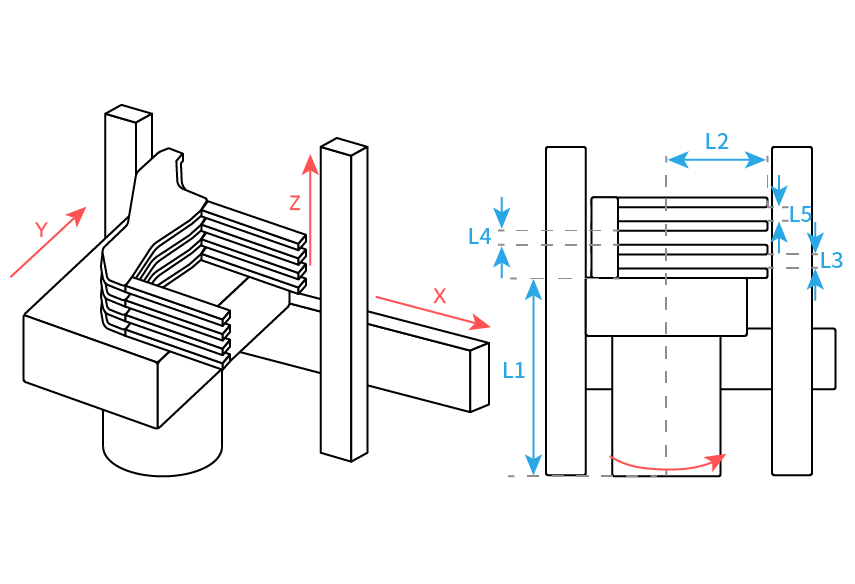 |

## 单轴

| 类型 | 说明 | 图片 |
| :--- | :--- | :--- |
| 单轴 | 单轴运动控制 |  |
| 单轴伺服 | 单轴伺服运动机构 | 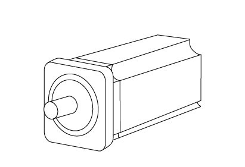 |

> **说明**：以上列表来自 NexDroid 官网，实际支持情况以控制器固件版本为准。如需适配其他构型请联系纳博特技术支持。
