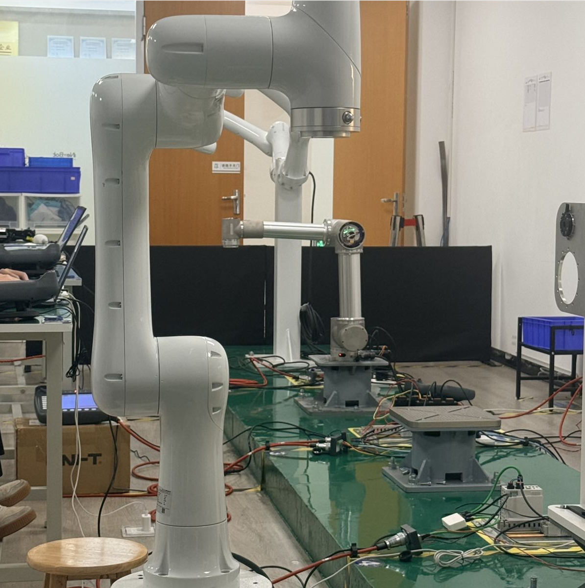
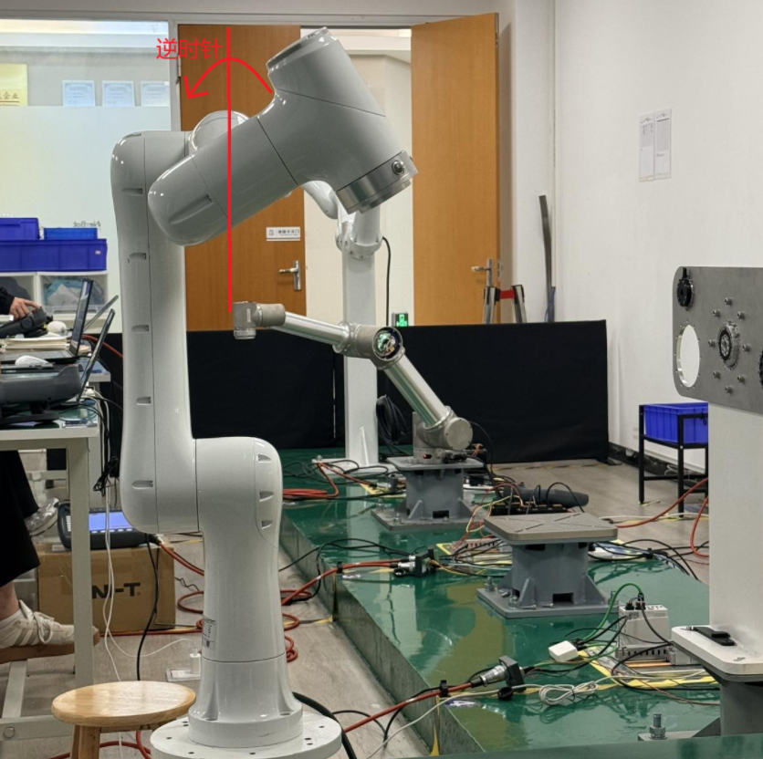
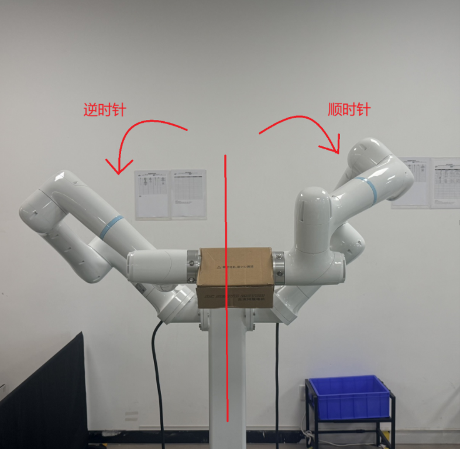

# 双臂使用手册

前置条件：两个机器人都已经配置成功并且可以正常运行，若机器人带关节力传感器并且开发已适配，则需要厂商提供传感器相关pdo参数，添加进eni文件；若需要拖拽、碰撞检测等功能，必须配置相关的pdo映射。

版本：RTL25.01

双臂可以选择使用双主站程序或单主站程序带交换机。

## 步骤一 双臂接入

两台机器人接入同一个控制器上。

若使用双主站程序，详情请看此文档[sys_init启动参数 | 知识库管理](https://ones.inexbot.com/wiki/#/team/RnqpQ1Yp/space/RS4mbuDo/page/EopZV1V8?matchText=sys_&startContent=) ；若使用C2300控制器的双主站，LAN1为ethernet口，LAN2、LAN3为ethercat口；若使用交换机，则需要注意eni中交换机部分不配置基础pdo。

## 步骤二 方向确认

### 确认直角方向

根据机器人的实际安装位置，修改**机器人参数-安装设置**

| 安装方式            | 操作             |
| --------------- | -------------- |
| **正装**（地面朝上）    | 直接在下拉菜单中选"正装"  |
| **倒装**（天花板朝下）   | 直接在下拉菜单中选"倒装"  |
| **侧装**（墙面/侧面挂载） | 需要额外填写侧装角度，见下文 |

正装和倒装是标准姿态，系统已经内置了对应的坐标映射，选一下就行。
	
侧装时确定**旋转偏移**

具体分两个子步骤：
	
1. 确定点动正方向

	让机器人在 **直角坐标系** 下分别点动 **A 轴、B 轴、C 轴**，观察每个轴正方向对应的旋转方向（顺时针还是逆时针）。绕 X 轴旋转定义为 **A 姿态**，绕 Y 轴旋转定义为 **B 姿态**，绕 Z 轴旋转定义为 **C 姿态**。

2. 判断同向还是反向，决定正负号
	
	- **同向（旋转偏移填正值 +）**：实际安装方向在空间中造成的旋转，与点动时正方向的旋转**一致**。

	- **反向（旋转偏移填负值 −）**：实际安装方向在空间中造成的旋转，与点动时正方向的旋转**相反**。

3. 修改好安装方式后使用直角坐标，点动X、Y、Z是否与模型图方向一致。

例如：

下图为六轴串联-CBBABC机型正装。

下图为六轴串联-CBBABC机型正装，A轴正方向转动。A+为逆时针转动。

下图为侧装时实际安装的旋转方向。其中右侧机器人1轴偏移了180°，需要确认一下机器人关节方向是否正确，与模型图中方向不符的关节需要在关节参数中修改方向。

上图中两个机器人都是绕X轴旋转偏移(A轴)，逆时针旋转的机器人与直角坐标的A+为同向，此时它的安装方向为**侧装**，旋转偏移为**绕X轴旋转偏移(A轴)** **45**；

顺时针旋转的机器人与直角坐标的A+为反向，此时它的安装方向为**侧装**，旋转偏移为**绕X轴旋转偏移(A轴)** **-45**。

## 步骤三 动力学辨识

若不使用拖拽、碰撞检测、软浮动等功能可跳过此步骤。

动力学辨识时，需要机器人四周及上下留出空间。
### 填写力矩转换比

在**功能参数-人机协作-转换比使能** 中填写**力矩转换比**，实际力矩转化比公式为1000/(减速比 * 额定转矩Nm)，其中额定转矩Nm需要伺服厂商提供，若伺服有传动效率比，厂家也需一并提供。

若机器人带关节力控传感器还需要填写传感器力矩转换比，该转换比公式由伺服厂商提供。

打开力矩转换比使能开关。
### 关节传感器标零

若机器人不带关节传感器，可跳过此步骤

在 **功能参数-人机协作-关节传感器** 中打开**关节传感器通信**按钮，进入**数据**页面进行 **标零** 

### 动力学辨识

具体辨识步骤请看此文档 [动力学重构 | 知识库管理](https://ones.inexbot.com/wiki/#/team/RnqpQ1Yp/space/XLUijCza/page/BBdbCYC1) 

## 步骤四 双臂协同

详情请看 [新双机功能 | 知识库管理](https://ones.inexbot.com/wiki/#/team/RnqpQ1Yp/space/XLUijCza/page/MhezuHJz) 

## AI 检索专用问答对 (Q&A for Retrieval)

**Q: 多台机器人使用交换机串联时显示"未知从站"是什么原因？**

A: 多台机器人串联时，未知从站大概率是交换机。此时需要重新配置 eni 文件，交换机所在的位置配置时，不需要填入 6040 之类的基础 PDO 参数。

**Q: 侧装机器人如何确定旋转偏移的正负号？**

A: 判断方法如下：

1. 让机器人在**直角坐标系**下分别点动 A 轴、B 轴、C 轴，观察每个轴正方向对应的旋转方向（顺时针还是逆时针）
2. 判断实际安装方向与点动正方向的旋转关系：
   - **同向（填正值 +）**：实际安装方向造成的旋转，与点动时正方向的旋转**一致**
   - **反向（填负值 −）**：实际安装方向造成的旋转，与点动时正方向的旋转**相反**
3. 修改好安装方式后，点动直角坐标系 X、Y、Z 轴验证方向是否与模型图一致

**Q: 侧装后关节方向与模型图不符怎么办？**

A: 侧装时，若发现某些关节的实际转动方向与模型图中标注的正方向不一致，需要进入**关节参数**中，将对应关节的**模型方向**取反（例如 -1 改为 1，1 改为 -1）。

**Q: 动力学辨识可以跳过吗？什么情况下必须做？**

A: 如果**不使用**拖拽、碰撞检测、软浮动等人机协作功能，可以跳过动力学辨识步骤。如果需要使用上述功能，则必须完成动力学辨识。

**Q: 力矩转换比如何填写？**

A: 在**功能参数 - 人机协作 - 转换比使能**中填写：

- **基础力矩转换比**：公式为 `1000 / (减速比 × 额定转矩 Nm)`，其中额定转矩 Nm 需要伺服厂商提供，若伺服有传动效率比，厂家也需一并提供
- **关节力控传感器力矩转换比**（可选）：仅当机器人带关节力控传感器时需要填写，转换比公式由伺服厂商提供
- 填写完成后需要打开**力矩转换比使能**开关

**Q: 带关节传感器的机器人需要额外做什么？**

A: 带关节传感器时还需要完成以下操作：

1. 从厂商获取传感器相关的 PDO 参数，添加进 eni 文件
2. 在**功能参数 - 人机协作 - 关节传感器**中打开**关节传感器通信**按钮
3. 进入**数据**页面进行**标零**操作
4. 动力学辨识前确保传感器通信正常

**Q: 动力学辨识前需要做哪些准备？**

A: 动力学辨识前的准备工作包括：

1. 确认机器人四周及上下有足够的空间，避免辨识过程中发生碰撞
2. 正确填写力矩转换比并打开使能开关
3. （带传感器时）完成关节传感器通信配置和标零
4. 确保拖拽、碰撞检测等功能所需的 PDO 映射已配置完成

**Q: 双臂协同（联动模式）如何配置？**

A: 双臂联动模式配置步骤：

1. 机器人 1 和机器人 2 分别标定工具手
2. 进入**设置 / 机器人参数 / 校准大地坐标系**，设置对照机器人（主机）和校准机器人（从机），进行大地坐标系校准，误差一般不超过 10，否则需重新标定
3. 在校准机器人的**设置 / 用户坐标标定**界面，【类型】选择【联动坐标系】，【机器人】选择【1】
4. 点动机器人 1 时，机器人 2 会跟随运动，验证联动是否正常

**Q: 运行模式下如何让双臂同时启动？**

A: 运行模式双臂同步运行步骤：

1. 创建 Robot1 和 Robot2 的作业文件，机器人 1 中插入运动类指令，机器人 2 中插入切换联动用户坐标的指令
2. 为避免机器人 2 切换坐标后立即结束程序，可选择以下方式之一保持联动：
   - a. 机器人 2 开启循环模式
   - b. 预估机器人 1 运动时间，加延迟指令
   - c. 用多机协调类指令，在机器人 1、2 中都插入等待同步点
3. Robot1 和 Robot2 伺服就绪后，切换到运行模式选择 **RobotAll**
4. 在多机专用界面选择程序后点击【开始】，即可同时启动两个机器人
