# 激光切割操作手册

## 目录

1. [工艺介绍](#1-工艺介绍)
2. [安全操作注意事项](#2-安全操作注意事项)
3. [界面说明](#3-界面说明)
4. [快捷功能](#4-快捷功能)
5. [激光切割工艺](#5-激光切割工艺)
6. [指令说明](#6-指令说明)
7. [仿真](#7-仿真)
8. [开机与关机](#8-开机与关机)
9. [易损件维护](#9-易损件维护)
10. [常见调试操作](#10-常见调试操作)

---

## 1 工艺介绍

激光切割是利用高能量密度激光束将材料局部加热至熔化或汽化状态，同时借助高速辅助气体吹除熔融物，从而形成切缝的热切割工艺。

- **核心优势**：精度高、速度快、热影响区小、柔性好。
- **主流形式**：光纤激光主导金属加工，薄板切割速度快、精度高、热影响小。
- **局限**：厚板能力有限，材料选择性较强。
- **典型应用**：钣金、汽车、航空、医疗、广告标识等领域。

## 2 安全操作注意事项

使用激光切割系统，必须遵守两条基本原则：**默认上电**、**非必要不下电**。

**默认上电**
只要连上 PC 示教器，系统就会发出上电信号（处于伺服运行状态）。PC 示教器上设有伺服上电按钮，按下后伺服直接上电。

**非必要不下电**
出现一般报错时，系统只停机、不下电。只有出现以下 3 类报错时系统才会下电：

- IO 急停
- 伺服急停
- 错误停止

下电后点击“清除错误”即可重新上电。

## 3 界面说明

### 3.1 用户权限

系统共有 3 类用户：

| 用户类型 | 权限说明 |
| --- | --- |
| 技术员（默认） | 程序运行、导出/导入程序、导出日志等 |
| 厂家 | 修改参数、IO 配置等 |
| 新建用户 | 可自定义设置权限 |

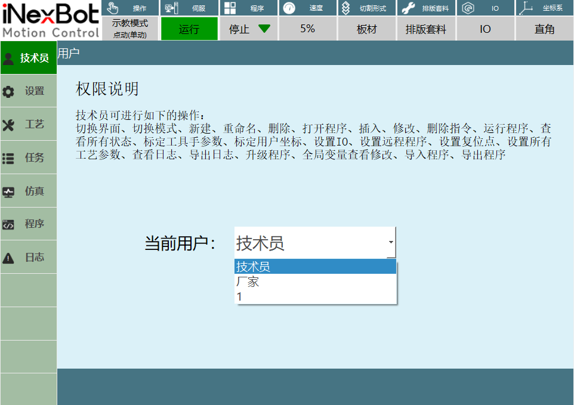

### 3.2 监控区域

PC 示教器的监控区域位于整个界面的下方，分别显示坐标、实时速度、切割头信息、输入输出、电容传感器信息。

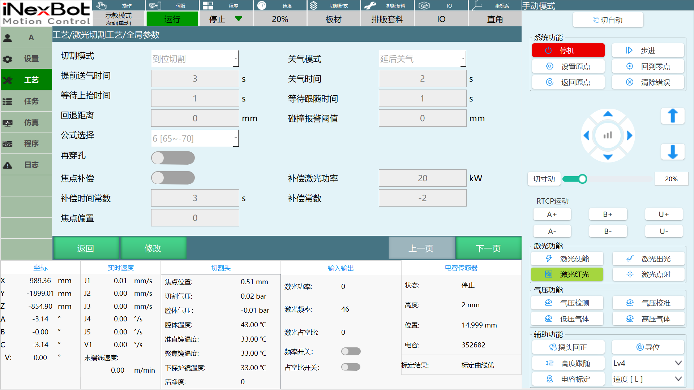

#### 3.2.1 参数说明

| 显示项 | 说明 |
| --- | --- |
| 坐标 | 显示各坐标系下机器人各轴和外部轴坐标值。注意：PC 示教器只显示一个外部轴值。 |
| 实时速度 | 显示各轴当前速度和末端线速度。 |
| 切割头 | 显示切割头各项数据（未连接实际切割头时，此处数据始终为 0）。 |
| 输入输出 | 显示功率、频率、占空比值、频率开关、占空比开关。其中频率开关与占空比开关仅用于显示是否开启，点击无效。 |
| 电容传感器 | 显示调高器的状态、高度、位置和传感器电容（未连接实际调高器和传感器时，此处数据不会变化）。 |

### 3.3 控制区域

PC 示教器的控制区域位于整个界面的右侧，可通过上方的“切自动/切手动”开关在自动模式与手动模式之间切换。控制区域中各控件的功能见[第 4 章](#4-快捷功能)。

**手动模式**

**自动模式**

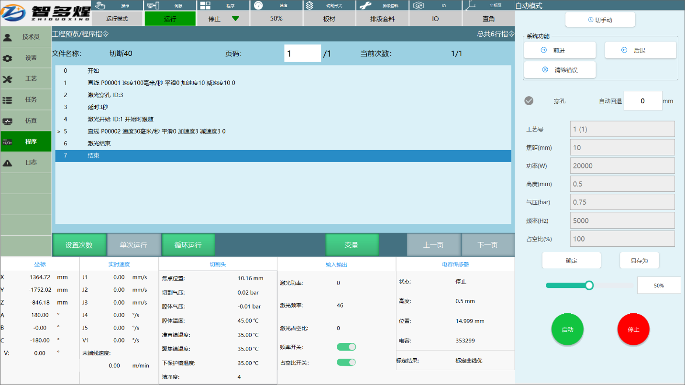

**提示说明**

部分按键带有提示说明：将鼠标移到该按键上，说明文字会悬停在按钮之上。

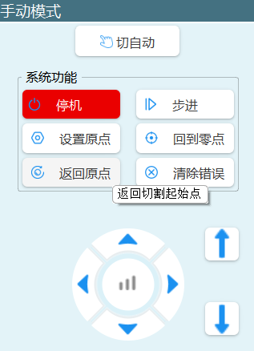

## 4 快捷功能

### 4.1 系统功能

| 按键 | 功能 |
| --- | --- |
| 停机 | 机器人暂停运行。 |
| 步进 | 单步运行程序指令。 |
| 设置原点 | 将当前位置设为切割起始点，并把当前位置的 X、Y、Z 值存入用户坐标系的原点。 |
| 返回原点 | 返回之前设置的切割起始点。 |
| 回到零点 | 回到机械零点。 |
| 清除错误 | 清除错误报警。报错下电时，第一次点击为清错，第二次点击为上电。 |

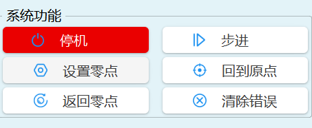

### 4.2 点动及速度切换

**点动**
圆盘的上下左右分别对应直角坐标系下的 X−、X+、Y−、Y+；右侧上下两个键对应 Z+、Z−。切割形式选择管材时，圆盘左侧会出现 V+、V− 按钮，分别对应外部轴正方向、负方向。

**速度切换**
圆盘中间的速度切换快捷键可将速度快速调节至 20%、50%、100%：一格为 20%，两格为 50%，三格为 100%。

**速度条与寸动模式**
速度条前面有“切寸动/切手动”开关，用于切换寸动模式与手动模式。

- **手动模式**（即点动模式）：可拉动速度条，或在右侧输入框内输入数值来改变速度。
- **寸动模式**：类似定距移动，单位为 mm，可在输入框中输入数值来改变单次运行距离。

*手动模式*

*寸动模式*

### 4.3 RTCP 运动

- A+ / A−：正向 / 反向移动 A 轴
- B+ / B−：正向 / 反向移动 B 轴
- U+ / U−：正向 / 反向移动调高器

### 4.4 激光功能

| 功能 | 说明 |
| --- | --- |
| 激光使能 | 打开激光器光闸。手动出光点射时须打开激光使能；程序运行到激光开始、穿孔指令时会自动打开。 |
| 激光出光 | 打开 / 关闭频率开关、占空比开关。二者是否开启会在监控区域“输入输出”中显示。正式出光时须先打开激光出光；不出光调试设备时只需打开激光出光。 |
| 激光红光 | 打开红光指示，用于辅助定位和标记。与激光使能互锁，打开其一即关闭另一个。 |
| 激光点射 | 首次点击跳转到“激光点射（打同轴）”界面，之后每次点击都以该界面中的参数点射一次。 |

#### 4.4.1 点射参数说明

| 参数 | 说明 |
| --- | --- |
| 焦距 | 即焦点位置，激光焦点与切割材料的距离。 |
| 公式选择 | 选择焦点公式。焦距须与焦点公式匹配，各公式的焦点值范围见下图；如焦点位置在 [−50, 45] 范围内，应选择公式 5。 |
| 点射功率 | 点射时的激光器功率。 |
| 点射时间 | 单次点射的时间。 |
| 点射频率 | 点射时每秒钟发出激光的次数。 |
| 占空比 | 点射时单位时间内激光工作的占比，如 66% 即一秒内激光工作 0.66 s。 |

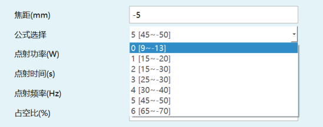

### 4.5 气压功能

**气压检测**
进行一次吹气，按点射气压值（在“工艺 → 激光切割工艺 → 手动操作”界面设置）出气，进行气压检查。

**气压校准**
根据“模拟量匹配”界面设置的气压校准级数和气压响应时间，自动完成气压匹配。使用流程如下：

1. 在“工艺 → 激光切割工艺 → 模拟量匹配 → 气压匹配 → 更多参数”界面设置对应参数（参数含义见 [5.3.3](#533-更多参数一键校准)）。
2. 点击“气压校准”，按当前设定参数执行校准。
3. 校准结束后，切换到“气压匹配”界面查看并检查气压匹配结果。

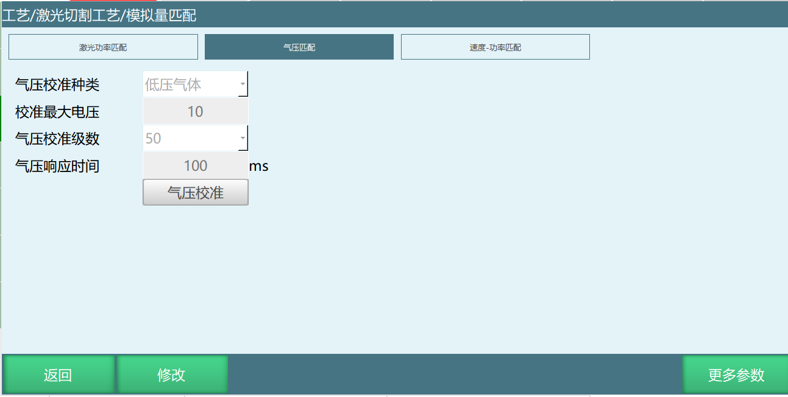

**低压气体 / 高压气体**
分别用于打开 / 关闭低压、高压气体阀门，并显示阀门当前状态。

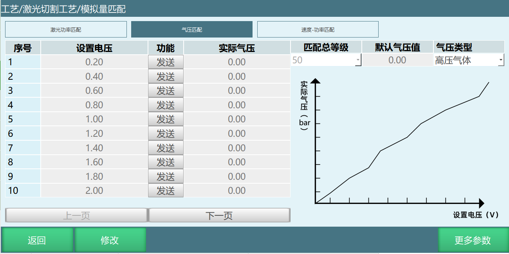

### 4.6 辅助功能

| 功能 | 说明 |
| --- | --- |
| 摆头回正 | 使切割头竖直向下。 |
| 寻位 | 点击后进入寻边找正、走边框界面。 |
| 高度跟随 | 使调高器进入 / 退出跟随模式。 |
| 跟随等级 | 选择跟随等级，共 Lv1～Lv30 三十级，默认 20 级。跟随等级与跟随速度的匹配关系可在“激光切割工艺 → 调高器 → 跟随等级匹配”处设置。 |
| 电容标定 | 让调高器执行电容标定，测量浮头与板材之间的电容与位置的对应关系。 |
| 调高器速度 | L / M / H 分别为调高器点动的低速、中速、高速，默认 L 挡。 |

### 4.7 前进 / 后退

**前进**
切割过程中暂停后点击前进，机器人会沿已走过的切割轨迹向暂停点前进，到达暂停点后无法继续前进。

**后退**
切割过程中暂停后点击后退，机器人会沿已走过的切割轨迹向起始点后退，到达起始点后无法继续后退。

- **使用前提**：需先将全局参数中的“回退距离”改为 0，并将通讯周期修改为 2 ms，否则容易掉 OP。
- **断点起步**：若在暂停后移动过机器人，点击回退会先回退到断电位置，再继续向后回退。
- **限制**：IO 急停或伺服急停之后，无法进入回退模式。

**典型使用场景**
切割过程中出现状况时暂停切割，点击前进 / 后退将机器人调整至合理位置，再点击启动继续切割。

### 4.8 再穿孔与自动回退

#### 4.8.1 再穿孔

对应全局参数中的“再穿孔”，用于开启或关闭再穿孔功能。开启后，切割中途暂停、断点执行时会先执行一次穿孔再继续运行。

#### 4.8.2 自动回退

对应全局参数中的“回退距离”，用于设置自动回退距离。设置后，切割中途暂停、断点执行时会先自动回退所设距离再继续运行；若同时开启再穿孔，则顺序为“回退 → 穿孔 → 继续运行”。

如需手动回退，须将自动回退距离设为 0。

### 4.9 运行中修改切割参数

可在运行过程中修改切割参数，包括焦距、功率、调高器高度、气压、频率、占空比。

1. 运行到激光开始时，此处会显示切割工艺号对应的切割参数。修改参数后点击“确认”，即以所设值作为临时参数进行切割；程序运行结束时会清空这些临时参数。

   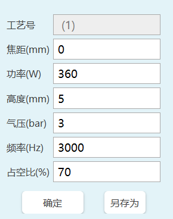

2. 点击“确认”后再点击“另存为”，弹出对话框，可选择工艺号并填写注释，将临时参数和注释写入所选切割工艺号。

   

3. 在“切割参数”界面可查看另存的切割参数。

## 5 激光切割工艺

点击“工艺”，进入“激光切割工艺”界面，再选择对应子界面。

### 5.1 全局参数

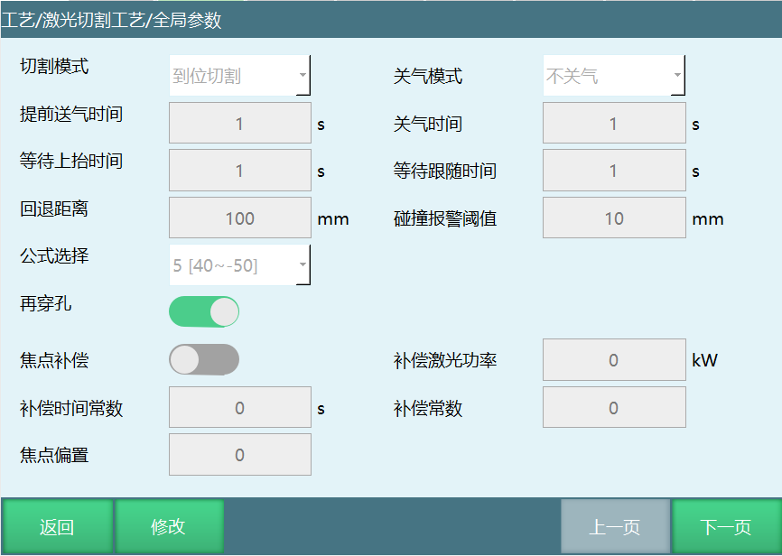

| 参数 | 说明 |
| --- | --- |
| 切割模式 | 到位切割：打开激光开关后，收到 IO 的到位信号再进行激光切割；直接切割：程序打开激光后直接进行切割。 |
| 关气模式 | 不关气：激光切割结束后不关气；延后关气：切割结束后继续吹气一段时间再关气。 |
| 提前送气时间 | 激光切割开始之前，提前多长时间开始送气。 |
| 关气时间 | 延迟关气的时间。 |
| 等待上抬时间 | 发出取消跟随信号后，等待跟随到位信号的最大时间。 |
| 等待跟随时间 | 发出跟随信号后，等待跟随到位信号的最大时间。 |
| 回退距离 | 激光切割中断后自动回退的距离。如需手动回退，将此值设为 0。 |
| 碰撞报警阈值 | 未打开调高器跟随时，若调高器与工件距离小于该阈值即判定为碰撞并发送报警；打开调高器跟随时，是否碰撞由调高器判定。 |
| 公式选择 | 选择焦点公式。焦距须与焦点公式匹配，焦点值范围须在公式范围内。 |
| 再穿孔 | 打后，切割中途暂停、断点执行时会先执行一次穿孔再继续运行。 |
| 焦点补偿 | 切割头出光一段时间后，焦点会受温度影响产生偏移，需要补偿焦距。补偿参数因激光器不同而各异，需由工程师按实际使用的激光器填写。 |
| 补偿激光功率 | 焦点补偿的功率条件值：功率提升至该值且出光时间达到补偿时间常数时，开始焦点补偿。 |
| 补偿时间常数 | 焦点补偿的时间条件值：功率提升至补偿激光功率且出光时间达到该值时，开始焦点补偿。 |
| 补偿常数 | 焦点补偿的时间。 |
| 焦点偏置 | 对激光器恒定存在的焦点偏移进行校正。 |
| 洁净度检测 | 检测激光头洁净度。洁净度不在允许范围内时会停止运行作业文件。 |
| 穿孔洁净度阈值 | 穿孔时洁净度超出该阈值会停止运行作业文件。上下限值都填 −1 则关闭穿孔洁净度检测。 |
| 切割洁净度阈值 | 切割时洁净度超出该阈值会停止运行作业文件。上下限值都填 −1 则关闭切割洁净度检测。 |
| 空走洁净度阈值 | 不出光调试时洁净度超出该阈值会停止运行作业文件。上下限值都填 −1 则关闭空走洁净度检测。 |
| 气压校准检测 | 开启后，开机、换喷头之后须先完成气压校准，才能回零、运行作业文件和发射激光，否则机器人只允许点动。 |
| 电容标定检测 | 开启后，开机、换喷头之后须先完成电容标定，才能回零、运行作业文件和发射激光，否则机器人只允许点动。 |

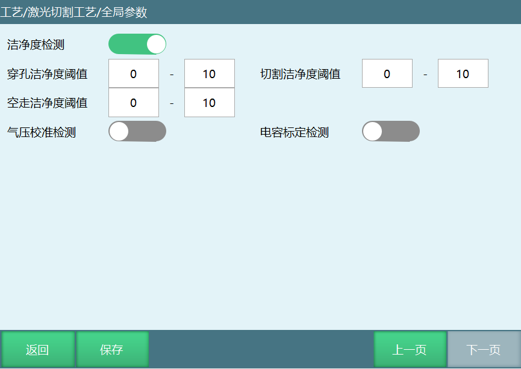

### 5.2 切割参数

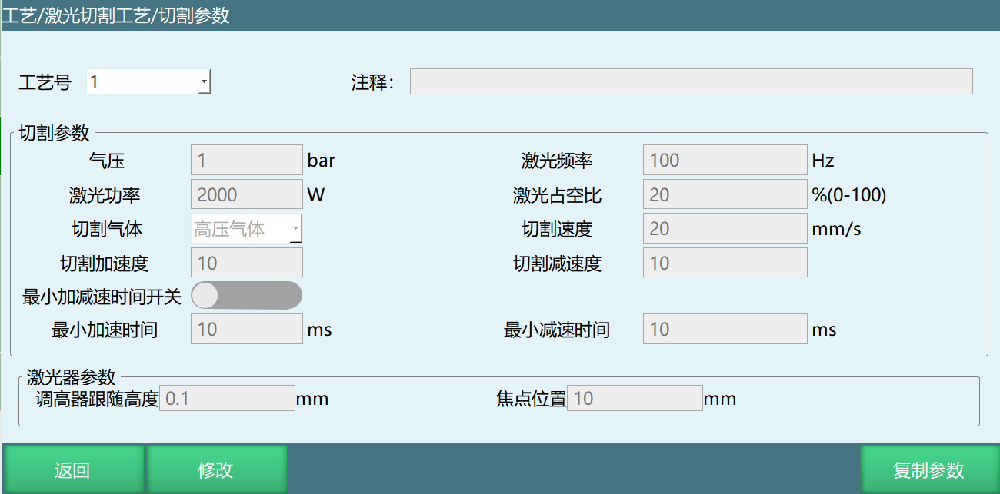

| 参数 | 说明 |
| --- | --- |
| 工艺号 | 可保存多份参数，在指令中调用。 |
| 气压 | 切割时的气压，单位 bar（1 bar = 100 kPa）。 |
| 激光频率 | 激光器每秒钟发出激光的次数。 |
| 激光功率 | 切割时的激光器功率。 |
| 激光占空比 | 单位时间内激光工作的占比，如 66% 即一秒内激光工作 0.66 s。 |
| 切割气体 | 选择切割时使用的气体。 |
| 切割速度 | 切割轨迹速度。切割时调用对应工艺中的切割速度运行轨迹，轨迹速度不受全局速度影响。 |
| 切割加速度 | 切割时轨迹的加速度。 |
| 切割减速度 | 切割时轨迹的减速度。 |
| 最小加减速时间开关 | 打开后运行切割轨迹时调用工艺中的加减速时间；不打开则调用系统设置中的默认加减速时间。 |
| 最小加速度时间 | 机器人从静止加速至目标速度（或由低速加速至高速）所需的最短时间。缩小该时间可优化过渡停顿。 |
| 调高器跟随高度 | 切割时调高器的跟随高度。 |
| 焦点位置 | 切割时激光焦点的位置。 |

### 5.3 模拟量匹配

#### 5.3.1 功率匹配

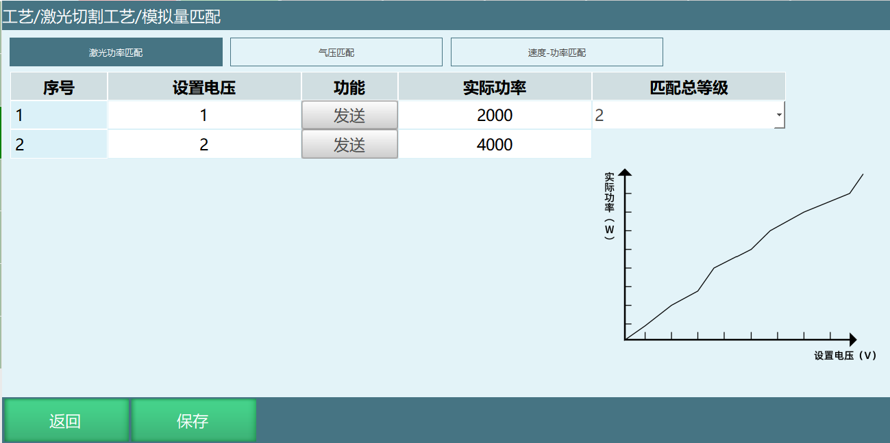

| 参数 | 说明 |
| --- | --- |
| 设置电压 | 激光功率匹配的给定电压。点击“发送”，系统将该电压发送给激光器。 |
| 实际功率 | 激光器接收给定电压后出光，界面显示当前实际功率；此时可将该功率值手动填入与设置电压对应的“实际功率”输入框。 |
| 匹配总等级 | 激光功率匹配的级数。 |

#### 5.3.2 气压匹配

| 参数 | 说明 |
| --- | --- |
| 设置电压 | 气压匹配的给定电压。点击“发送”，系统将该电压发送给比例阀。 |
| 实际功率 | 比例阀接收给定电压后出气，激光头反馈当前实际气压；此时可将该气压值手动填入与设置电压对应的“实际气压”输入框。 |
| 匹配总等级 | 气压匹配的级数。 |
| 默认气压值 | 第一级气压匹配的气压下限值。若在某一级给定电压后实际出气值小于该值，请重新设置电压，直至实际气压值大于默认气压值。 |
| 气压类型 | 可切换查看不同气体的气压匹配结果。 |
| 更多参数 | 进入一键校准气压设置界面。 |

#### 5.3.3 更多参数（一键校准）

| 参数 | 说明 |
| --- | --- |
| 气压校准种类 | 低压气体 / 高压气体，选择哪个即校准哪个。 |
| 校准最大电压 | 校准时给出的最大电压值。 |
| 气压校准级数 | 将最大电压分成多少份，作为每次气压匹配的给定电压。例如：校准最大电压设为 10 V、级数设为 50，系统会将 10 V 分为 50 份，从 0.2 V 开始每级递增 0.2 V，直至 10 V。 |
| 气压响应时间 | 气压匹配的间隔时间。校准时，系统每给定一次电压都会等待该时间结束后再出气，然后读取当前气压，读取完成后再给定下一级电压。 |
| 气压校准 | 点击后按当前设定参数执行气压校准。 |

校准结束后，可切换到“气压匹配”界面查看并检查气压匹配结果。

#### 5.3.4 速度功率匹配

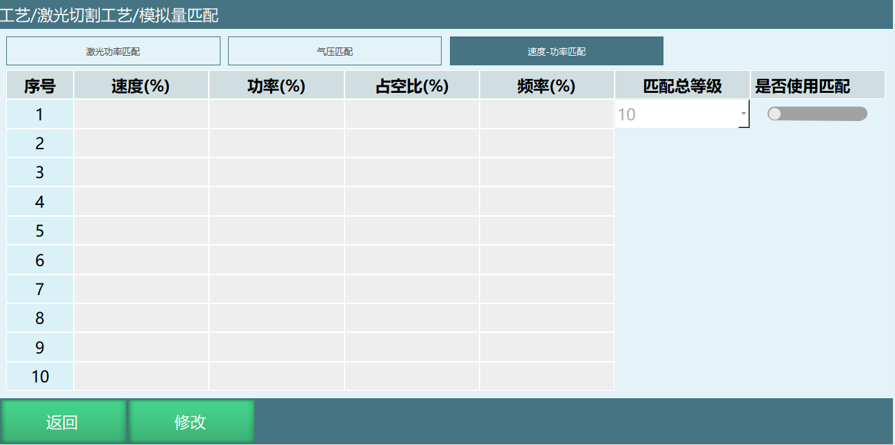

功率曲线为占空比或频率与速度的关系：根据速度大小灵活调整所使用的占空比或频率，可减轻拐角过烧或挂渣。

**速度**：当前速度 / 设定速度，对应出光百分比。

**计算示例**
界面设置为 50% 速度、功率 50%、占空比 100%、频率 30%；切割参数为功率 20000 W、占空比 80%、频率 500；当前速度为 50 mm/s，而指令设定速度为 100 mm/s。若打开速度功率匹配，则按 50/100 = 50% 执行“50%”那一行的激光功率、占空比与频率，即实际功率 10000 W、占空比 80%、频率 150。

**规则说明**

- 速度百分比 = 当前速度 / 设定速度，范围为 0～100%。
- 当前速度大于设定速度时（曲线轨迹某段可能超速），按 100% 功率曲线执行。

**是否启用匹配**：打开后功能生效，不打开则关闭，默认不启用。

### 5.4 IO 设置

分为 4 个部分：控制操作、状态提示、功率气压、PWM。各部分界面见下方图示。

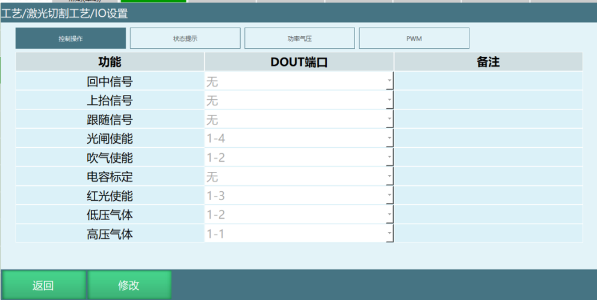

#### 5.4.1 控制操作

| 信号 | 说明 |
| --- | --- |
| 回中信号 | 对应信号输出后，激光器回中。 |
| 上抬信号 | 对应信号输出后，激光器上抬。 |
| 跟随信号 | 对应信号输出后，激光器开始跟随。 |
| 光闸使能 | 对应信号输出后，打开光闸。 |
| 吹气使能 | 对应信号输出后，开始吹气。 |
| 电容标定 | 对应信号输出后，检测是否有返回信号标定成功。 |

#### 5.4.2 状态提示

| 信号 | 说明 |
| --- | --- |
| 停靠到位 | 调高器停止到位后，对应端口有输入信号。 |
| 回中到位 | 调高器回中到位后，对应端口有输入信号。 |
| 跟随到位 | 调高器跟随到位后，对应端口有输入信号。 |
| 穿孔到位 | 激光切割穿孔到位后，对应端口有输入信号。 |
| 激光故障 | 出现激光故障后，对应端口有输入信号并报错停止。 |
| 调高器故障 | 出现调高器故障后，对应端口有输入信号并报错停止。 |
| 水冷机故障 | 出现水冷机故障后，对应端口有输入信号并报错停止。 |
| 气压故障 | 出现气压故障后，对应端口有输入信号并报错停止。 |
| 电容标定 | 调高器返回对应信号后标定成功。 |

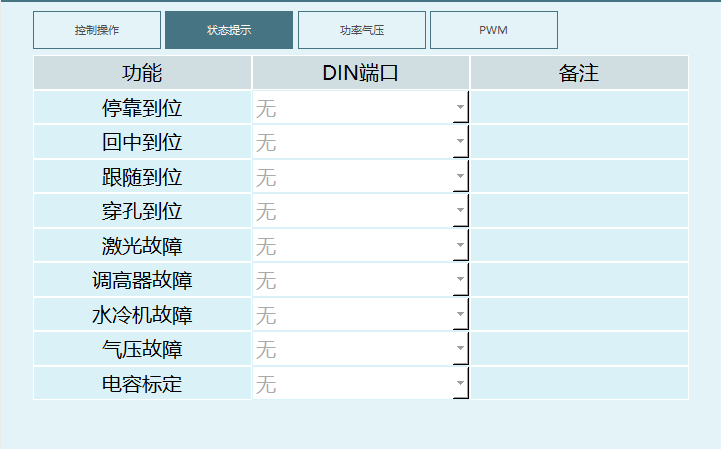

#### 5.4.3 功率气压

- **激光功率**：控制激光功率的模拟量端口，根据模拟量输出控制实际输出。
- **气压**：控制气压的模拟量端口，根据模拟量输出控制实际输出。

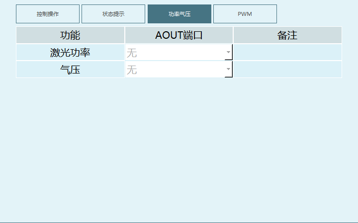

#### 5.4.4 PWM

**激光频率占空比**：根据 R4 PWM IO 板，可在两个端口中切换设置；只有带 PWM IO 时才可选择端口。

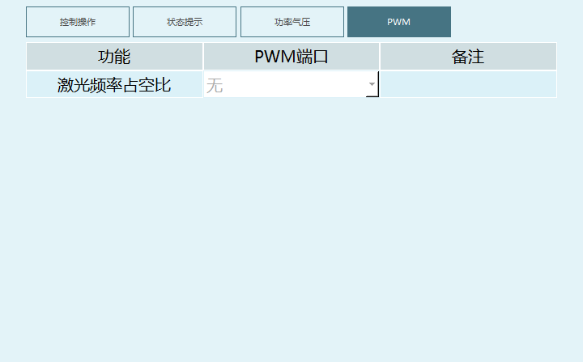

### 5.5 手动操作

#### 5.5.1 激光器

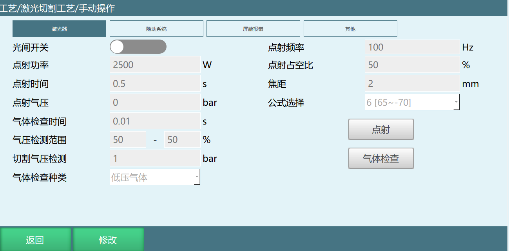

| 参数 / 按钮 | 说明 |
| --- | --- |
| 光闸开关 | 打开后才能出光。须手动打开光闸开关，不会自动打开。 |
| 点射功率 | 点射时的激光器功率。 |
| 点射时间 | 单次点射时间。 |
| 点射频率 | 点射时每秒钟发出激光的次数。 |
| 点射占空比 | 点射时单位时间内激光工作的占比。 |
| 焦距 | 即焦点位置，相对零焦的距离。 |
| 点射按钮 | 用于调试激光参数：设置好对应 IO 后点击即可出光，便于调整。 |
| 点射气压 | 点射时的气压。 |
| 气体检查时间 | 单次气体检查时间，在该时间内重复检查会提示。 |
| 气压检测范围 | 切割和穿孔时，气压值与设定值相比超出该范围会报警。例如：气压检测范围为（−50%～50%），切割气压检测值为 1 bar，则提前送气时间结束后，气压不在 0.5～1.5 bar 之间时会报警。 |
| 切割气压检测 | 预留项，方便后续扩展，暂时无用。 |
| 气体检查种类 | 气体检查时检查的气体种类。 |
| 气体检查 | 检测吹气气压时使用。设置好对应 IO 后点击即可出气，便于查看气压是否匹配准确。 |

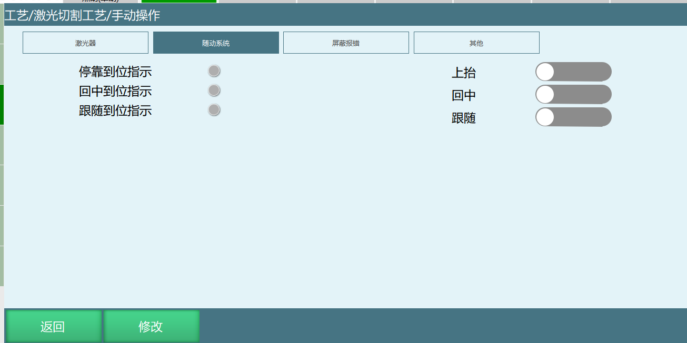

下图界面反馈调高器当前状态。

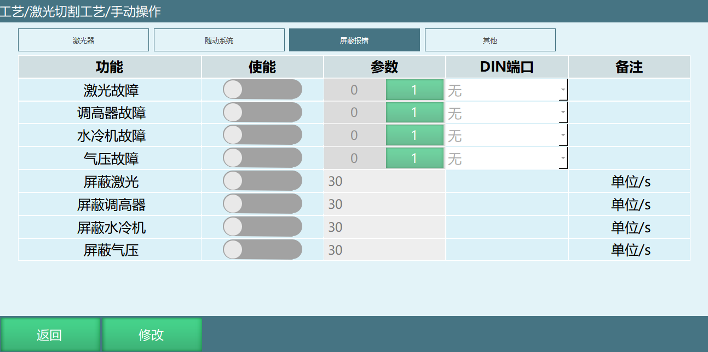

打开使能即启用对应功能：前四项在收到对应 IO 输入故障信号时上报对应报警；后四项打开后，在设定时间内不会有信号报警，设置时间为 0 则为无限时间。每次开机，该界面设置都会重置。

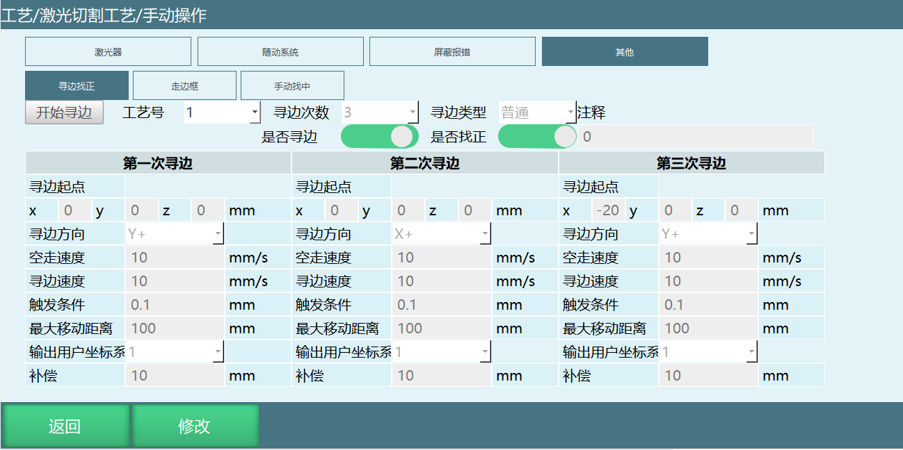

#### 5.5.2 寻边

该页面包含各种板材寻边、走边框和手动找中功能。

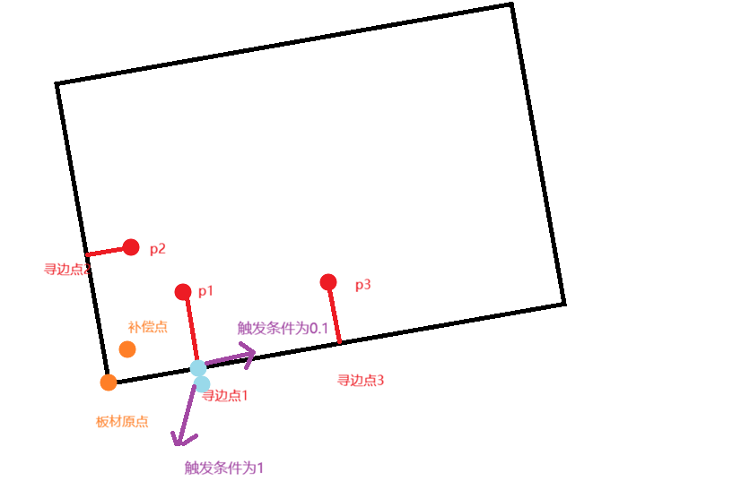

**功能**：寻找板材边框以确定切割起始点，寻边结束后将结果存入用户坐标系。

**参数说明**

| 参数 | 说明 |
| --- | --- |
| 工艺号 | 可保存多份参数，在指令中调用。 |
| 寻边次数 | 正常寻边需设置 2 次，寻边找正需 3 次。两次寻边先找到板子起点，第三次寻边确定板子斜率。 |
| 寻边类型 | 设置寻边类型，如普通寻边、圆板寻边。 |
| 寻边起点 | xyz 值为相对于当前点的偏移值；若 xyz 全为 0 则无偏移，以当前点为寻边起点。 |
| 寻边方向 | 有 X+、X−、Y+、Y−、Z+、Z− 六个方向，分别沿对应轴的正负方向寻边。 |
| 寻边速度 | 寻边时机器人运动的速度，不受全局速度影响。 |
| 触发条件 | 指定调高器高度变化多大时判定为触发成功（即到达板子边缘）。 |
| 最大移动距离 | 寻边运动的最大移动距离。超过该距离仍未触发成功则报寻边失败。 |
| 输出用户坐标系 | 指定寻边结果存入的用户坐标系。 |
| 补偿尺寸 | 寻边信号与实际位置可能因延时存在误差，可通过补偿尺寸修正。正值往板材中间补偿，负值往板外补偿，按寻边方向补偿；若存在相同寻边方向，以后一次的方向为准。示例：若往板内 x、y 方向各补偿 10 mm，再将第三次寻边补偿值改为 −10 mm，则最终为往板内 x 方向补 10 mm、往板外 y 方向补 10 mm。补偿方向按用户坐标方向执行。 |

**设置示例**

正常寻边需设置 2 次寻边，寻边找正需设置 3 次。寻边次数设为 2 次，寻边起点设为 p1、p2（p1、p2 也可以是同一点位），设置好寻边方向（两点寻边方向不能一致），点击寻边开始后，机器即按 p1→寻边点 1 方向、p2→寻边点 2 方向开始寻边。

须设置正确的触发条件与寻边速度，否则不同条件下寻到的点位会不同——如图示触发条件为 0.1 与 1 时寻到的点位不同，会导致最终算出的板材原点不正确。寻边速度越快，触发条件应越小以保持灵敏；速度越慢，触发条件应越大。

两点寻完后计算出板材原点；若设置了补偿参数并往板内补偿了位置，则补偿点会替换板材原点，成为新的板材原点。

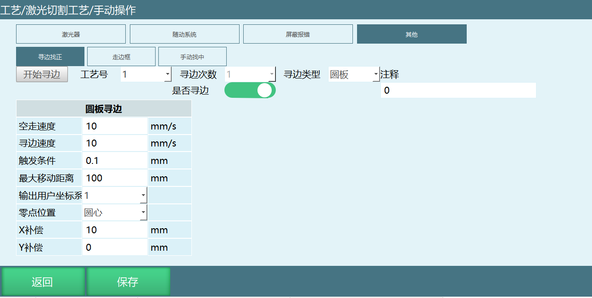

#### 5.5.3 圆板寻边

参数功能与普通寻边相同。

**零点位置**：寻完边后，将圆板的圆心、左上角、右上角、左下角或右下角设为零点位置，即切割起始点（用户坐标原点）。

**使用方法**：设置好寻边速度与触发条件，选择零点位置，按需求决定是否进行原点补偿（不补偿则设 0）；将激光头移动到圆板上方任意一点，点击开始寻边即可。

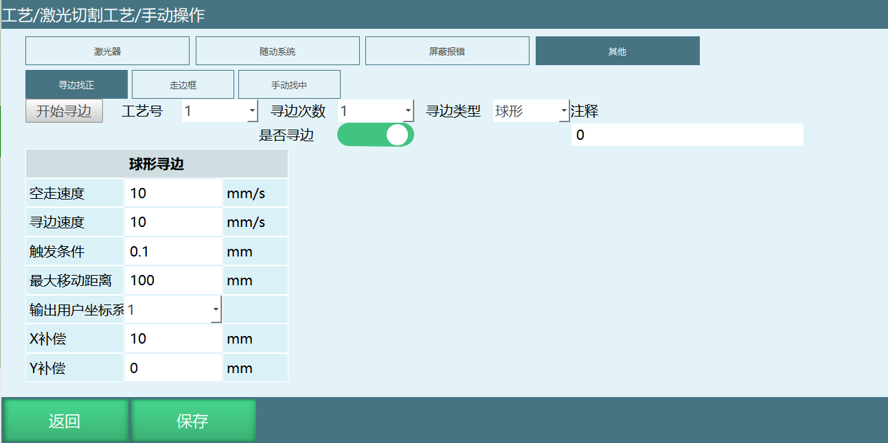

#### 5.5.4 球形寻边

参数功能与普通寻边相同。

**使用方法**：设置好寻边速度与触发条件，按需求决定是否进行原点补偿（不补偿则设 0）；将激光头移动到球形中心上方附近任意一点，点击开始寻边即可。

寻边开始时机器往 X− 方向行走并检测调高器高度：若高度一直增大则往反方向行走，通过算出两边对等距离让调高器移动对应高度（ab = cd），以 a、c 中点为圆心；Y 方向同理。

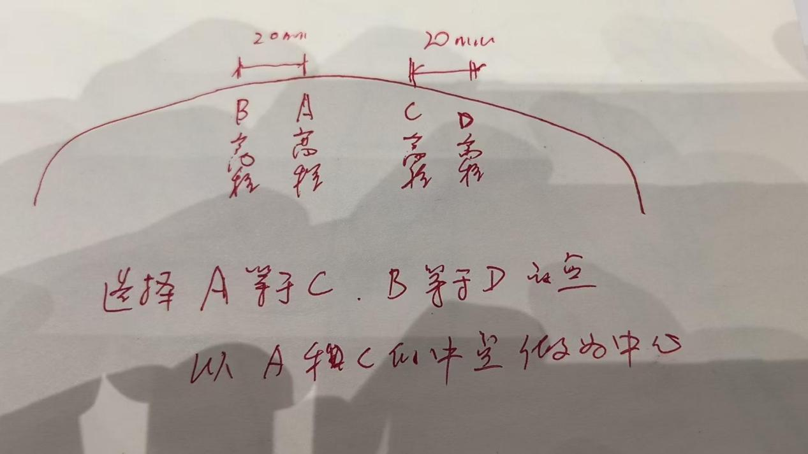

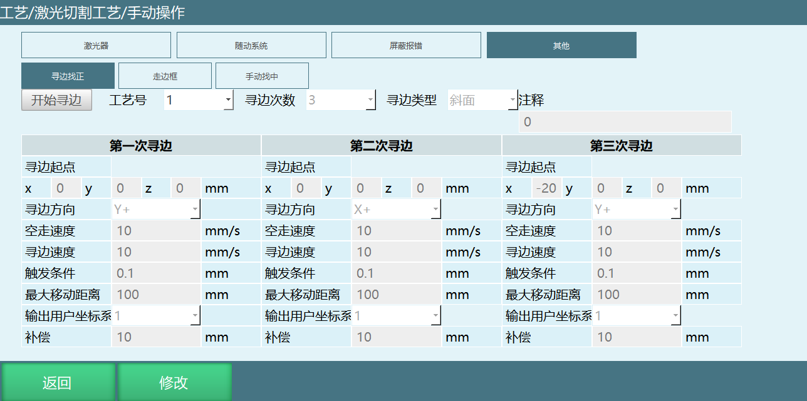

#### 5.5.5 斜面寻边

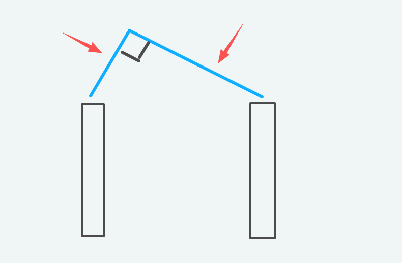

**使用方法**

- **寻边一次**：往设定方向寻边一次，重新标定用户坐标该方向的原点。
- **寻边三次**：设置好寻边速度与触发条件，按需求决定是否进行原点补偿（不补偿则设 0），将激光头移动到斜板上方附近任意一点，点击开始寻边。机器会先依次移动到设定的寻边起点，然后打开调高器跟随探测斜面；三个起点都探测完毕后，通过调高器高度测算板材斜面（三点确定一个面），再将枪头摆到垂直于板材斜面，最后按正常三次寻边流程执行。

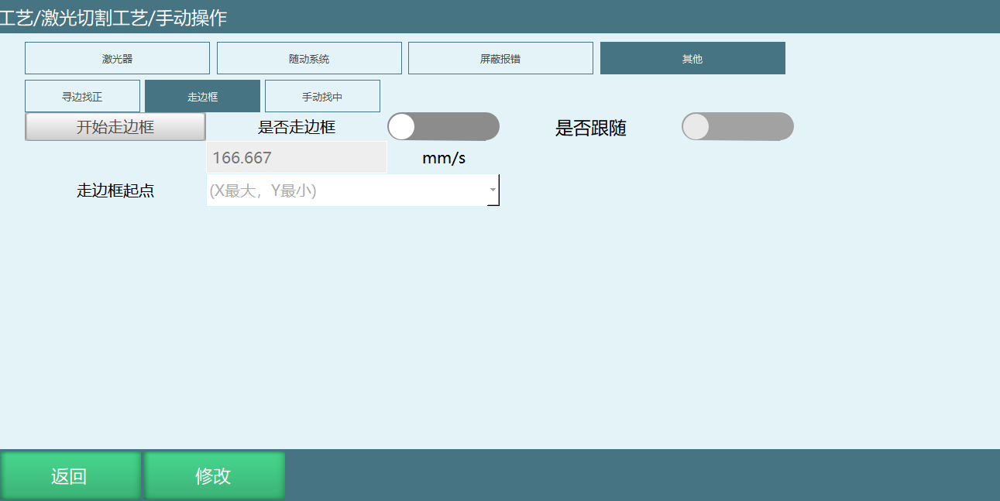

#### 5.5.6 走边框

**功能**：根据已打开的作业文件，获取文件内坐标的最大 X、Y 值，生成走边框轨迹，并可自由设置走边框起点。

**适配 call 指令**：作业文件可通过 call 调用子程序，将分段的作业文件整合；跑主文件即可把分段作业文件当作一个整体大文件走边框。

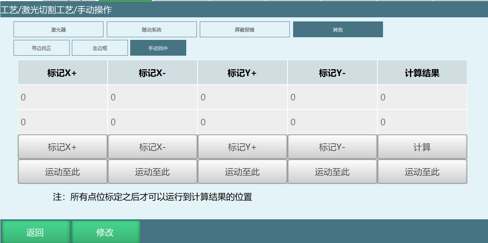

#### 5.5.7 手动找中

通过标定四个点并点击计算，即可移动到四个点的中心。

#### 5.5.8 调高器标定

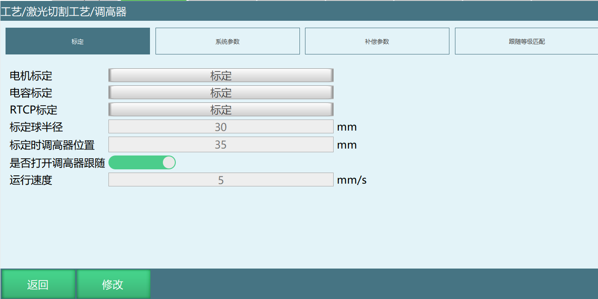

| 项目 | 说明 |
| --- | --- |
| 电机标定 | 伺服标定的目的是消除伺服电机的零漂（正常无需二次标定）。 |
| 电容标定 | 测量浮头与板材之间的电容与位置的对应关系。标定约持续 4～5 s，喷嘴会缓慢下降确定碰板位置。 |
| RTCP 标定 | 通过标定球标定机器喷嘴末端，使机器能更好地绕末端点旋转。 |
| 标定球半径 | RTCP 标定时使用的标定球半径。 |
| 标定时调高器位置 | 标定工具手时调高器的位置。 |
| 是否打开调高器跟随 | 进行 RTCP 时是否打开调高器跟随。 |
| 运行速度 | 标定 RTCP 时机器人的速度。 |

**RTCP 使用方法**

RTCP 标定前须保证已做过工具手标定、绕点大致准确，否则 RTCP 会失败。若工具手标定正常但绕点误差过大，请先检查坐标是否为用户坐标、工具手是否正常、模型方向是否正确。

示例：机器在调高器高度 35 时进行工具手标定，标定球大小为 20；则设置标定球半径为 20、标定时调高器位置为 35，将激光头移动到球正上方、末端点离球约 15 的距离，进行电容标定；电容标定完成后点击 RTCP 标定按钮即可。

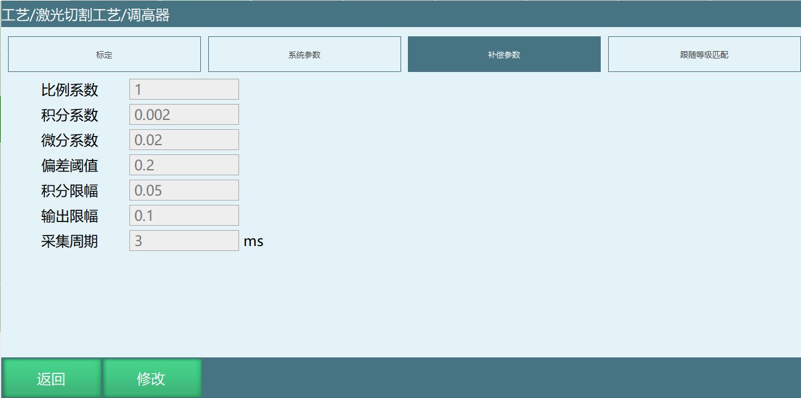

#### 5.5.9 调高器补偿参数

用于设置调高器参数，使调高器补偿更准确、迅速。此功能供调高器补偿指令使用；若补偿存在误差，可调试比例系数、输出限幅和采集周期来优化。

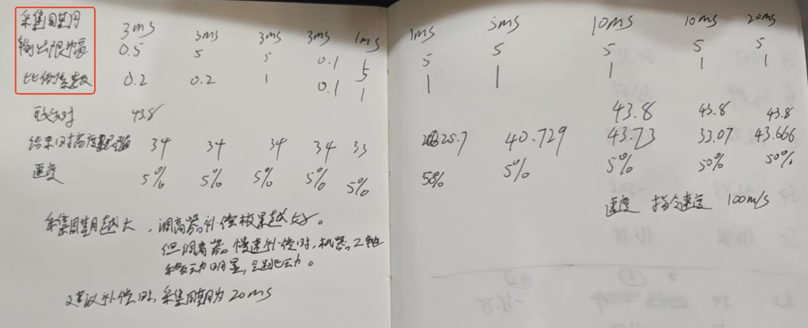

采集周期越大，调高器补偿效果越好；但采集周期过大时，低速补偿会出现某段明显跳动的现象，因此须设置合适的补偿周期。

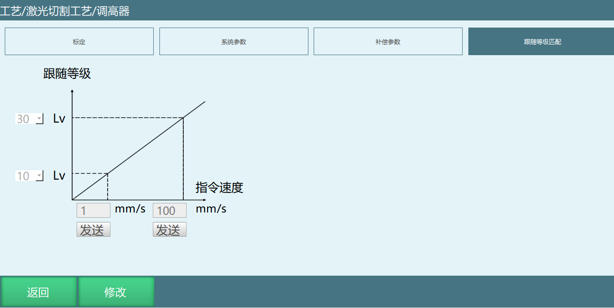

此处用于设置调高器跟随等级与切割速度的匹配关系。

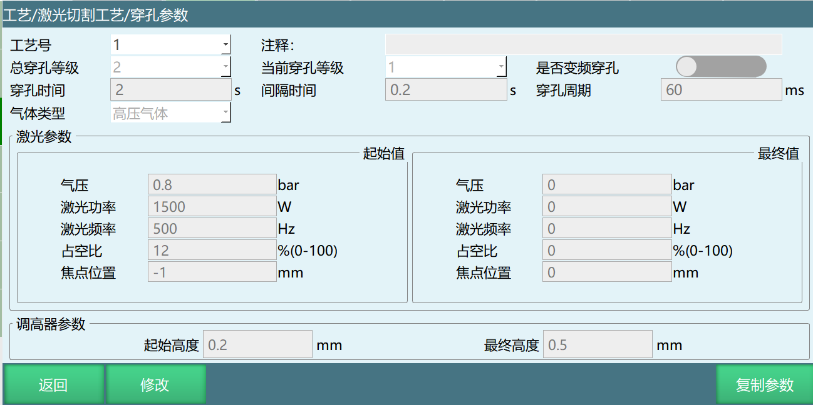

#### 5.5.10 穿孔参数

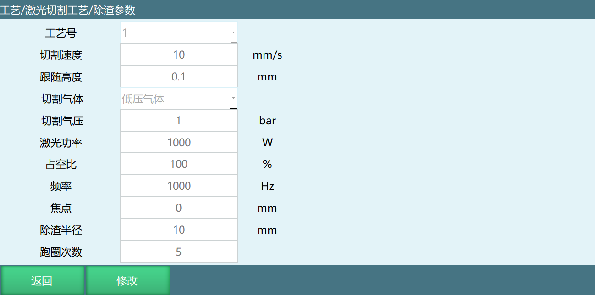

| 参数 | 说明 |
| --- | --- |
| 总穿孔等级 | 穿孔时穿孔的总次数。 |
| 当前穿孔等级 | 选择穿孔等级，以设置其穿孔参数。 |
| 是否变频穿孔 | 打开后该次穿孔进行变频穿孔，即激光参数以穿孔周期为间隔，从起始值向最终值渐变。 |
| 穿孔时间 | 激光开始后进行穿孔的时长，须保证当前工件被穿透。 |
| 间隔时间 | 两次穿孔之间的时间。 |
| 穿孔周期 | 变频穿孔的变化周期。 |
| 气体类型 | 选择切割时使用的气体。 |
| 气压 | 气压输出大小。气压控制用于清理切口背面残渣，保证切面光滑整洁。 |
| 激光功率 | 穿孔时的激光器功率，单位 W。功率越大穿孔效率越高，同时切面越粗糙。 |
| 激光频率 | 激光器每秒钟发出激光的次数。 |
| 占空比 | 单位时间内激光工作的占比，如 66% 即一秒内激光工作 0.66 s。 |
| 焦点位置 | 激光器穿孔时焦点的位置。 |
| 调高器起始高度 | 穿孔时先确定板面与调高器之间的距离，便于后续移动，最终高度通过起始高度空移到穿孔出光点。 |
| 调高器最终高度 | 穿孔出光点。因穿孔时高度会大于 10 mm，而调高器跟随无法超过 10 mm，且跟随高度过高会不准、波动大，故先用较低的起始高度跟随确定板材与激光头的高度，再通过最终高度与起始高度之差空移调高器完成穿孔。 |

#### 5.5.11 除渣参数

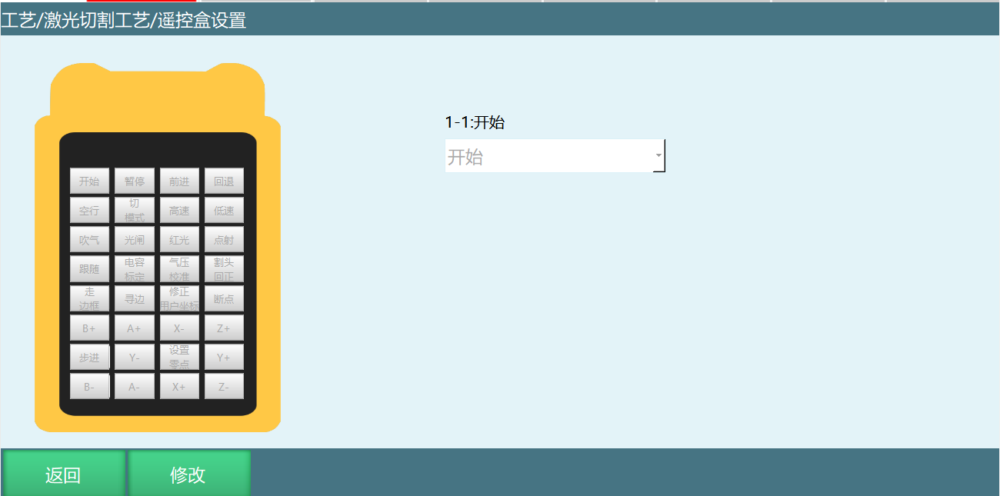

| 参数 | 说明 |
| --- | --- |
| 工艺号 | 可保存多份参数，在指令中调用。 |
| 切割速度 | 切割轨迹速度。 |
| 跟随高度 | 切割时调高器的跟随高度。 |
| 气体类型 | 选择切割时使用的气体。 |
| 切割气压 | 气压输出大小。 |
| 激光功率 | 出光时的激光器功率。 |
| 占空比 | 单位时间内激光工作的占比，如 66% 即一秒内激光工作 0.66 s。 |
| 频率 | 激光器每秒钟发出激光的次数。 |
| 焦点 | 激光器焦点的位置。 |
| 除渣半径 | 除渣最大半圆轨迹半径。 |
| 跑圈次数 | 除渣跑圈次数，将半径圆等分跑轨迹。 |

#### 5.5.12 遥控盒设置

遥控盒可对工作台进行远程控制，可通过此界面配置遥控盒按钮功能。

按钮盒需插入 C1102 控制器上对应的 3.0 USB 口才有效，插入其他接口无效。

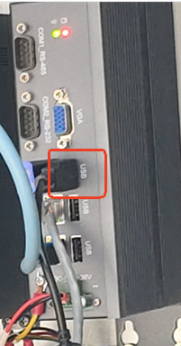

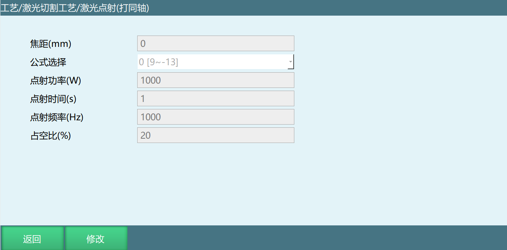

**激光点射（打同轴）参数**

| 参数 | 说明 |
| --- | --- |
| 焦距 | 即焦点位置，激光焦点与切割材料的距离。 |
| 公式选择 | 选择焦点公式。焦距须与公式匹配，焦点值范围见下图；如焦点位置在 [−50, 45] 范围内，应选择公式 5。 |
| 点射功率 | 点射时的激光器功率。 |
| 点射时间 | 单次点射的时间。 |
| 点射频率 | 点射时每秒钟发出激光的次数。 |
| 占空比 | 点射时单位时间内激光工作的占比，如 66% 即一秒内激光工作 0.66 s。 |

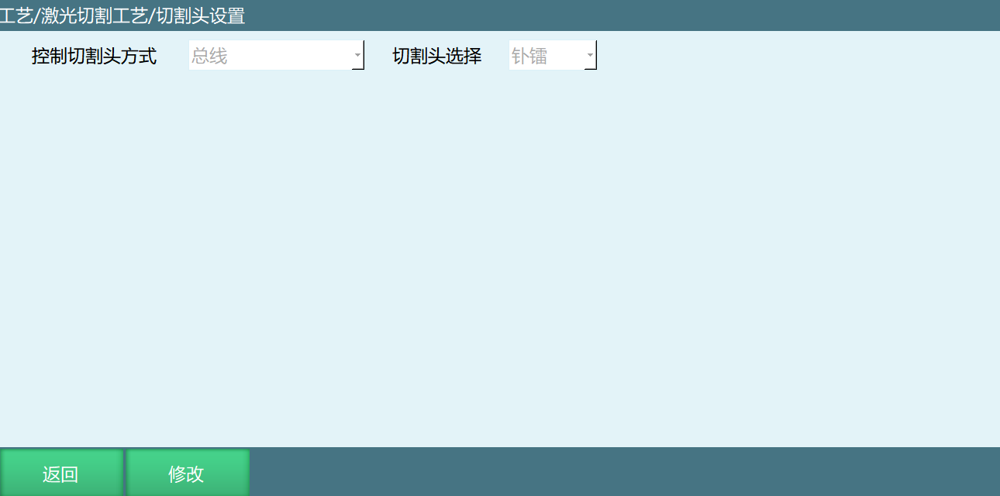

#### 5.5.13 切割头设置

目前支持三种切割头：钋镭、岗春、普瑞玛。

此界面可切换切割头，开机会自动匹配切割头；切割头切换会影响监控界面显示。

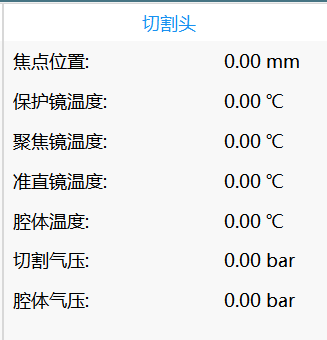

#### 5.5.14 设置 / 本体补偿

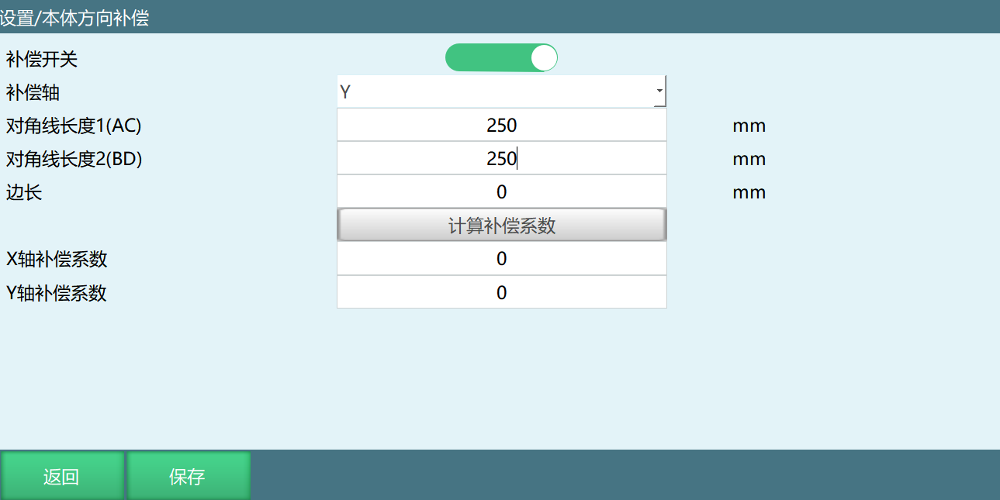

用平行四边形轨迹修正矩形轨迹，通过调整 X、Y 比例值调整用户坐标系 X、Y 的比例。

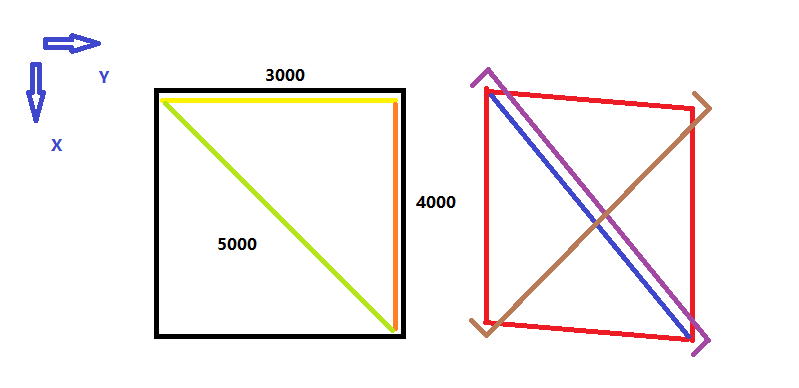

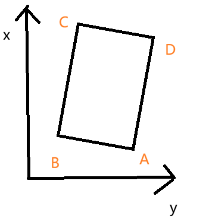

## 6 指令说明

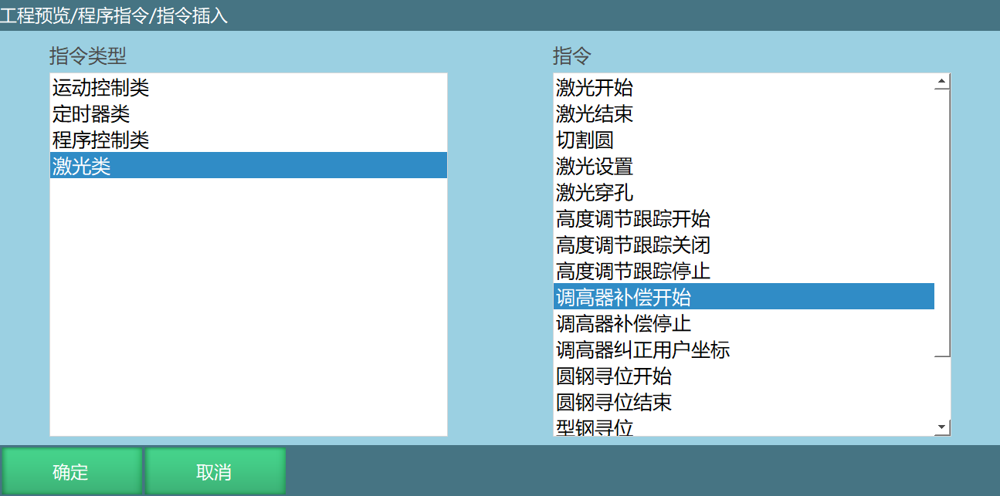

### 6.1 激光开始

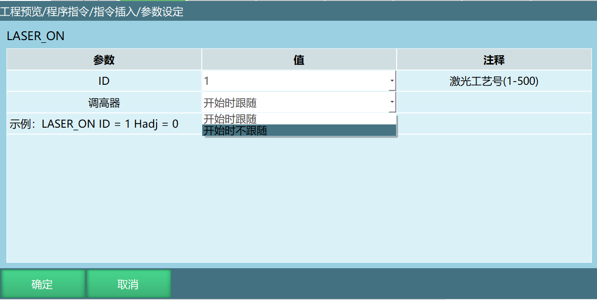

**格式**：`LASER_ON【指令名】 ID=1 Hadj=0【工艺号】 调高器=开始时跟随【调高器跟随选项】`

**功能**：到达切割起始点后开始切割。

| 参数 | 说明 |
| --- | --- |
| ID | 激光切割工艺号，范围 (1, 500)。 |
| 调高器 · 开始时跟随 | 需收到跟随到位信号才能继续运行。该方式开始运行时会发出跟随信号，并打开吹气使能、光闸使能；收到跟随到位信号后运行下一条指令，结束时关闭跟随信号和吹气使能。 |
| 调高器 · 开始时不跟随 | 不需收到跟随到位信号即可继续运行。该方式开始运行时不会发出跟随信号，但会打开吹气使能和光闸使能。 |

### 6.2 激光结束

**格式**：`LASER_OFF【指令名】`

**功能**：到达切割结束点后停止切割。

**参数**：切割结束时关闭光闸使能、吹气使能、调高器跟随。

### 6.3 切割圆

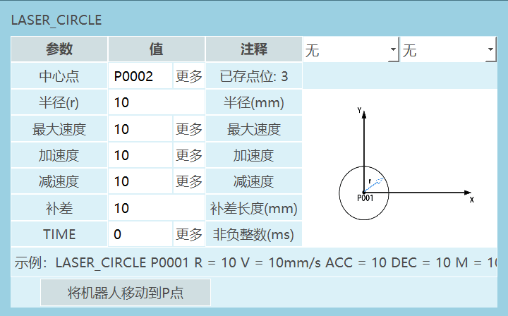

**格式**：`LASER_CIRCLE【指令名】 P/GP【中心点】 R【半径】 V【最大速度】 ACC【加速度比率】 DEC【减速度比率】 M【补差】 TIME【提前执行时间，不设置则为 0】`

**功能**：设置切割圆的参数，运行到该条指令时执行切割圆轨迹。

| 参数 | 说明 |
| --- | --- |
| 中心点 | 切割圆轨迹的中心点。使用局部位置变量（P）或全局位置变量（GP）。 |
| 半径 (R) | 切割圆的半径，范围 [1, 3000]。 |
| 最大速度 | 切割圆时的指令速度，范围 [1, 999]。 |
| 加速度 | 切割圆时的加速度比率，范围 [1, 100]。 |
| 减速度 | 切割圆时的减速度比率，范围 [1, 100]。 |
| 补差 | 整圆走完后，按补差距离继续运行圆轨迹的距离，范围 [0, 500]。 |
| TIME | 提前执行时间。与运动控制类指令的提前执行时间一致，即该指令的下一条非运动类指令提前执行的时间，单位 ms。 |

**注意**：切割圆需在上一点的基础上运行。例如上一条运动指令的点位为 P0001，则切割圆的中心点也须设置为 P0001 才能运行。

### 6.4 激光设置

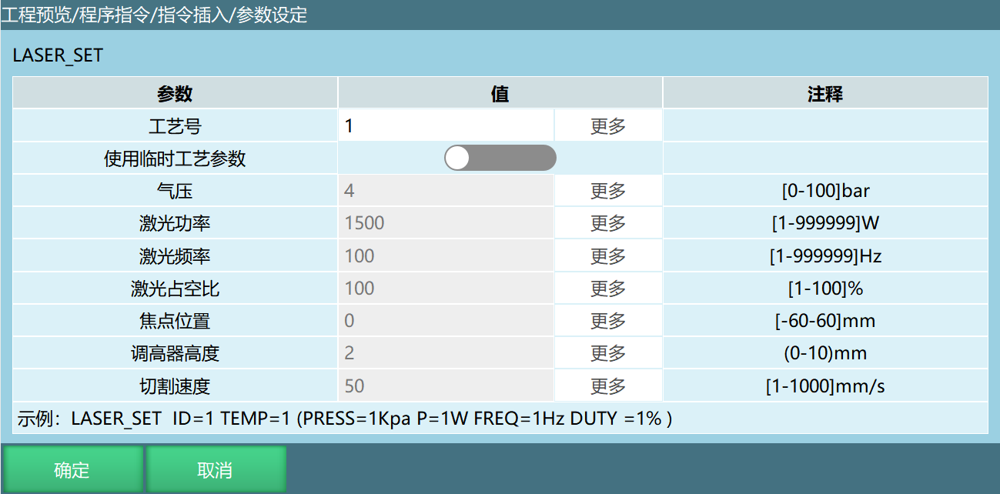

**格式**：`LASER_SET【指令名】 ID【工艺号】 TEMP【是否使用临时工艺参数】（PRESS【气压】 P【功率】 FREQ【频率】 DUTY【占空比】（临时工艺参数））`

**功能**：可在切割过程中通过指令修改气压、功率、频率、占空比、焦点位置、调高器高度和切割速度，中间不停顿。

| 参数 | 说明 |
| --- | --- |
| 工艺号 | 激光切割工艺号，范围 [1, 500]，可绑定变量。 |
| 使用临时工艺参数 | 不打开时，气压、激光功率、激光频率、激光占空比取工艺参数界面所设值；打开时，用户可根据环境随时修改上述参数。 |
| 气压 | 激光切割的气压，范围 [1, 99999] kPa，可绑定变量。 |
| 激光功率 | 激光切割的功率，范围 [1, 99999] W，可绑定变量。 |
| 激光频率 | 激光器每秒钟发出激光的次数，范围 [1, 99999] Hz，可绑定变量。 |
| 激光占空比 | 激光器输出信号的占空时间比例，范围 [0, 100]%，可绑定变量。 |
| 焦点位置 | 切割时激光焦点的位置。 |
| 调高器高度 | 切割时调高器的跟随高度。 |
| 切割速度 | 切割轨迹速度。切割时调用对应工艺中的切割速度运行轨迹，不受全局速度影响。 |

### 6.5 激光穿孔

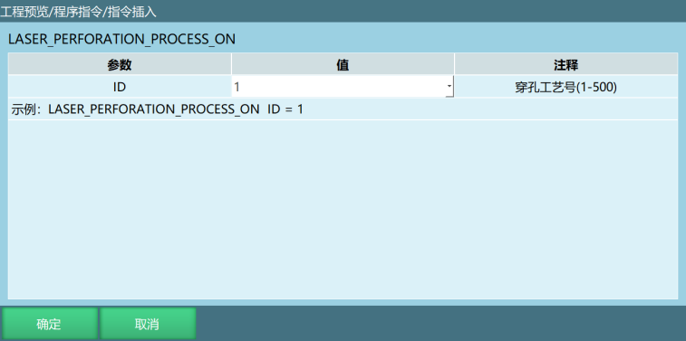

**格式**：`LASER_PERFORATION_PROCESS_ON【指令名】 ID【工艺号】`

**功能**：在当前位置进行激光穿孔。

| 参数 | 说明 |
| --- | --- |
| 工艺号 | 激光穿孔工艺号，范围 [1, 500]。 |

### 6.6 高度调节跟踪

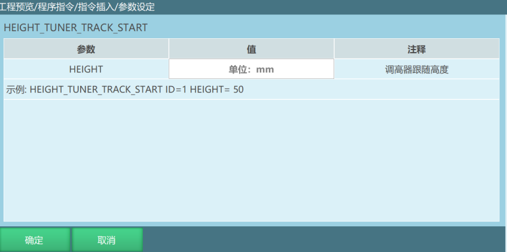

**高度调节跟踪开始**
格式：`HEIGHT_TUNER_TRACK_START ID=1 HEIGHT【跟随高度】`
功能：调高器进行高度跟随。

| 参数 | 说明 |
| --- | --- |
| 跟随高度 | 调高器跟随板子的距离。 |

**高度调节跟踪暂停**

格式：`HEIGHT_TUNER_TRACK_PAUSE`
功能：暂停调高器高度跟随。

**高度调节跟踪停止**

格式：`HEIGHT_TUNER_TRACK_STOP`
功能：停止调高器高度跟随。

### 6.7 调高器补偿

**调高器补偿开始**

格式：`HEIGHT_TUNER_COMPENSATION_ON`
功能：调高器跟随打开时，保持调高器位置不变，用机器人 XYZ 轴的位置变化代替调高器自身的调节。

**目的**：调高器装在机器人末端，打开跟随功能后，调高器会根据与工件的距离自行伸长缩短以保持距离不变。当工件表面不平、放置不平，或机器人末端执行不正对地面时，与工件的距离会变化，调高器随之自行调节，导致原来标定的工具手失效，机器人绕点不再以当前末端为中心。

**示例**

**调高器补偿停止**

格式：`HEIGHT_TUNER_COMPENSATION_OFF`
功能：关闭调高器补偿。

### 6.8 调高器纠正用户坐标系

**格式**：`HEIGHT_TUNER_MODIEF_USERCOORD HEIGHT【跟随高度】`

**功能**：设置调高器需要保持的高度。运行指令时，读取调高器当前位置，将它与保持高度的差值加到用户坐标偏移上，使运动到的目标用户坐标能把调高器位置保持在设定高度。

### 6.9 圆钢寻位

**功能**：修改用户坐标方向轴（X、Y）偏移，确保方向轴零点在圆钢中心。

调高器跟随打开时，在方向轴方向上移动机器人，调高器为保持与工件距离固定会移动自身位置。找到调高器位置最大值对应的机器人坐标，修改用户坐标方向轴偏移，使该点成为用户坐标的方向轴零点。

**圆钢寻位结束**

**使用方法**

1. 执行“圆钢寻位开始”，启动寻位线程，按采集周期循环读取调高器位置数据，记录最大值时的机器人位置。
2. 执行“圆钢寻位结束”，结束线程，计算出新的用户坐标 Y 轴偏移。

程序编程

修改用户坐标 Y 轴偏移，确保用户坐标的 Y 轴零点位于中轴线上。

### 6.10 型钢寻位

**方向参数**：Y 轴正方向 / Y 轴负方向。调高器位于工件 Y 轴正方向时选“Y 轴正方向”，反之选“Y 轴负方向”。

**基准位置参数**：运行“型钢寻位”指令时，控制器会记录当前调高器位置，与基准位置比较得到位置偏差（调高器当前位置 − 基准位置）。

**型钢寻位计算**：分别在工件 Y 正、负方向运行“Y 轴正方向”和“Y 轴负方向”的型钢寻位指令后，再执行型钢计算指令。系统取两次记录差值的一半，加上当前 Y 轴用户坐标偏移，得到新的用户坐标。

### 6.11 寻边

调用寻边参数进行一次寻边。

### 6.12 激光除渣

调用除渣参数进行一次除渣。

### 6.13 程序编写

1.

2.

## 7 仿真

打开作业文件后点击仿真界面，系统会根据作业文件轨迹自动生成仿真轨迹。

**轨迹颜色含义**

| 颜色 | 含义 |
| --- | --- |
| 绿色 | 切割时的运行轨迹（工艺号调用 1–490 时） |
| 黄色 | 空移轨迹 |
| 蓝色 | 打标轨迹（打标工艺号 490–500，工艺号调用 490–500 时为蓝色） |

相同轨迹重合时，颜色显示优先级为：绿色 ＞ 蓝色 ＞ 黄色。

运行作业文件时，仿真轨迹会跟随真实轨迹运行，轨迹走完会置灰。

**视图操作**：鼠标右键拖动旋转图形，滚轮放大图形，中键平移图形。

**新增功能**

1. **轨迹拾取**
   - 鼠标左键拾取，左下角提示行号。
   - 重叠或相近轨迹会弹出“行选择”对话框。
   - 选中后可点击底部“上一个”“下一个”按钮切换选中轨迹。
   - 选中后点击“跳转”按钮，即可在“程序”页面定位到选中行。
2. **其他改进**：新增六个方向的视图切换；jbr 文件中三点圆不成立时给出错误行号提示；视口底部新增工具栏，包含常用按钮。
3. **任意视角下的定角度旋转**
   - 新增旋转角度输入框，范围 [0, 360] 度，默认 45 度。
   - 每次点击累加输入的角度值，超过 360 度后置零。

## 8 开机与关机

### 8.1 开机前机床检查

1. **巡视机床周边环境，消除安全隐患**

   安全注意事项：

   - a. 检查消防设施，做好防火安全。
   - b. 检查高压气路，防止高压气体喷出伤人。
   - c. 检查氧气气路，防止氧气溢出引起火灾。
   - d. 准备好激光防护眼镜。

2. **检查切割头下端铜嘴是否破损**，必要时更换。

3. **检查保护镜片有无污物或破损**

   对污染的保护镜片进行清洗，以延长使用寿命、降低使用成本（方法见 [9.2 保护镜片](#92-保护镜片)）；污染严重的保护片须更换，否则会导致切割速度及品质下降。

4. **开启冷干机、空气压缩机或需要使用的气体**

   - a. 对空气压缩机手动排水、排油：打开空气压缩机底部储气罐的泄水阀排水，待废水排完后关闭该阀。
   - b. 对空气清净器手动排水、排油：打开空气清净器底部的排水阀排水，待废水排完后旋紧该阀。
   - c. 检查冷冻干燥机出气压力是否正常。如小于 0.4 MPa，可能存在堵塞，需检修或更换空气过滤器滤芯。
   - d. 检查 O₂ 和 N₂ 容量，不足时需提前更换。

5. **检查冷水机冷却水质**

   冷却水变色或污浊时须更换。开启激光器及冷水机，检查冷水机温度在 22 ℃ 左右。室内温度低时须确认水是否结冰，结冰则不能开启激光器及冷水机，必须化冰后方可开启。最后激光器上高压。

### 8.2 开机

1. 打开机床控制总电源。
2. 电脑主机启动后，打开桌面上的示教器程序软件。

   

3. 进入程序后点动机器人，查看能否正常点动。
4. 打开“激光出光”和“激光使能”按钮，进行激光点射，查看能否正常出光。

   

5. 视需要执行[打同轴](#101-打同轴)操作，通过调整聚焦镜片将激光光斑调节到喷嘴中心位置。
6. 测试气体是否正常：点击“低压气体”，再点击“气压检测”，查看能否正常吹气。

   

### 8.3 运行程序进行切割

1. 确认所需的切割辅助气路已经打开。
2. 确认激光器正常开启。
3. 调整激光同轴（通过调整聚焦镜片将激光光斑调节到喷嘴中心位置）。
4. 将机器移到板面（与板面距离约 1～5 mm），进行电容标定。
5. 进行气压校准；校准完毕后打开气压检测，进行一次吹气，按点射气压值（在“工艺 → 激光切割工艺 → 手动操作”界面设置）出气检查。若下图两个值对应得上，说明气压校准正常。

   

   

6. 打开需要切割的程序。
7. 根据程序中激光穿孔和激光开始的工艺号，到穿孔、激光界面查看对应工艺号参数是否正确。

   

8. 打开激光器红光，按编程时指定的起始零点位置，将切割头移动到板材相应位置。
9. 打开“激光出光”按钮，否则运行时不会出光。

   

10. 检查机床周围环境。
11. 切换到运行模式，点击启动。

> 注意事项：必要时请佩戴激光防护眼镜及防尘口罩。

### 8.4 关机

1. 关闭激光器光闸、红光，将激光器钥匙开关置于“OFF”挡位。
2. 查看调高器是否处于跟随状态，如是则关闭跟随。
3. 将机器移动到安全位置。
4. 关闭空气压缩机和气罐阀门，必要时释放管内气体。
5. 关闭机床控制总电源。
6. 巡视机床周边环境状况。

## 9 易损件维护

### 9.1 陶瓷环

**作用**

陶瓷环位于喷嘴之上、传感器之下，负责传输与收集喷嘴切割信号，防止切割头其他贵重部分因碰撞板材而损坏，同时具备耐高温、防变形特性，确保激光切割机稳定运行。

**损坏影响**

- 可能导致切割过程出现问题（如无法完成切割穿孔）及系统错误提示（如“本体电容值异常变化”），需及时更换。
- 损坏风险来源：切割头受到撞击时陶瓷体可能破裂；激光输出功率过高时陶瓷体可能因过度受热而出现裂纹。

**更换方法**

1. 拧下切割头上的喷嘴。
2. 松开陶瓷环锁紧螺母。
3. 小心取出旧陶瓷环，并记录定位销与垫圈的原始位置。
4. 安装新陶瓷环，确保定位销与垫圈复位稳固。

**检查**：安装完毕后须确认陶瓷环稳定、无晃动及松动——这直接影响使用效果与安全性。

### 9.2 保护镜片

保护镜片是激光切割机光路系统中非常重要的精密元件，其清洁程度对加工性能和质量影响很大。使用一段时间后，镜片会出现掉膜、金属残留、凹痕、划伤等现象，导致功能大打折扣，需及时清洁或更换。

#### 9.2.1 镜片清洗注意事项

1. 用空气球将镜片表面的绒絮、灰尘和浮物吹除。**不要使用压缩空气**——压缩空气含油和水分较高，会严重污染保护镜片。
2. 用专用棉签或棉球蘸湿丙醇，缓慢轻柔地清洗镜片表面。擦拭时应尽快划过，利于丙醇挥发、不留条纹。
   - 注意：① 使用纸柄棉签和高质量外科棉球；② 推荐使用试剂级丙醇。
3. 清洁中等污染物（如油渍、汗渍）：用白醋沾湿棉签或棉球，以很小的力擦洗表面，再用干棉签擦掉多余白醋；随后立即用丙酮沾湿棉签或棉球轻擦表面，除去残留醋酸。
4. 极度污染的镜片（如金属飞溅严重）可用抛光膏处理：将抛光膏摇匀，倒 4～5 滴到棉球上，让棉球在镜片上做圆周移动。不要向下压棉球，棉球自重已足够；压力过大会很快划伤表面。频繁翻转镜片，避免单方向过度抛光。抛光时间控制在 30 s 内；一旦发现颜色变化立即停止抛光（说明膜层外部正在被腐蚀）。没有抛光膏时可用牙膏替代。
5. 用蒸馏水沾湿一个新棉球，轻轻拭洗镜片表面，使镜片全部沾湿，尽可能多地除去残留抛光膏。注意不要让镜片表面变干，否则剩余抛光膏很难再除去。
6. 迅速用丙醇沾湿一个起毛棉签，轻洗整个镜片表面，尽可能多地除去残留抛光膏。注意：镜片直径超过 2 英寸时，用棉球代替棉签执行此步骤。
7. 用丙酮沾湿一个起毛棉签，轻洗镜片表面，除去上一步留下的抛光膏和丙醇。最后用丙酮清洗时，棉签轻轻拭过镜片、重叠进行，直到整个表面都擦过。最后一次擦洗时缓慢移动棉签，确保表面丙酮快速干燥，以消除条纹。
8. 检测：在阳光下、黑色背景下仔细检查镜片表面。若仍有抛光膏残留可反复进行，直至彻底清除。

> 部分污染或损伤无法清除（如金属飞溅、凹痕等）。若镜片存在此类问题，需返修或更换新镜片。

#### 9.2.2 更换保护镜片

**NO.1 擦**
用酒精将无尘布润湿（及时盖好酒精瓶盖，以免打翻），轻轻擦拭激光切割头保护镜窗口四周，避免拆卸过程中灰尘进入腔体。

**NO.2 卸**
先用美纹纸封住铜嘴，轻轻拔出保护镜片抽屉，再用美纹纸封住腔体防止灰尘进入；逆时针旋转卸下保护镜片，将镜片放在无尘布上。

**NO.3 清**
用无尘布、棉签轻轻擦拭保护镜片抽屉内部及插块四周，清洁干净，避免灰尘进入。

**NO.4 换**
取出新保护镜片，撕掉一面保护纸，将保护镜片插块轻盖在镜片上并翻转，再撕掉另一面保护纸，装入压片并锁紧。

**NO.5 装**
撕掉美纹纸，将保护镜片插块轻轻插入腔体，锁紧六角螺丝。

#### 9.2.3 注意事项

1. 更换时镜片一定要拿侧面，不要触碰镜面。
2. 检查密封圈，松动或老化时及时更换。
3. 避免通风：关闭厂房风扇及其他通风设备，以免灰尘落到镜片上。换镜片前先观察周边环境并做好准备工作（擦拭机器灰尘、切割头周边灰尘），防止振动落下的细微尘沾到镜片；切勿毛躁，按正规流程细心操作，防止因镜片污染导致切割面毛糙、工艺质量下降而影响生产。
4. 新镜片安装后应定期检查保护镜片，做到及时清洁更换。
5. 选购保护镜片务必选择原厂镜片。

## 10 常见调试操作

### 10.1 打同轴

打同轴通常指激光切割机或增材制造设备中的同轴度调整操作，主要用于确保激光束与喷嘴出口孔中心对齐，避免加工偏差或设备损坏。

**不进行调整的后果**

喷嘴出口孔与激光束不同轴时，轻微情况会影响切割面质量；严重时激光可能直接打到喷嘴上，造成喷嘴过热甚至烧毁。

**调整步骤**

1. **准备工具**：透明胶带、1.5 mm 口径喷嘴、内六角扳手。
2. **设置焦点**：在操作软件中将激光头焦点设为 0，选择正确的公式，设置点射功率、时间、频率和占空比。

   

3. **粘贴胶带**：将透明胶带粘贴在喷嘴平面处，打开示教器上的激光出光，点击激光点射。

   

4. **取下胶带查看印记**（注意取下时不要随意转动方向）：印记上有一个孔径大小的圆圈，观察光点是否位于喷嘴圆圈的正中心。

   

5. **调整光斑位置**：若光点不在圆圈中心，用内六角扳手旋转左右两颗螺丝调整光斑位置，直至光点移到圆圈中心（此过程需反复测试调整）。

   根据光斑与喷嘴圆圈的相对位置调整：

   | 光斑位置 | 调整方法 |
   | --- | --- |
   | 左上角 | 右螺丝逆时针旋转 |
   | 右上角 | 左螺丝逆时针旋转 |
   | 正上方 | 双螺丝逆时针旋转 |
   | 左下方 | 左螺丝顺时针旋转 + 右螺丝逆时针旋转 |
   | 右下方 | 左螺丝逆时针旋转 + 右螺丝顺时针旋转 |

   

6. 若光斑始终无法对齐，需检查设备光路系统或联系专业人员检修。

### 10.2 电容标定

电容标定的目的是测量浮头与板材之间的电容与位置的对应关系。

- **标定前**：可先把浮头点动到靠近板面（与板面距离约 1～5 mm），并保持板面静止、不振动。
- **操作**：点击示教器主界面上的“电容标定”按钮即可开始标定，界面会同时跳转到调高器界面；标定过程中可观察调高器当前数值。
- **耗时**：标定过程自动完成，约十几秒。

**标定过程**

1. 浮头缓慢向下运动，检测碰板。
2. 碰到板后向上移动一段距离，检测传感器稳定度。
3. 浮头第二次缓慢向下运动，检测碰板。
4. 碰到板后向上移动设定的标定距离，检测传感器的平滑度和特征曲线。

