# web协作示教操作手册

---

## 1. 系统概述

### 1.1 产品简介

Web 人机交互服务，彻底摆脱传统独立示教器的束缚。用户仅需通过电脑、平板或手机等浏览器，即可轻松完成示教、编程、运行、监控与维护等全流程操作。系统以“易用、安全、开放”为核心设计理念，全面赋能：

1. **极致易用，零门槛部署**
   - **拖拽示教**：无编程经验的操作者也能快速上手，轻松完成工艺部署。
   - **图形化编程**：提供直观的指令块编程界面，全面覆盖运动控制、IO 逻辑、循环、数学运算、变量管理及力控等全场景需求。

2. **立体防护，安全无忧**
   - 构建包含干涉区检测、碰撞检测、安全装置及安全姿态在内的多重立体安全防护体系，全方位保障人机协同作业安全。

3. **开放生态，即插即用**
   - 支持 Modbus TCP/RTU、RS485 等主流通讯协议。
   - 无缝兼容夹爪及五指灵巧手等外部设备，快速构建柔性化工作站。

### 1.2 访问

| 项目    | 说明                                          |
| ----- | ------------------------------------------- |
| 访问地址  | [http://192.168.1.13](http://192.168.1.13/) |
| 推荐浏览器 | Google Chrome（最新版）、Microsoft Edge           |
| 推荐分辨率 | 1920×1080 及以上                               |
| 全屏    | 首次打开显示全屏提示，点击后进入全屏，功能完整                     |

> **说明**：表中 IP 为示例地址，实际使用时请以控制器当前 IP 为准（可在“设置 → 系统 → 网络配置”中查看）。

## 2. 安全须知

### 2.1 安全总则

1. 未经培训严禁操作。首次使用须通读手册并接受培训；操作前务必确认运动范围内无人员与障碍物。
2. 通电状态下，严禁将身体任何部位伸入机器人运动范围。
3. 修改安全参数（干涉区、碰撞等级等）后，必须重新验证机器人行为。
4. 遇异响、抖动或非预期动作，立即按下急停或将机器人切换至下电状态，排查后方可继续。

### 2.2 安全功能体系

系统提供四层安全防护，可独立或组合使用：

1. **干涉区**：可限制区域内/外动作、禁用运动或联动状态输出（入口：设置-干涉区）。
2. **碰撞检测**：关节级碰撞等级与响应时间可调；（入口：协作-碰撞检测力阈值）。
3. **安全装置**：外接安全设备（急停、安全门、光栅等）、软件紧急停止按钮。
4. **安全位置**：作为机器人的起始点位（入口：设置-初始姿态）。

> **提示**：安全参数修改后必须低速验证；干涉区可多组配置并独立使能。

## 3. 快速入门

① 连接 → ② 全屏 → ③ 上电 → ④ 清错 → ⑤ 点动 → ⑥ 编程 → ⑦ 运行 → ⑧ 下电

| 步骤       | 操作                         | 说明                          |
| -------- | -------------------------- | --------------------------- |
| **① 连接** | 网线连接电脑与控制器，或连接 Wi-Fi 无线网络 | 支持有线（网线）与无线（Wi-Fi）两种连接方式 |
| **② 全屏** | 点击全屏提示层                    | 点击后进入全屏模式，系统功能完整；按 Esc 退出全屏 |
| **③ 上电** | 点击顶部工具栏“本体电源未接通”按钮         | 按钮变为“本体电源接通中”即已上电           |
| **④ 清错** | 查看有无报错；有则点“清错”             | 有报错时无法上电需要清错后重新上电           |
| **⑤ 点动** | 主页选 直角/关节 坐标系，**按住对应**按钮示教 | 操作机器人进行示教点位                 |
| **⑥ 编程** | 编程页新建配方，拖拽积木块写程序           | 目标位置可通过“位置标定”记录当前点          |
| **⑦ 运行** | 编程页面选配方 →“启动”              | 运行中可暂停/停止/紧急停止，速度可动态调整      |
| **⑧ 下电** | 停止程序后，点顶部工具栏本体电源按钮         | 抱闸闭合锁定关节，机器人无法运动            |

## 4. 主页

主页是系统默认页面，由 **工具栏、导航栏、机器人模型区、点动面板、控制面板** 组成。

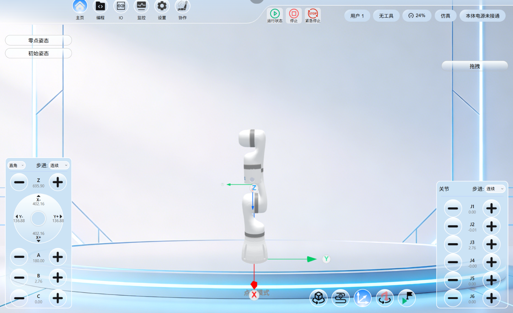

### 4.1 工具栏

| 控件            | 说明                            |
| ------------- | ----------------------------- |
| 用户            | 当前用户坐标系，点击弹出列表（用户 1~9）切换      |
| 工具            | 当前工具手，点击弹出列表（无工具 / 工具手 1~9）切换 |
| 速度            | 点动速度百分比，点击弹出速度调节对话框           |
| 仿真            | 仿真模式开关（打开后才可上电本体电源）           |
| 本体电源接通中 / 未接通 | 本体电源开关，点击上电/断电                |
| 清错            | 清除控制器报警，**有错误时按钮闪烁提醒**        |

**速度调节弹窗**：滑块 1~100%，提供“低 / 中 / 高”参考刻度，松开滑块后生效。

### 4.2 运行控制面板

默认固定顶部中间区域，可拖动位置；顶部工具栏第一个按钮展开，展开后最后一个箭头按钮/退出按钮收起。

| 控件          | 说明                       |
| ----------- | ------------------------ |
| 运行状态        | 展开运行配方状态控制面板             |
| **启动**      | 运行当前选中的程序（配方）            |
| **暂停 / 停止** | 暂停 / 停止运行                |
| 运行速度        | 控制运行配方时速度。注意：与顶部工具栏速度区分 |
| 状态          | 已停止 / 运行中 / 已暂停          |
| 运行时间        | 本次运行累计时间（时:分:秒）          |
| 退出          | 关闭面板并发送停止指令              |

> **注意**：未选程序点启动会提示“请先选择程序”；**拖拽模式下无法运行作业**，需先切回点动模式。

### 4.3 点动

点动面板提供 **直角 / 工具 / 用户 / 关节** 多种坐标系（面板左上方切换）。

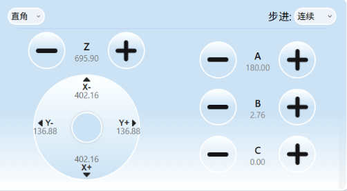

| 模式       | 显示内容                   | 操作                                   |
| -------- | ---------------------- | ------------------------------------ |
| **直角点动** | X/Y/Z（mm）+ 姿态 A/B/C（°） | 按住方向按钮（X± / Y± / Z±）连续运动；A/B/C 为姿态旋转 |
| **关节点动** | 各关节角度                  | 按住关节按钮沿正/负方向连续运动                     |
| **工具点动** | 工具末端相对于机器人基座中心的偏移量 | 工具末端（TCP）沿设定的工具各轴方向移动 |
| **用户点动** | 相对于用户坐标系原点的偏差值 | 末端沿用户设定的 XYZ 方向移动 |

**步进模式**：

| 模式 | 说明                                  |
| -- | ----------------------------------- |
| 连续 | 按住期间持续运动，松开即停                       |
| 步进 | 每次按固定步进量运动，需长按对应的点动按钮（系统默认为连续模式） |
| 定点 | 通过手动填写坐标值运动到指定位置 |

**操作流程**：

1. 确认本体电源已接通
2. 确认机器人已使能上电
3. 选择坐标系（直角/工具/用户/关节）与步进模式
4. 按住方向按钮点动，观察数值变化

### 4.4 预设位置

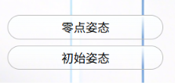

| 按钮   | 说明                               |
| ---- | -------------------------------- |
| 零点姿态 | 运行到零点位姿（各关节 0°，系统定义，不可配置）        |
| 初始姿态 | 运行到初始姿态，可通过设置 → 姿态 → 初始姿态进行自定义位置 |

### 4.5 拖拽示教

点击“拖拽”切换至拖拽模式，出现拖拽控制区：

| 控件   | 说明                     |
| ---- | ---------------------- |
| 开始拖拽 | 进入拖拽状态，可直接手拉机器人末端示教    |
| 停止录制 | 结束轨迹录制并弹出保存对话框         |
| 回放   | 回放最新一次录制的轨迹            |
| 采样间隔 | 轨迹录制采样间隔（整数，**录制前设置**） |
| 轨迹名称 | ≤15 个字符，**仅限英文字母或数字**  |

## 5. 图形化编程

编程页为 Blockly 图形化编程界面，通过拖拽积木块编写作业程序，程序以 **配方**形式管理。

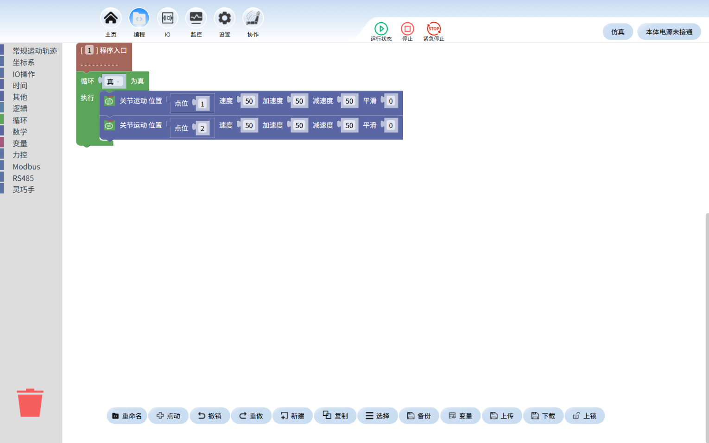

### 5.1 页面布局

| 区域 | 内容                                                              |
| -- | --------------------------------------------------------------- |
| 左侧 | 积木块指令分类面板                                                       |
| 中间 | 程序编辑区，顶部为 [程序名] 程序入口                                            |
| 底部 | 重命名 / 点动 / 撤销 / 重做 / 新建 / 复制 / 选择 / 备份 / 变量 / 上传 / 下载 / 上锁 工具按钮 |

### 5.2 指令分类总览

| 分类     | 条数 | 内容                          |
| ------ | -- | --------------------------- |
| 常规运动轨迹 | 7  | 关节/直线/圆弧/样条运动/定点移动，含点位与全局速度 |
| 坐标系    | 4  | 切换/修改工具手、用户坐标               |
| IO 操作  | 6  | 数字量/模拟量输入输出读写               |
| 时间     | 4  | 延时等待、等待条件、计时器               |
| 其他     | 7  | 注释、子程序、Python 脚本、并行操作       |
| 逻辑     | 7  | 条件判断、比较、布尔与三目运算             |
| 循环     | 2  | 条件循环与跳出/继续                  |
| 数学     | 4  | 数值常量、四则运算、文本拼接              |
| 变量     | 动态 | 变量赋值与读取（局部/全局）              |
| 力控     | 6  | 六维力碰撞检测、额外负载、阈值、轨迹回放        |
| Modbus | 6  | Modbus 主站连接与读写              |
| RS485  | 5  | RS485 连接与读写                 |

### 5.3 编程基础

**语句块 vs 表达式块**：

- **语句块**（上下有凹凸接口）→ 按顺序执行，组成程序主干
- **表达式块**（左右有圆角接口）→ 只返回值（数值/布尔/字符串/点位等），必须嵌入语句块的参数孔，**不能单独成行**

**参数填写**：

- 数字参数可直接输入，或拖入“数学”分类的数字块、变量读取块等
- 下拉参数点击右侧箭头选择

### 5.4 指令详解（12 个分类）

#### 分类一：常规运动轨迹（7 条）

##### ① 点位

目标位置引用块。程序中的运动目标统一用“点位 n”表示：每拖入一个运动块，编号自动递增（1、2、3…）。

- 把“点位 n”表达式块拖入运动块的“位置”孔 → 引用点位
- 点击运动块上的“位置”字段 → 弹出“**位置标定**”对话框新建/修改点位坐标

**位置标定对话框**（界面按钮文案为“点位标定”）：

| 参数   | 选项                 | 说明         |
| ---- | ------------------ | ---------- |
| 坐标类型 | 关节坐标 / 直角坐标/工具/用户  | 目标位置的表示方式  |
| 配置形态 | 当前形态               | 目标点的机器人形态  |
| 工具坐标 | 无工具 / 工具手 n        | 目标点使用的工具手  |
| 关节位置 | 各关节角度（°）           | 关节坐标下的目标位置 |
| 直角位置 | X/Y/Z（mm）、A/B/C（°） | 直角坐标下的目标位置 |

##### ② 全局速度

设置本程序后所有无运动参数的运动指令都以此速度为基准（不影响设置过参数块的指令）。

| 参数      | 默认  | 说明               |
| ------- | --- | ---------------- |
| 角速度     | 10  | 关节运动的速度基准        |
| 角加减速度比率 | 10  | 关节运动的加减速度比率      |
| 线速度     | 100 | 直线/圆弧/样条运动的线速度基准 |
| 线加减速度   | 10  | 直线/圆弧/样条运动的加减速度  |

##### ③~⑥ 四个运动块（共用参数说明）

| 运动块      | 轨迹说明                              | 特有参数    |
| -------- | --------------------------------- | ------- |
| **关节运动** | 各关节从当前角度同步运动到目标位置                 | 位置 ×1   |
| **直线运动** | 末端沿直线运动到目标点位（保持姿态）                | 位置 ×1   |
| **圆弧运动** | 起点 + 位置1（中间点）+ 位置2（终点）三点定圆弧       | 位置1、位置2 |
| **样条运动** | 末端沿样条曲线依次通过多个点位（默认 4 个，可通过块上齿轮增减） | 点位1~点位n |

**四个运动块的通用参数**：

| 参数        | 说明                  |
| --------- | ------------------- |
| 位置        | 运动目标位置              |
| 速度        | 当前全局速度的百分比          |
| 加速度 / 减速度 | 加/减速度倍率             |
| 平滑        | 轨迹平滑参数（0-5，越大过渡越平滑） |

**⑦定点移动**

功能：机器人定点移动到设置的点位。

参数设定：

| 坐标系      | 设置的位置参数值                 | 示例介绍                                                         |
| -------- | ------------------------ | ------------------------------------------------------------ |
| 关节坐标（RF） | J1-(10) J2-(-5)，J3~J6 留空 | 机器人移动到设置好的关节点位：J1 轴坐标为 10，J2 轴为 -5，其余轴保持不变 |
| 直角坐标（BF） | X-(300) Y-(0) Z-(120)，A/B/C 留空 | 机器人移动到设置好的直角点位：X 轴为 300，Y 轴为 0，Z 轴为 120，其余轴保持不变 |

注意事项：如果不需要移动某个轴，请在该轴的坐标处留空，不要填0（如果填写0的话，在运行这条指令时对应的坐标轴点位会变为0）。

#### 分类二：坐标系（4 条）

| 指令       | 功能                  | 关键参数                                  |
| -------- | ------------------- | ------------------------------------- |
| 切换工具手    | 后续运动按指定工具手计算        | 编号（默认 1）                              |
| 切换用户坐标   | 后续直角运动/点位按指定用户坐标解释  | 编号（默认 1）                              |
| 修改工具手参数  | 运行时直接修改工具手偏移，无需重新标定 | X/Y/Z（mm）、A/B/C（**rad**，与用户坐标的 ° 不同！） |
| 修改用户坐标参数 | 运行时修改用户坐标系原点与姿态     | X/Y/Z（mm）、A/B/C（°）                    |

#### 分类三：IO 操作（6 条）

| 指令      | 功能            | 关键参数                 |
| ------- | ------------- | -------------------- |
| 读取数字输入  | 读取 DIN电平（1=高） | 端口（默认 1）             |
| 设置数字输出  | 置 DOUT 电平     | 端口（默认 1）、电平（高/低，默认高） |
| 读取数字输出  | 读 DOUT 当前电平    | 端口                   |
| 读取模拟量输入 | 读 AIN 当前值       | 端口                   |
| 设置模拟量输出 | 设置 AOUT 输出值    | 端口（默认 1）、值（默认 0）     |
| 读取模拟量输出 | 读 AOUT 当前值    | 端口                   |

#### 分类四：时间（4 条）

| 指令     | 功能                      | 关键参数                  |
| ------ | ----------------------- | --------------------- |
| 等待     | 延时后执行下一条                | 时间（默认 1）、单位（秒/毫秒，默认秒） |
| 等待条件为真 | 阻塞至条件为真（默认不超时，100ms 轮询） | 条件孔（接返回 Boolean 的表达式） |
| 计时器初始化 | 指定编号计时器复位归零             | 编号（默认 1）              |
| 计时器时间  | 读取计时器当前值                | 编号（默认 1）、单位（秒/毫秒，默认秒） |

#### 分类五：其他（7 条）

| 指令           | 功能                                                          | 说明                            |
| ------------ | ----------------------------------------------------------- | ----------------------------- |
| 注释           | 程序中写说明文字，仅显示                                                |                               |
| 调用子程序        | 调用另一配方，可携带多参数                                               | 名称 + 参数1~n（齿轮添加，按子程序入口参数顺序对应） |
| 调用 Python 脚本 | 调用控制器已装的 Python 函数并传参                                       | name + param1~n（按函数签名顺序）      |
| 启动并行操作       | 开启与主程序并行的任务，块体三段：**进入执行**（一次）/ **循环执行**（周期）/ **退出执行**（结束一次） | 名称默认“默认”，多任务用名称区分             |
| 结束并行操作       | 结束并行任务                                                      | 与“启动并行操作”成对使用                 |
| 退出并行操作       | 立即退出当前所在并行任务                                                | 只能放在“启动并行操作”块体内               |
| 弹窗暂停         | 弹出提示窗需要手动确认是否继续运行                                           |                               |

#### 分类六：逻辑（7 条）

| 指令      | 功能                              |
| ------- | ------------------------------- |
| 如果      | 条件为真执行“执行”内语句；齿轮可加“否则如果”/“否则”分支 |
| 如果…则…否则 | 三目运算，可嵌在任意数值/字符串孔               |
| 比较      | 比较符：=、≠、<、≤、>、≥                 |
| 且 / 或   | 逻辑与/或                           |
| 非       | 取反                              |
| 真 / 假   | 布尔常量                            |
| 空       | 空值占位                            |

#### 分类七：循环（2 条）

| 指令      | 功能                     |
| ------- | ---------------------- |
| 循环…为真   | 条件为真时反复执行块内语句（每轮开始前判断） |
| 跳出/继续循环 | 只能放循环体内：跳出循环 / 直接下一轮循环 |

#### 分类八：数学（4 条）

| 指令   | 功能                 |
| ---- | ------------------ |
| 数字   | 数值常量（默认 1，可输小数/负数） |
| 四则运算 | 加、减、乘、除、取余         |
| 文本   | 字符串常量              |
| 创建文本 | 多项内容拼接（齿轮增减项数）     |

#### 分类九：变量

变量分类的块不固定：顶部有 **创建变量 / 删除变量** 按钮，变量创建后，工具箱才出现对应块。

| 指令   | 功能             |
| ---- | -------------- |
| 赋值   | 赋值 [变量] 为 [值]  |
| 变量读取 | 返回变量当前值（局部/全局） |

#### 分类十：力控（6 条）

| 指令        | 功能                        | 关键参数               |
| --------- | ------------------------- | ------------------ |
| 轨迹回放      | 按名称回放已保存的拖拽轨迹（**不需力传感器**） | 名称、速率（默认 100）      |
| 开启六维力碰撞检测 | 检测到碰撞（超阈值）即停止             | —                  |
| 关闭六维力碰撞检测 | 恢复普通运动                    | —                  |
| 添加额外负载    | 力控补偿添加临时负载（如抓取的工件）        | 质量（kg）、质心 X/Y/Z（m） |
| 清除额外负载    | 放开工件后调用，恢复原补偿             | —                  |
| 阈值设置      | 设置碰撞检测触发阈值                | 力上限/下限             |

#### 分类十一：Modbus（6 条）

> **注意**：使用前需先在“设置 → 外部通信 → Modbus 主站”完成配置；指令中的“工艺号”即该页工艺号（1~99），**必须一致**，否则运行时报连接失败。

| 指令             | 功能               |
| -------------- | ---------------- |
| 打开 Modbus 主站连接 | 建立连接后才能读写        |
| 关闭 Modbus 主站连接 | 断开连接             |
| 获取连接状态         | 主站是否已连接，可用于等待/条件 |
| Modbus 主站读数据   | 从从站读取数据存入变量      |
| Modbus 主站写数据   | 写入从站保持寄存器        |
| 等待Modbus数据条件为真 | 阻塞至条件为真          |

**读数据参数**：

| 参数   | 选项/默认                                         | 说明                    |
| ---- | --------------------------------------------- | --------------------- |
| 工艺号  | 默认 1                                          | 主站工艺号                 |
| 寄存器区 | 3x / 4x（默认 3x）                                | 输入寄存器 / 保持寄存器         |
| 起始地址 | 默认 1                                          | 寄存器起始地址               |
| 数据类型 | short / ushort / int / uint / float（默认 short） | 按该类型解释，占用寄存器数自动确定     |
| 变量   | —                                             | 存放读回结果（把该变量的读取块拖入此孔指定） |

**写数据参数**：

| 参数   | 默认 | 说明                    |
| ---- | -- | --------------------- |
| 工艺号  | 1  | 主站工艺号                 |
| 数据   | 1  | 待写入的值（数值或变量；留空按 0 发送） |
| 寄存器区 | 4x | 写操作仅支持保持寄存器           |
| 地址   | 1  | 寄存器地址                 |

#### 分类十二：RS485（5 条）

| 指令                                  | 类型          | 功能       | 关键参数                              |
| ----------------------------------- | ----------- | -------- | --------------------------------- |
| 打开 RS485 连接（open_rs485_comm）        | 语句          | 建立连接     | 工艺号（默认 1）                         |
| 断开 RS485 连接（close_rs485_comm）       | 语句          | 断开连接     | 工艺号（默认 1）                         |
| 获取连接状态（get_rs485_connection_status） | 表达式→Boolean | 连接是否已打开  | 工艺号（默认 1）                         |
| RS485 写操作（rs485_write_data）         | 语句          | 发送数据     | 工艺号、数据类型（ASCII/HEX，默认 ASCII）、数据来源 |
| RS485 读操作（rs485_read_data）          | 语句          | 接收数据存入变量 | 工艺号、数据类型                         |

### 5.5 配方管理

| 按钮      | 说明                        |
| ------- | ------------------------- |
| 新建      | 新建配方（可选“保存并新建”/“不保存直接新建”） |
| 复制      | 复制当前配方                    |
| 选择      | 打开配方列表，切换当前配方             |
| 重命名     | 重命名当前配方                   |
| 备份      | 导出程序备份（ZIP）               |
| 变量      | 打开变量管理面板（见下）              |
| 上传 / 下载 | 上传配方文件 / 下载当前配方文件         |
| **上锁**   | 锁定当前配方防误改（需管理员及以上权限）      |
| 点动      | 显示/隐藏底部“点动菜单”仿真示教面板（取点时用） |
| 撤销 / 重做 | 编辑操作的撤销与重做                |

**变量管理**：

| 参数      | 说明                      |
| ------- | ----------------------- |
| 变量名     | 必填，支持中文/英文/数字           |
| 类型      | 在“选择变量类型”列表中选择（数值、字符串等） |
| 初始值     | 程序启动时的初始值               |
| 观察值     | 运行时的实时值（调试用）            |
| 注释      | 变量说明                    |
| 局部 / 全局 | 局部仅当前配方有效；全局跨配方共享       |

### 5.6 程序运行

在编程页面选择配方 →“启动”即可；主页也提供运行控制（启动/暂停/停止/速度/紧急停止）。

## 6. IO监控与操作

IO 页面用于查看和操作控制器的数字量/模拟量输入输出，按模块分类展示。

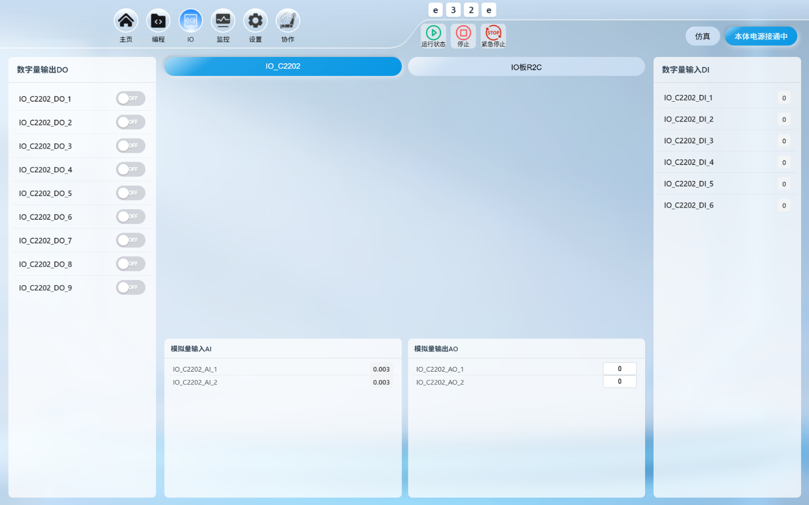

### 6.1 IO 分组与信号

进入 IO 界面后，可查看 IO 板数量和当前连接的 IO 板型号。

| 类型       | 数量 | 操作                         |
| -------- | -- | -------------------------- |
| 数字量输入 DI | 6  | 只读，实时刷新                    |
| 数字量输出 DO | 9  | **点击切换 ON / OFF**，实时同步控制器  |
| 模拟量输入 AI | 2  | 只读，实时刷新                    |
| 模拟量输出 AO | 2  | 输入目标值（01 或 0100% 视量程）确认后下发 |

> **提示**：IO 实时状态通过 WebSocket 推送刷新；IO 点位编号与端子排的对应关系以控制器铭牌 / 接线图为准。

## 7. 监控

监控页实时显示各关节运行状态与温度，顶部为系统状态栏。

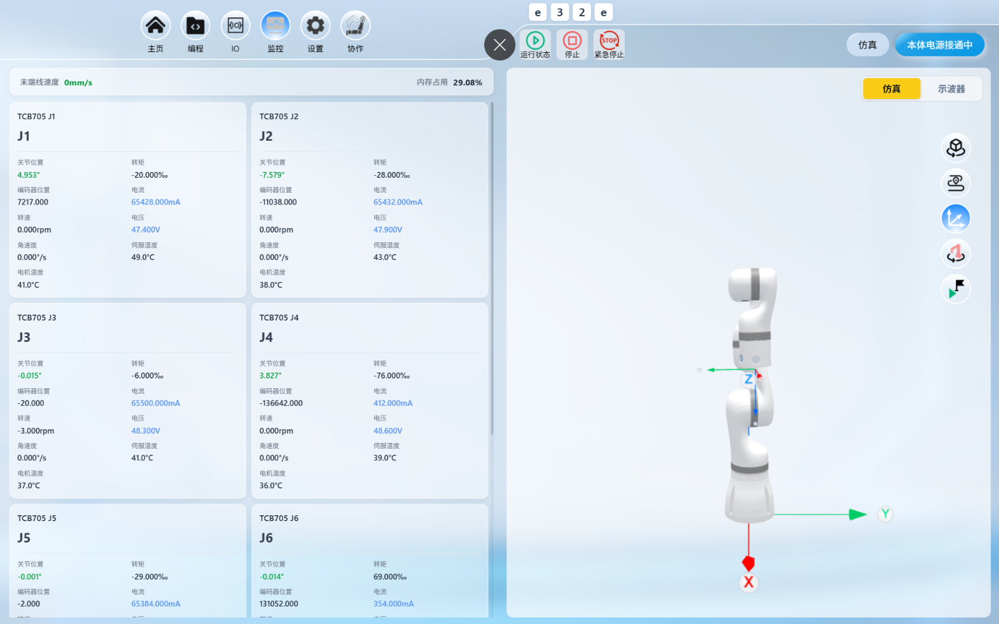

### 7.1 系统状态栏

| 参数    | 说明            |
| ----- | ------------- |
| 末端线速度 | 末端当前线速度（mm/s） |
| 内存占用  | 控制器系统内存占用率（%） |

### 7.2 关节参数（每关节一个面板）

| 参数    | 单位  | 说明               |
| ----- | --- | ---------------- |
| 关节位置  | °   | 当前关节角度           |
| 转矩    | ‰   | 关节输出转矩（占额定转矩千分比） |
| 编码器位置 | —   | 编码器累计位置          |
| 电流    | mA  | 电机相电流            |
| 转速    | rpm | 电机转速             |
| 电压    | V   | 电机母线电压           |
| 角速度   | °/s | 关节角速度            |
| 伺服温度  | °C  | 伺服驱动器温度          |
| 电机温度  | °C  | 电机绕组温度           |

## 8. 设置

### 8.1 安全 - 干涉区

**功能**：限制机器人 TCP 的活动范围——TCP 超出设定立方体范围时触发限制动作，防止进入危险区域。

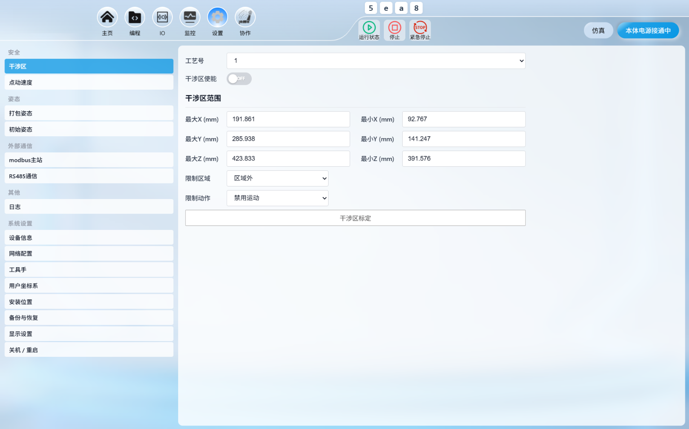

#### 参数说明

| 参数        | 选项/范围     | 说明                              |
| --------- | --------- | ------------------------------- |
| 工艺号       | 1 ~ 9     | 最多 9 组干涉区                       |
| 干涉区使能     | ON / OFF  | 是否启用检测                          |
| 最大X / 最小X | 数值（mm）    | 立方体 X 边界                        |
| 最大Y / 最小Y | 数值（mm）    | 立方体 Y 边界                        |
| 最大Z / 最小Z | 数值（mm）    | 立方体 Z 边界                        |
| 限制区域      | 区域外 / 区域内 | TCP 处于何处时触发限制                   |
| 限制动作      | 禁用运动 / 状态输出 | 禁用运动：触发后机器人无法运动；状态输出：触发时输出指定值（OFF/ON） |

> **注意**：最大/最小差值必须 > 0.1，否则提示“干涉区范围无效”。精确范围可通过“干涉区标定”获得，也可手动输入。

#### 干涉区标定

① 示教 TCP 对准立方体最小 XYZ 角点 → 点“标定该点”（P1）

② 示教 TCP 对准对角点（最大 XYZ 角点）→ 点“标定该点”（P2）

③ 点“计算”，系统由两点生成立方体范围

每步支持“运动到该点”（回到已标定点）

### 8.2 安全 - 点动速度

配置点动示教时的运动速度上限，含三个标签页。

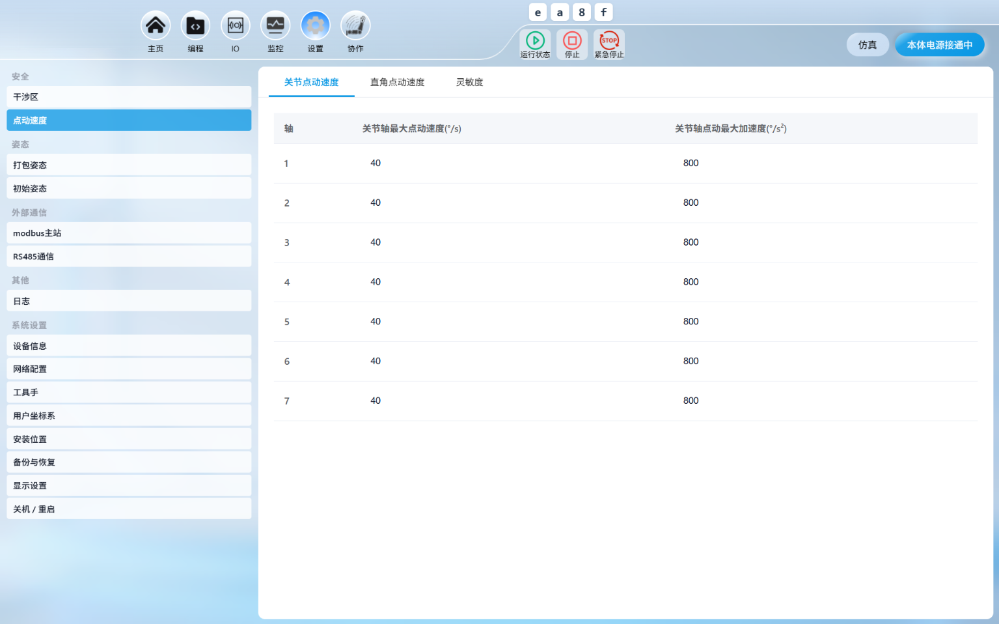

#### 关节点动速度

| 参数            | 单位   | 默认值     | 输入范围    |
| ------------- | ---- | ------- | ------- |
| 轴 1~7 最大点动速度  | °/s  | 40（各轴）  | 0~1000  |
| 轴 1~7 点动最大加速度 | °/s² | 800（各轴） | 0~10000 |

> **说明**：本机为 TCB705 七轴本体，界面显示 J1~J7 共 7 轴。

#### 直角点动速度（全局统一配置，不按轴区分）

| 参数         | 单位    | 默认值  | 输入范围    |
| ---------- | ----- | ---- | ------- |
| 笛卡尔点动最大线速度 | mm/s  | 200  | 0~5000  |
| 笛卡尔点动最大加速度 | mm/s² | 3000 | 0~50000 |
| 最大姿态角速度    | °/s   | 10   | 0~10000 |

#### 灵敏度

| 参数    | 默认值   | 说明        |
| ----- | ----- | --------- |
| 点动灵敏度 | 0.001 | 数值越大响应越灵敏 |

### 8.3 姿态 - 打包姿态

**功能**：设定机器人收拢/打包摆放的关节位置，用于运输与收纳。

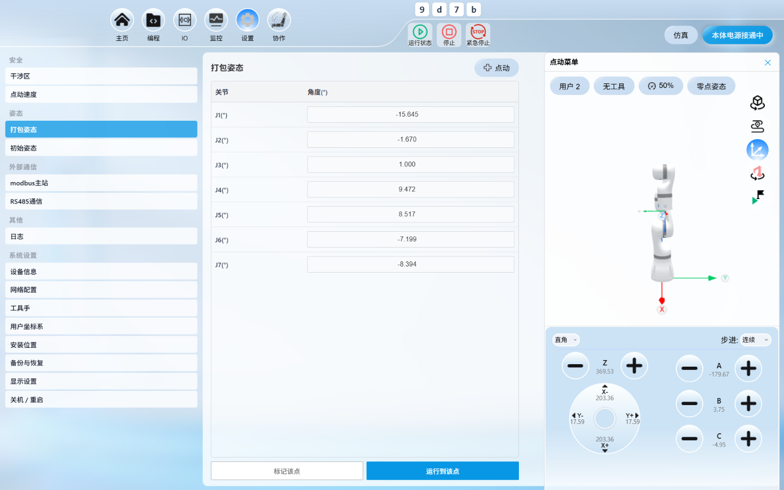

| 参数/按钮   | 说明                          |
| ------- | --------------------------- |
| 手动      | 手动输入各关节角度                   |
| 关节角度(°) | 各关节目标角度（界面显示 J1~J7；共 7 轴数据） |
| 标记该点    | 将当前位置标记为打包姿态                |
| 运行到该点   | 运动到打包姿态（需手动模式）              |

> **注意**：运行前请确保运动范围内无障碍物。主页预设按钮为“零点姿态 / 初始姿态”，打包姿态在本页调用。

### 8.4 姿态 - 初始姿态

**功能**：设定机器人安全位置（界面菜单名为“初始姿态”，即安全姿态 / 安全位置）。

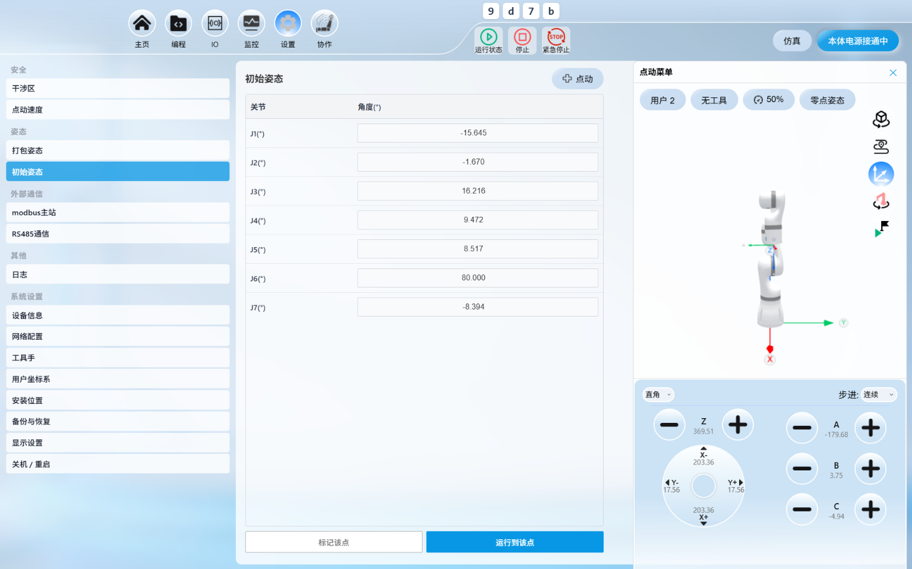

| 参数/按钮   | 说明                  |
| ------- | ------------------- |
| 手动      | 手动输入各关节角度           |
| 关节角度(°) | 共 7 轴数据，界面显示 J1~J7） |
| 标记该点    | 将当前位置标记为初始（安全）姿态    |
| 运行到该点   | 运动到初始（安全）姿态         |

### 8.5 外部通信 - Modbus 主站

**功能**：配置控制器作为 Modbus 主站与外部从站（PLC、传感器、上位机等）通信。

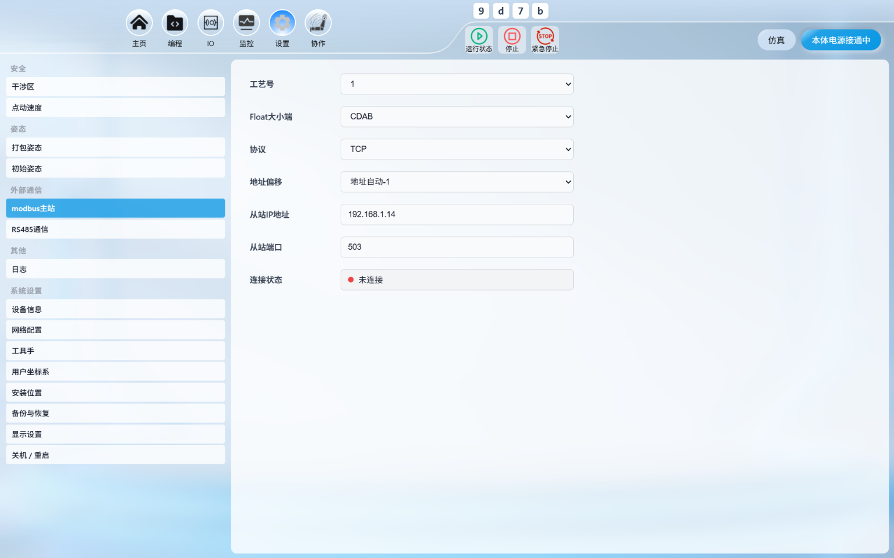

#### 基本参数

| 参数   | 选项/范围         | 说明                              |
| ---- | ------------- | ------------------------------- |
| 工艺号  | 1 ~ 99        | 最多 99 组                         |
| 协议   | TCP / RTU     | Modbus TCP（以太网）/ Modbus RTU（串口） |
| 地址偏移 | 地址不变 / 地址自动-1 | 部分从站 0 起始地址需减 1                 |

#### TCP 参数（协议选 TCP 时）

| 参数       | 说明                        |
| -------- | ------------------------- |
| 从站IP地址   | 格式校验 xxx.xxx.xxx.xxx      |
| 从站端口     | 标准 Modbus 端口为 502         |
| Float大小端 | ABCD / CDAB / BADC / DCBA |

#### RTU 参数（协议选 RTU 时）

| 参数     | 说明           |
| ------ | ------------ |
| 从站ID   | 范围 1~247     |
| 本地COM口 | 控制器物理串口的逻辑编号 |
| 波特率    | 串口波特率        |
| 校验位    | —            |
| 数据位    | 以实际要求为准      |
| 停止位    | 1 / 2        |

### 8.6 外部通信 - RS485 通信

**功能**：配置控制器 RS485 串口通信参数。

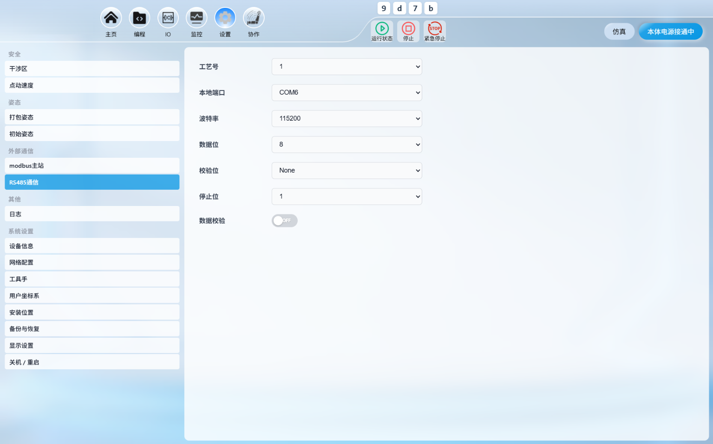

| 参数    | 选项/范围                    | 说明              |
| ----- | ------------------------ | --------------- |
| 工艺号   | 1 ~ 3                    | RS485 通信工艺号     |
| 本地端口  | COM1 ~ COM6              | 控制器 RS485 物理串口  |
| 波特率   | 110 ~ 921600             | 串口波特率           |
| 数据位   | 5/6/7/8                  | —               |
| 校验位   | None/Odd/Even/Mark/Space | —               |
| 停止位   | 1 / 1.5 / 2              | —               |
| 数据校验  | ON / OFF                 | 是否启用 CRC 校验     |
| 校验位长度 | 16 / 32                  | CRC 校验宽度        |
| 多项式选择 | MODBUS / CCITT / DNP     | CRC 多项式         |
| 字节顺序  | 低字节在前 / 高字节在前            | 多字节数据字节序（小端/大端） |

### 8.7 其他 - 日志

**功能**：显示系统运行日志，可按类型过滤并导出。

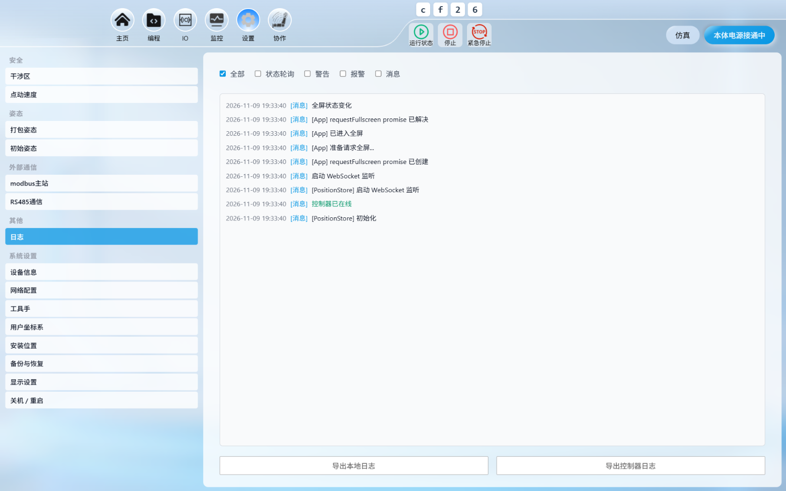

**过滤类型**：全部 / 状态轮询 / 警告 / 报警 / 消息

每条日志含：时间（yyyy-mm-dd hh:mm:ss）、类型标签（[消息]/[警告]/[报警]）、内容。

| 按钮      | 说明                               |
| ------- | -------------------------------- |
| 导出本地日志  | 导出浏览器端日志（ZIP）                    |
| 导出控制器日志 | 导出控制器端日志（controller_log_时间戳.zip） |

### 8.8 系统 - 设备信息

**功能**：显示系统软硬件版本信息，可设置语言与机器人型号。

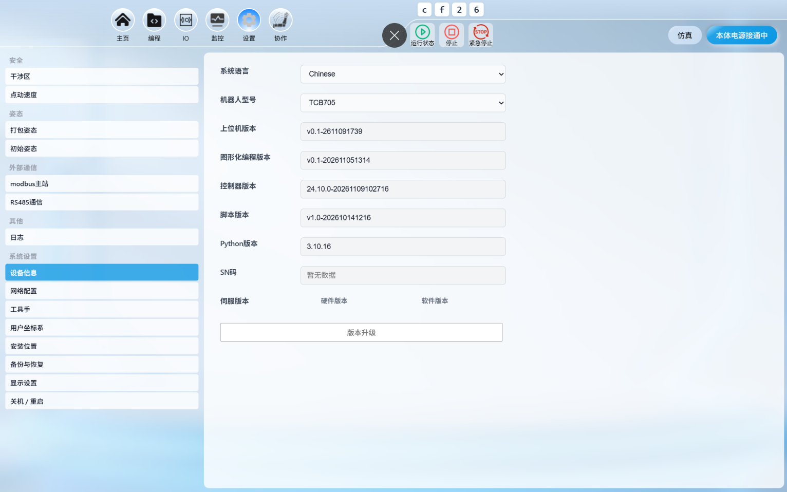

| 参数    | 选项                                           | 说明              |
| ----- | -------------------------------------------- | --------------- |
| 系统语言  | 跟随系统 / English / Chinese                     | “跟随系统”即随浏览器语言   |
| 机器人型号 | TCB705 / TCB605 / TCB705L / TCB605L（可适配其他类型） | **决定关节数量与显示配置** |

**伺服版本（1~7 轴）**：显示各轴硬件/软件版本（伺服未连接时显示“伺服未连接”）。

### 8.9 系统 - 网络配置

**功能**：设置控制器以太网（eth0）与 WIFI 网络参数。

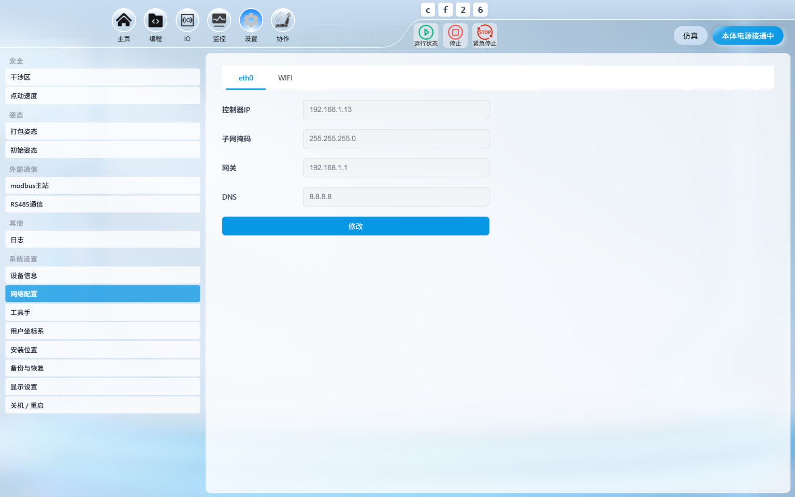

#### 以太网（eth0）

| 参数    | 说明          |
| ----- | ----------- |
| 控制器IP | 控制器当前以太网 IP |
| 子网掩码  | 子网掩码        |
| 网关    | 默认网关        |
| DNS   | 域名服务器       |

> **注意**：修改控制器 IP 后需用**新 IP** 重新打开页面（页面会提示）。IP 格式错误会提示“IP地址格式错误”。

#### WIFI

| 参数        | 说明              |
| --------- | --------------- |
| 模式选择      | AP（热点）/ STA（站点） |
| AP名称      | 热点 SSID         |
| 密码        | 热点密码（最少八位）      |
| IP分配      | 动态 / 静态         |
| IP网段      | 静态模式下的热点网段      |
| AP客户端连接数量 | 当前连接客户端数        |
| 频段        | 2.4GHz / 5GHz   |
| 连接状态      | 已连接 / 未连接       |

> **注意**：AP 与 STA 不能使用相同 IP，否则提示“IP地址冲突”。保存 Wi-Fi 配置后需**重启控制器**生效。

### 8.10 系统 - 工具手

**功能**：管理工具手（TCP 工具坐标系），支持 9 组工具手 + 无工具。

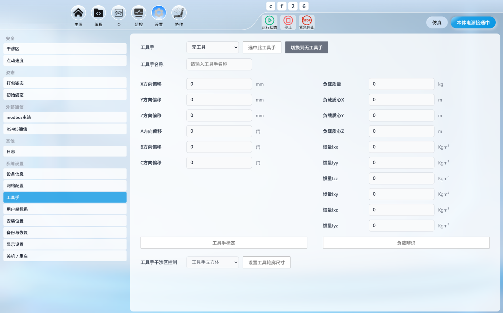

#### 参数说明

| 参数         | 单位          | 说明               |
| ---------- | ----------- | ---------------- |
| 当前工具手      | —           | 无工具 / 工具手 1~9    |
| 工具手名称      | —           | 必填               |
| X/Y/Z 方向偏移 | mm          | TCP 相对法兰坐标系的原点偏移 |
| A/B/C 方向偏移 | °           | TCP 相对法兰的姿态偏移 |
| 负载质量       | kg          | —                |
| 负载惯量       | ×10⁻³ kg·m² | 界面原文显示为“0.001 Kgm²” |
| 负载质心 X/Y/Z | m           | 相对法兰坐标系的偏移       |

**辅助功能**：工具手标定、负载辨识、工具手干涉区控制（设置工具轮廓尺寸用于干涉区检测）。

> **提示**：工具手切换后，主页“工具 n”与点动 / 程序中的坐标系立即更新。

#### 工具手标定

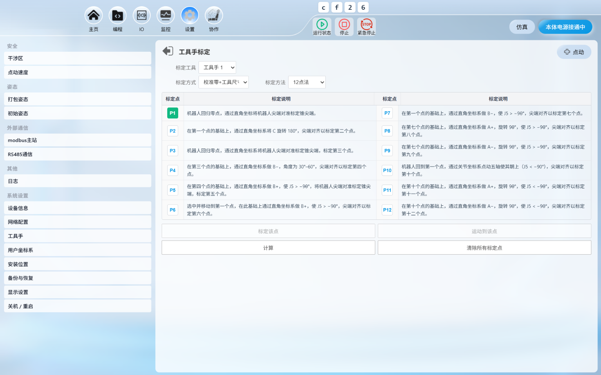

| 参数   | 选项                     | 说明                     |
| ---- | ---------------------- | ---------------------- |
| 标定工具 | 工具手 1~9                | 要标定的工具手                |
| 标定方式 | 校准零+工具尺寸 / 工具尺寸 / 工具姿态 | 是否包含零点校准与姿态            |
| 标定方法 | 12点法 / 9点法 / 6点法       | 标定点数量                  |
| 标定点  | P1~P12                 | 依次示教并“标定该点”（支持“运动到该点”） |

**12 点法标定顺序（标定说明）**：

| 点   | 操作说明                                |
| --- | ----------------------------------- |
| P1  | 机器人回零点，直角坐标将尖端对准标定锥尖端               |
| P2  | 在 P1 基础上直角坐标 C 旋转 180°，尖端对齐         |
| P3  | 机器人回零点，尖端对准标定锥尖端                    |
| P4  | 在 P3 基础上做 B-，度数 30°~60°，尖端对齐        |
| P5  | 在 P4 基础上做 B+，J5 > -90°，尖端对齐         |
| P6  | 选中 P1 并运动到 P1，做 B+，J5 > -90°，尖端对齐   |
| P7  | 在 P1 基础上做 B-，J5 > -90°，尖端对齐         |
| P8  | 在 P7 基础上做 A+，旋转 90°，J5 > -90°，尖端对齐  |
| P9  | 在 P7 基础上做 A-，旋转 90°，J5 > -90°，尖端对齐  |
| P10 | 回到 P1，关节点动五轴使五轴向上，J5 < -90°，尖端对齐    |
| P11 | 在 P10 基础上做 A+，旋转 90°，J5 < -90°，尖端对齐 |
| P12 | 在 P10 基础上做 A-，旋转 90°，J5 < -90°，尖端对齐 |

> **注意**：标定前请先切换到**无工具手**状态；某点未标定时提示“该点尚未记录坐标，请先标定”。标定方式与方法选项可能因固件版本而异。

#### 负载辨识

通过机器人运动自动辨识负载的质量、质心与惯量。

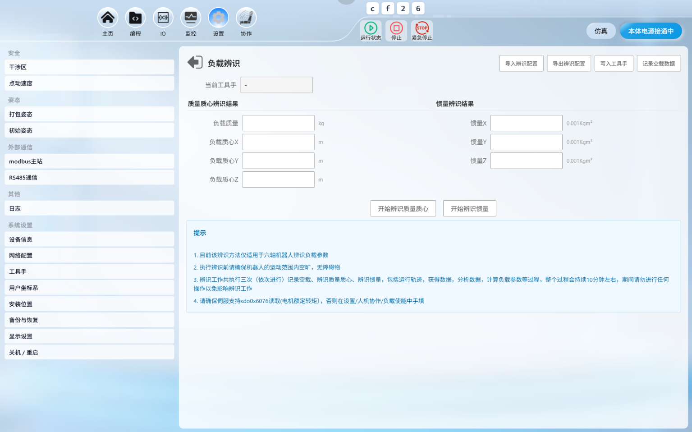

| 按钮        | 说明                    |
| --------- | --------------------- |
| 记录空载数据    | **辨识第一步**，记录未装负载的空载数据 |
| 开始辨识质量质心  | 第二步                   |
| 开始辨识惯量    | 第三步                   |
| 写入工具手     | 将结果写入当前工具手参数          |
| 导入/导出辨识配置 | JSON 格式               |

**辨识结果**：负载质量（kg）、负载质心 X/Y/Z（m）、惯量 X/Y/Z（×10⁻³ kg·m²）。

> **警告：辨识注意事项（界面原文）**

1. 目前仅适用于**六轴**机器人辨识负载参数
2. 执行前确保运动范围内空旷无障碍物
3. 共执行三次（空载 → 质量质心 → 惯量），全程约 **10 分钟**，期间**请勿进行任何操作**
4. 请确保伺服支持 SDO 0x6076 读取（电机额定转矩），否则在设置/人机协作/负载使能中手填

### 8.11 系统 - 用户坐标系

**功能**：管理工作台/工装上的用户坐标系，支持 9 组。

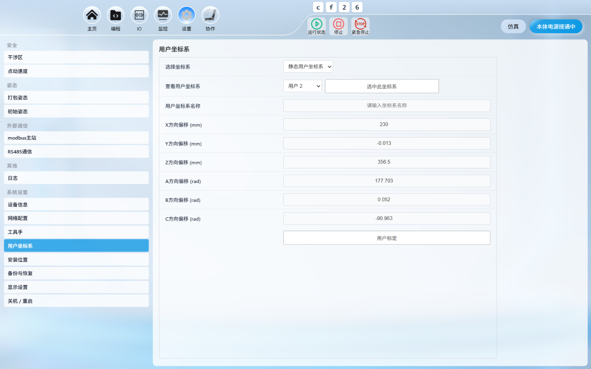

| 参数         | 选项      | 说明              |
| ---------- | ------- | --------------- |
| 选择坐标系      | 静态 / 联动 | 联动随外部机构（如传送带）运动 |
| 用户 1~9     | —       | 列表点击选中          |
| 选中此坐标系     | —       | 设为当前用户坐标系       |
| 用户坐标系名称    | —       | 必填              |
| X/Y/Z 方向偏移 | mm      | 原点相对基坐标系的平移     |
| A/B/C 方向偏移 | °       | 姿态偏移（欧拉角）       |

#### 用户坐标系标定（三点法）

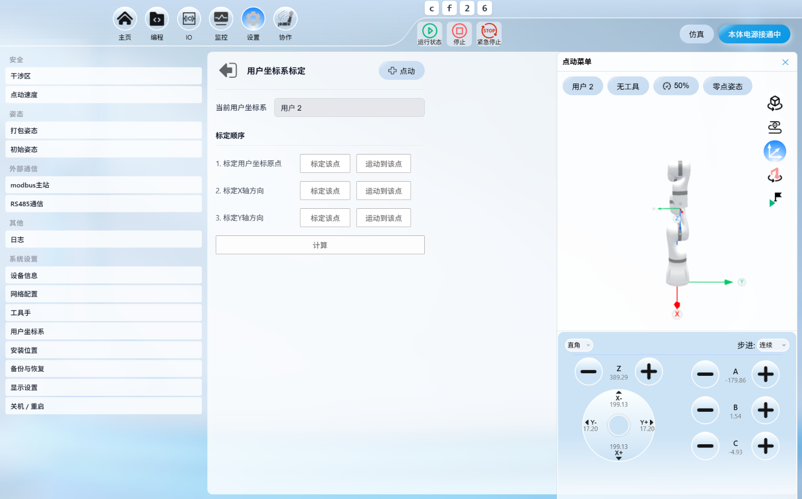

① 标定原点 ─→ ② 标定X轴方向 ─→ ③ 标定Y轴方向 ─→ 计算

每步示教 TCP 到位后点“标定该点”（支持“运动到该点”）；计算后坐标系自动生效。

### 8.12 系统 - 安装位置

**功能**：设置机器人本体的安装方式与安装角度偏移。

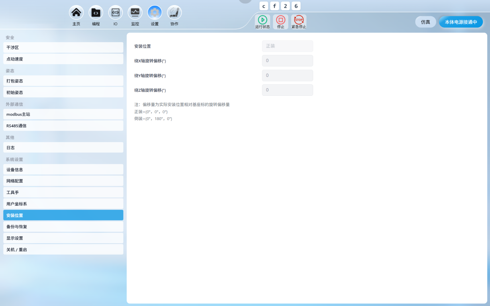

| 参数         | 选项           | 说明                   |
| ---------- | ------------ | -------------------- |
| 安装位置       | 正装 / 倒装 / 侧装 | 机器人本体安装方向            |
| 绕X轴旋转偏移(°) | 数值           | 实际安装位置相对基座标的 X 轴旋转偏移 |
| 绕Y轴旋转偏移(°) | 数值           | 实际安装位置相对基座标的 Y 轴旋转偏移 |
| 绕Z轴旋转偏移(°) | 数值           | 实际安装位置相对基座标的 Z 轴旋转偏移 |

> **提示**：偏移量为实际安装位置相对基座标的旋转偏移量；正装 = (0°, 0°, 0°)，倒装 = (0°, 180°, 0°)。

### 8.13 系统 - 备份与恢复

**功能**：程序、配置、脚本的导入导出。

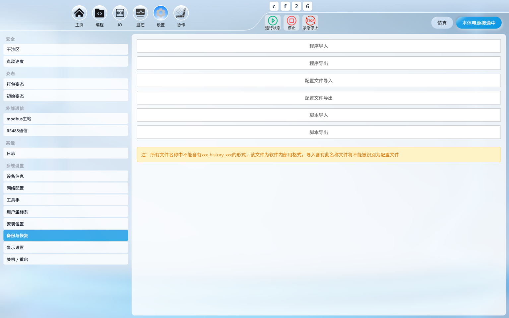

| 功能          | 内容              |
| ----------- | --------------- |
| 程序导入 / 导出   | 作业程序（配方）ZIP 包   |
| 配置文件导入 / 导出 | 控制器配置文件 ZIP 包   |
| 脚本导入 / 导出   | Python 脚本 ZIP 包 |

### 8.14 系统 - 显示设置

**功能**：配置仿真与 3D 显示参数。

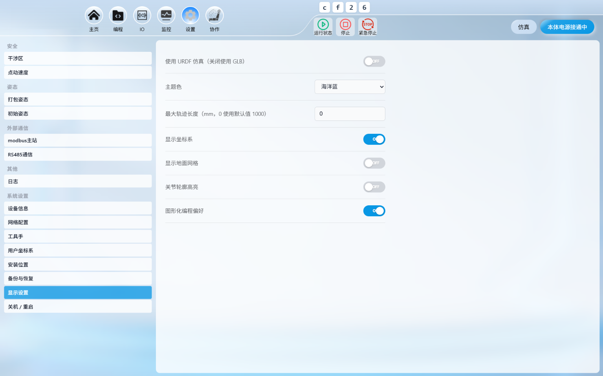

| 参数                | 选项/范围           | 说明                  |
| ----------------- | --------------- | ------------------- |
| 使用URDF仿真（关闭使用GLB） | ON / OFF        | ——                  |
| 最大轨迹长度            | ——              | 仿真轨迹保留长度（0 默认为1000） |
| 显示坐标系             | ON / OFF        | 3D 画面中显示坐标系         |
| 关节轮廓高亮            | ON / OFF        | 高亮机器人关节轮廓           |
| 主题色               | 海洋蓝 / 森林绿 / 明亮黄 / 热情红 | 更换主题颜色              |
| 图形化编程偏好           | ON / OFF        | 打开或关闭指令默认参数块        |

### 8.15 系统 - 重启

| 按钮 | 说明                          |
| -- | --------------------------- |
| 重启 | 重启控制器，页面显示“控制器正在重启...”并自动重连 |

## 9. 插件

插件是一种可插拔的功能模块，可在不改动主程序的前提下，为其扩展新的功能。

功能：主程序提供标准接口，插件通过该接口与主程序通信、调用其能力，从而在独立环境中运行并协同工作。

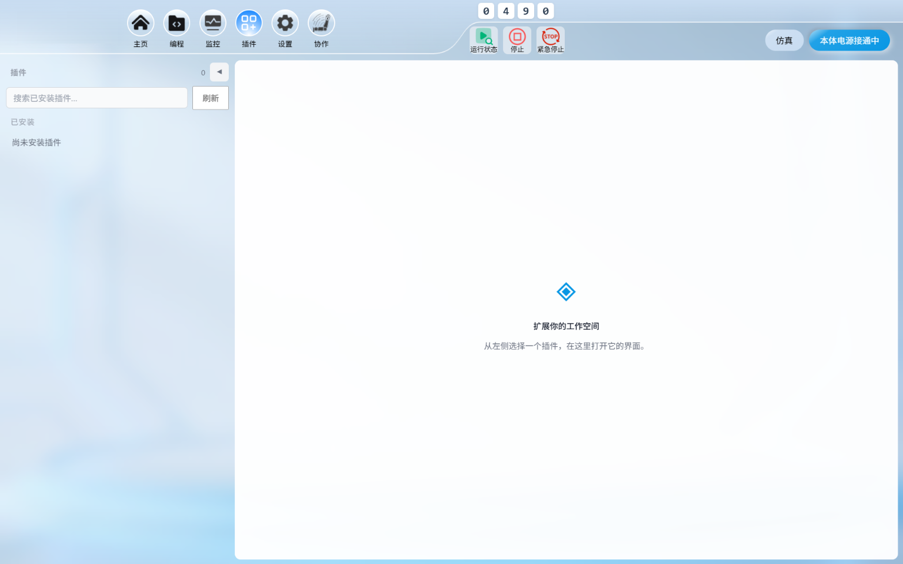

- **即插即用**：安装、启用后即可使用，无需重新编译主程序
- **功能扩展**：为主程序增加原本没有的能力
- **独立开发**：可单独开发、升级、替换，互不影响
- **按需加载**：需要时加载，不需要时禁用或卸载

### 9.1 插件 - 使用

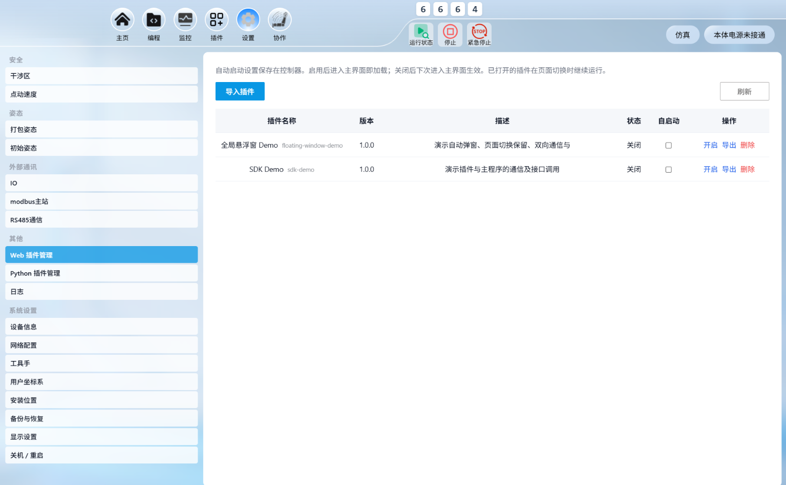

**功能入口**

在设置左侧导航栏的「其他」分组中，点击「Web 插件管理」进入本页。同组的「Python 插件管理」用于管理另一类插件，界面与操作方式类似。

该页面用于查看控制器中已有的插件，并完成导入、开启、导出和删除等操作。

**界面说明**

页面顶部提示：自动启动设置保存在控制器。启用后进入主界面即加载；关闭后下次进入主界面生效。已打开的插件在页面切换时继续运行。

**导入插件**：点击「导入插件」，按弹窗提示选择插件包；导入完成后插件会显示在列表中。

**刷新列表**：点击页面右上角「刷新」，同步控制器中插件的最新状态。

**开启插件**：在目标行「操作」列点击「开启」，状态列由「关闭」变为运行中（具体文案以实际界面为准）。

**设置自启动**：勾选「自启动」列的复选框，设置将保存在控制器中；启用后进入主界面即加载，关闭后下次进入主界面生效。

**导出与删除**：点击「导出」可备份插件；确认不再使用时再点击「删除」。删除前建议先导出备份。

> **注意**：
> - 自启动与当前运行状态相互独立：勾选自启动只影响下次进入主界面时的加载，当前使用仍需点击「开启」。
> - 已打开的插件在页面切换时会继续运行，不必重复开启。

## 10. 协作

协作页用于配置协作场景相关的外设与功能，左侧导航：动力学辨识、碰撞检测力阈值、摩擦力系数、轨迹列表、灵巧手设置、夹爪、六维力传感器。

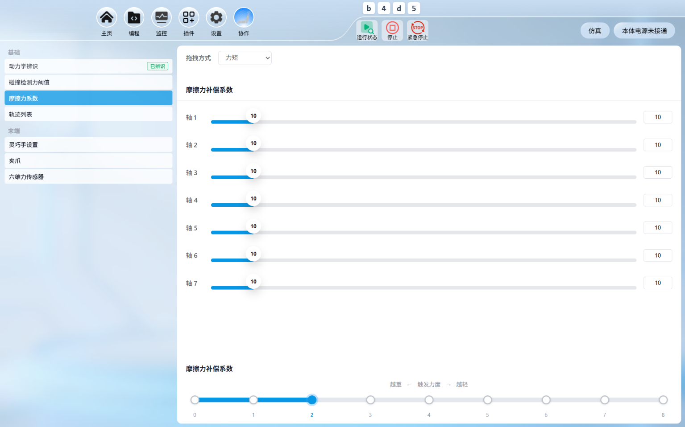

### 10.1 动力学辨识

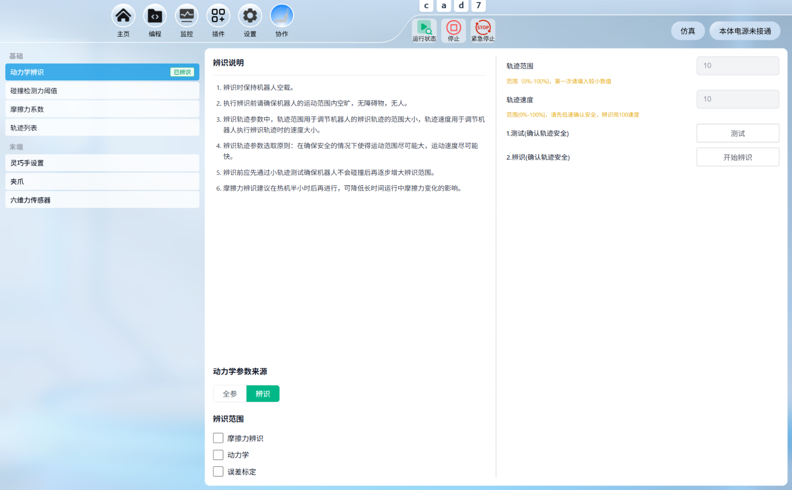

轨迹范围：根据轨迹范围计算出机器人最大最小运动范围。

轨迹速度：机器人在运行时的速度，与全局速度无关。

### 10.2 碰撞检测力阈值

配置各关节的碰撞检测等级与响应时间。碰撞检测用于人机协作安全：运动中检测到碰撞力矩超阈值并持续设定时间后，触发停止保护。

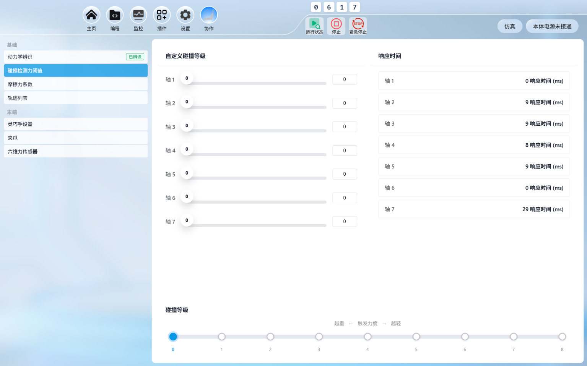

| 参数      | 范围                    | 说明                  |
| ------- | --------------------- | ------------------- |
| 自定义碰撞等级 | 滑块0-100，下方有八个挡位可以一键切换 | 数值越小越灵敏、越容易触发；越大越迟钝 |
| 响应时间    | ms                    | 达到设定时间即触发保护         |

> **注**：碰撞等级由界面映射为对应力矩阈值，请根据工艺需求平衡灵敏度与误报率；响应时间为 0 ms 的轴表示立即响应碰撞。

### 10.3 摩擦力系数（拖拽）

配置拖拽示教的补偿与位置拖拽参数。

#### 基本参数

| 参数        | 选项/范围                                              | 说明         |
| --------- | -------------------------------------------------- | ---------- |
| 拖拽方式      | 无 / 力矩 / 位置                                        | 力矩拖拽/ 位置拖拽 |
| 摩擦力补偿灵敏系数 | 位置：X/Y/Z/A/B/C 滑块 0~100；力矩：轴 1~轴 7（以实际机器为准）滑块 0~100 | 数值越大越省力 |

#### 位置模式配置（拖拽方式为“位置”时显示）

| 参数      | 选项                 | 说明             |
| ------- | ------------------ | -------------- |
| 拖动模式    | 自由拖拽 / 位置拖拽 / 姿态拖拽 | 位置拖拽下允许拖动的自由度  |
| 启动阈值(F) | 数值                 | 触发拖拽的力阈值       |
| 启动阈值(M) | 数值                 | 触发拖拽的力矩阈值      |
| 笛卡尔速度限制 | m/s                | 位置拖拽 TCP 最大速度  |
| 关节速度限制  | °/s                | 位置拖拽关节最大速度     |
| 拖拽变化率   | %                  | 拖拽过程中速度变化的调节比率 |

### 10.4 轨迹列表

**功能**：管理拖拽示教录制的轨迹文件

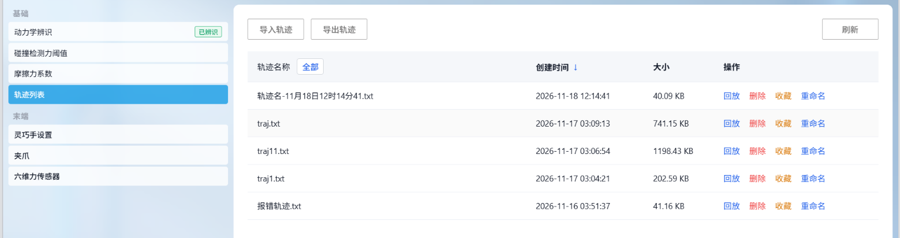

页面上方提供「导入轨迹」「导出轨迹」「刷新」按钮，并支持按轨迹名称筛选（如“全部”）。

| 列    | 说明                                                   |
| ---- | ---------------------------------------------------- |
| 轨迹名称 | 文件名（.txt）                                            |
| 创建时间 | 创建时系统时间                                              |
| 大小   | 文件大小                                                 |
| 操作   | **回放**：运动当前选中的录制轨迹；**删除**：删除该轨迹（**删除后不可恢复**）；**收藏**：收藏该轨迹；**重命名**：修改轨迹名称 |

### 10.5 灵巧手设置

配置灵巧手（五指机械手）参数与手势/动作测试。

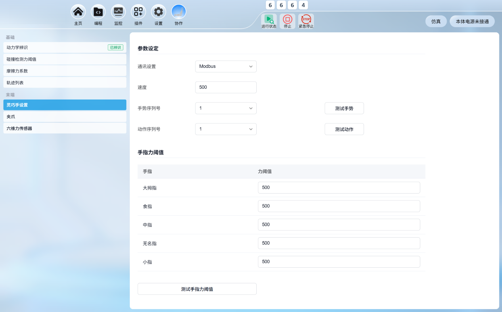

#### 参数设定

| 参数    | 选项/范围  | 说明          |
| ----- | ------ | ----------- |
| 速度    | 数值     | 动作速度        |
| 手势序列号 | 1 ~ 99 | 要测试/使用的手势编号 |
| 测试手势  | —      | 下发当前手势      |
| 动作序列号 | 1 ~ 99 | 要测试/使用的动作编号 |
| 测试动作  | —      | 下发当前动作      |

#### 手指力阈值

| 参数      | 说明                        |
| ------- | ------------------------- |
| 手指力阈值   | 各手指（大拇指/食指/中指/无名指/小指）的力阈值 |
| 测试手指力阈值 | 下发各手指力阈值并测试               |

#### 通讯设置

通讯方式：Modbus / Rs485

注意：默认参数：速度 500、各手指力阈值均为 500。灵巧手通讯参数与控制器 RS485/Modbus 配置联动，详见灵巧手产品文档。

### 10.6 夹爪

配置夹爪参数并控制夹爪动作。

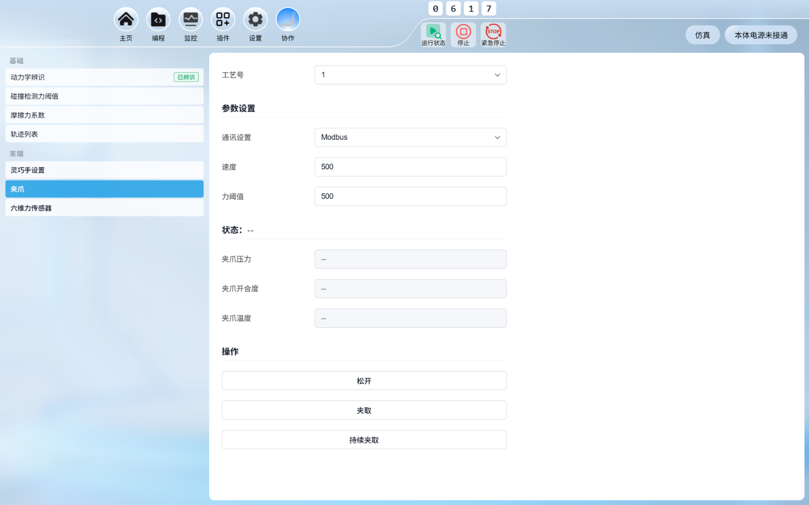

#### 参数

| 参数   | 选项/范围          | 默认值 | 说明           |
| ---- | -------------- | --- | ------------ |
| 工艺号  | 1 ~ 99         | 1   | 夹爪工艺号        |
| 速度   | 数值             | 500 | 单位与量程见夹爪产品文档 |
| 力阈值  | 数值             | 500 | 同上           |
| 通讯设置 | Modbus / Rs485 | —   | 通讯方式         |

#### 状态与操作

| 项目              | 说明             |
| --------------- | -------------- |
| 状态              | 连接状态（未连接显示 --） |
| 夹爪压力 / 开合度 / 温度 | 当前实时值          |
| 松开              | 执行松开           |
| 夹取              | 按力阈值夹持         |
| 持续夹取            | 持续保持夹持状态       |

### 10.7 六维力传感器

配置六维力传感器的通讯、标定与负载计算。含四个标签页：**通讯设置、数据、基础参数、负载计算**。

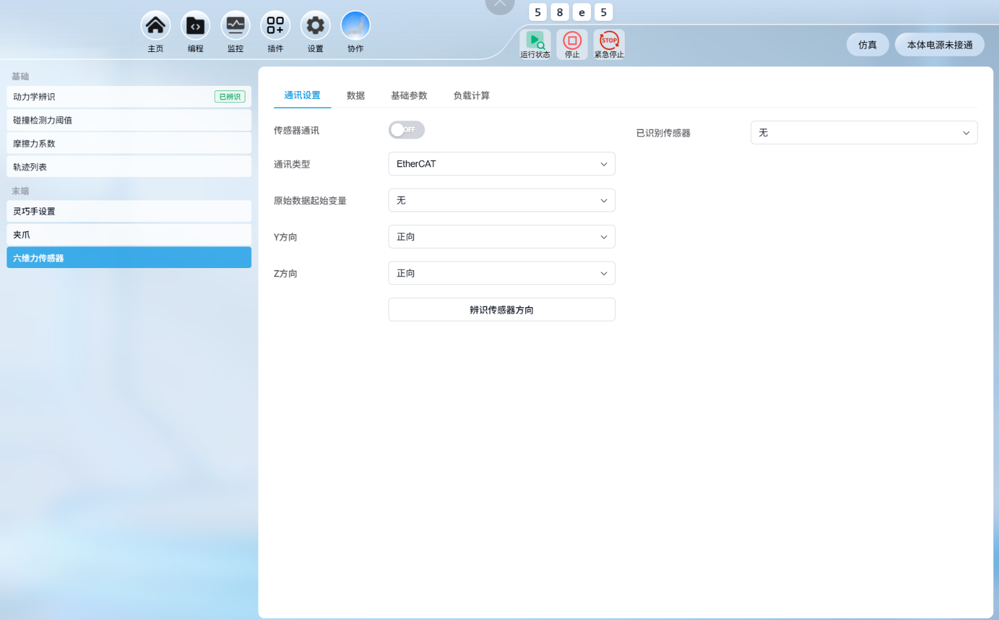

#### 标签页 1：通讯设置

| 参数        | 选项                                 | 说明                |
| --------- | ---------------------------------- | ----------------- |
| 传感器通讯     | ON / OFF                           | 是否启用              |
| 通讯类型      | EtherCAT / Modbus TCP / Modbus RTU | 通讯协议              |
| 原始数据起始变量  | 无 / GD001~GD099                    | 原始数据写入的数据字典变量起始地址 |
| Y方向 / Z方向 | 正向 / 反向                            | 传感器安装方向           |
| 辨识传感器方向   | —                                  | 自动辨识安装方向          |
| 已识别传感器    | 无 / （实际型号）                         | 当前识别到的传感器         |

#### 标签页 2：数据

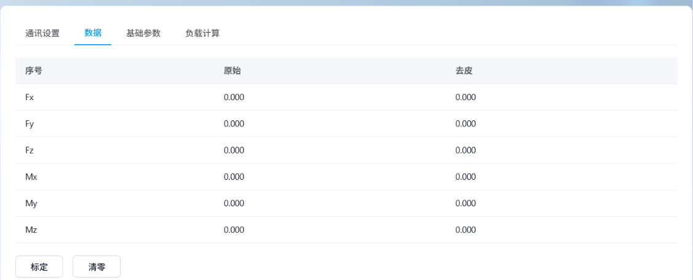

- **数据项**：Fx / Fy / Fz / Mx / My / Mz
- **数据源**：原始数据 / 去皮数据
- **操作**：清零（去皮）、标定

#### 标签页 3：基础参数

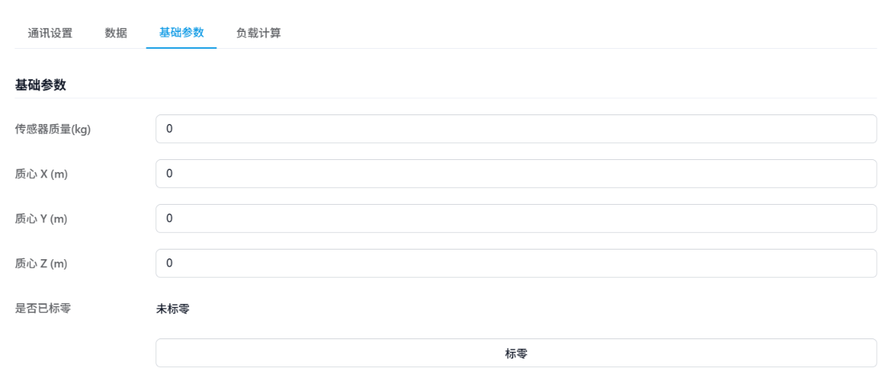

| 参数       | 单位 | 说明          |
| -------- | -- | ----------- |
| 传感器质量    | kg | 传感器自身质量     |
| 质心 X/Y/Z | m  | 传感器质心相对安装位置 |
| 标零       | —  | 执行传感器标零     |

#### 标签页 4：负载计算

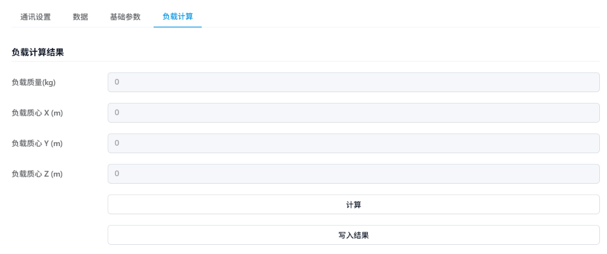

| 参数/按钮      | 单位 | 说明             |
| ---------- | -- | -------------- |
| 负载质量       | kg | 计算得到的负载质量      |
| 负载质心 X/Y/Z | m  | 计算得到的负载质心      |
| 计算         | —  | 执行负载计算         |
| 写入结果       | —  | 将结果写入当前工具手负载参数 |

> **注意**：辨识过程中提示“辨识中无法操作”，请勿在辨识期间操作机器人。
