# 纳博特机器人自动标定系统NexAutoCail 性能测试使用手册_单靶球

国标性能测试共有十四项，分为单靶球和三靶球两种情况。

国标十四项分别为：位姿准确度和位姿重复性、多方向位姿准确度变动、距离准确度和距离重复性、位置稳定时间、位置超调量、位姿特性漂移、互换性、轨迹准确度和轨迹重复性、重复定向轨迹准确度、拐角偏差、轨迹速度特性、最小定位时间、静态柔顺性、摆动偏差。

双击打开软件，项目选择“性能测试”，标定模式选择“单靶球标定”，点击进入；如果从标定界面进入性能测试，直接关闭标定界面，选择项目和标定模式后进入性能测试。

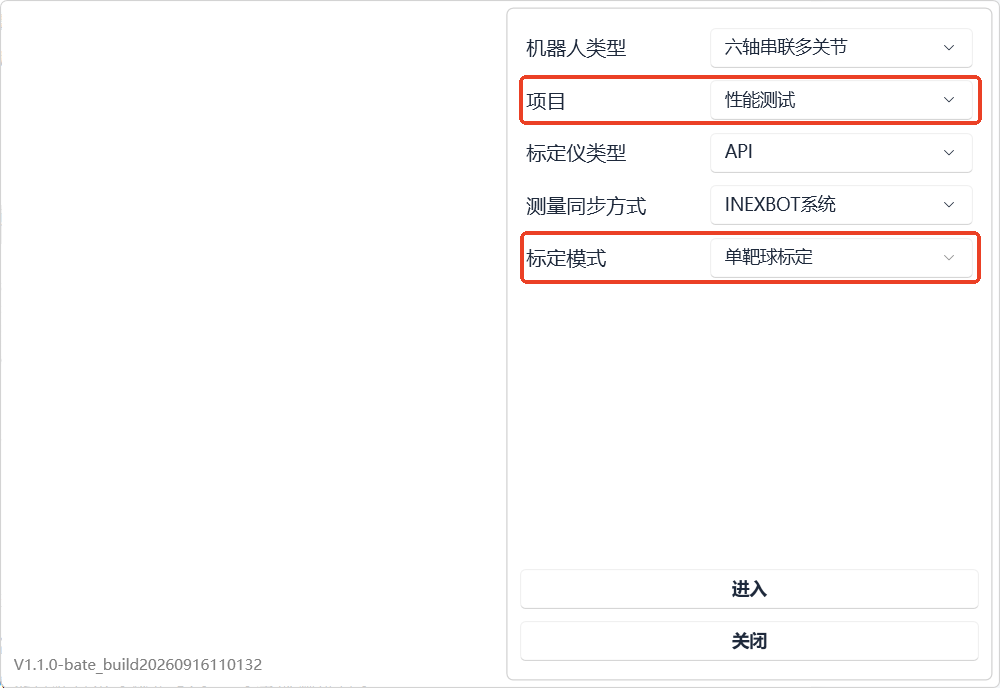

图1　软件项目与标定模式选择界面

进入性能测试后填写弹窗内容，根据机器人实际填写

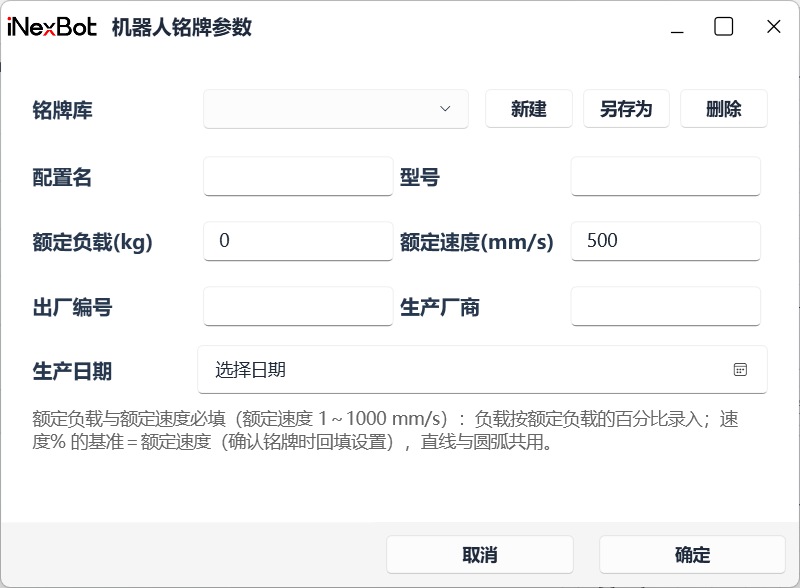

图2　性能测试机器人信息填写弹窗

第一次性能测试的机型需要填写配置名（机器人品牌）、型号、额定负载、额定速度等必填信息，填写完点击【确定】，即可进入正常标定流程；

如果是已经填写过信息的机器人，下拉“铭牌库”下拉框，选择对应的机器人点击【确定】即可

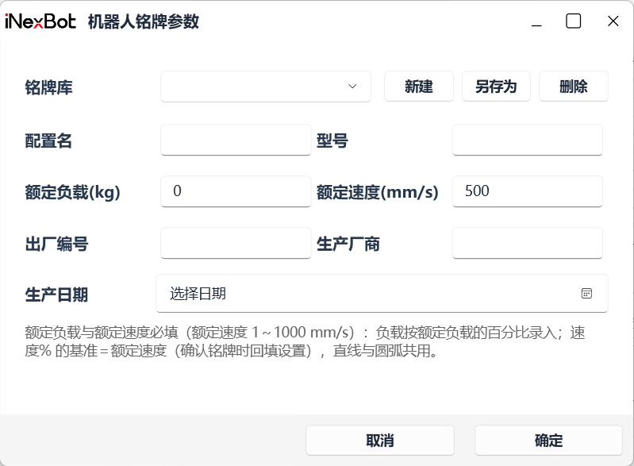

图3　铭牌库机器人选择界面

# 一、性能测试基础设置步骤

进入性能测试界面后依次连接控制器和标定仪；如果从标定界面进入，控制器和标定仪不会自动断开，在进入性能测试界面后会自动连接，不需二次连接。

## 1.1： 生成工作空间

确认位姿测试平面和轨迹测试平面。点击【工作空间】，如下图所示：

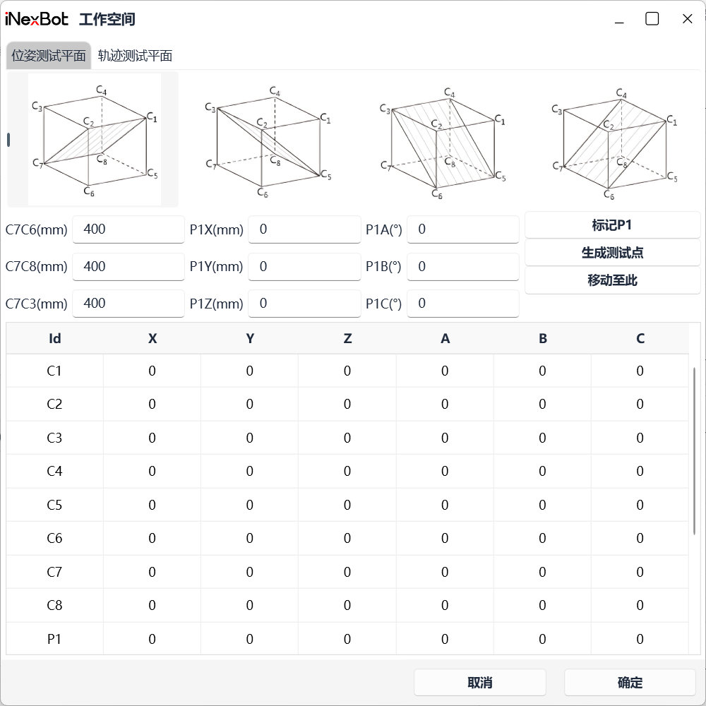

图4　工作空间设置界面

“位姿测试平面”的参数设置：设置C7C6、C7C8、C7C3的值，三个值的填写依据机器人大小及工作空间设定，其中C7C8的值是机器人Y方向的运动轨迹长度。在设置完三个参数后在机器人零点处点击【标记P1】、【生成测试点】。

“轨迹测试平面”的参数设置：同位姿测试平面一致，C7C6、C7C8、C7C3的值填写的与位姿测试平面的值相同。

在设置好“位姿测试平面”与“轨迹测试平面”后，点击【确定】。

## 1.2： 确定基座标

点击【坐标标定】，如下图所示：

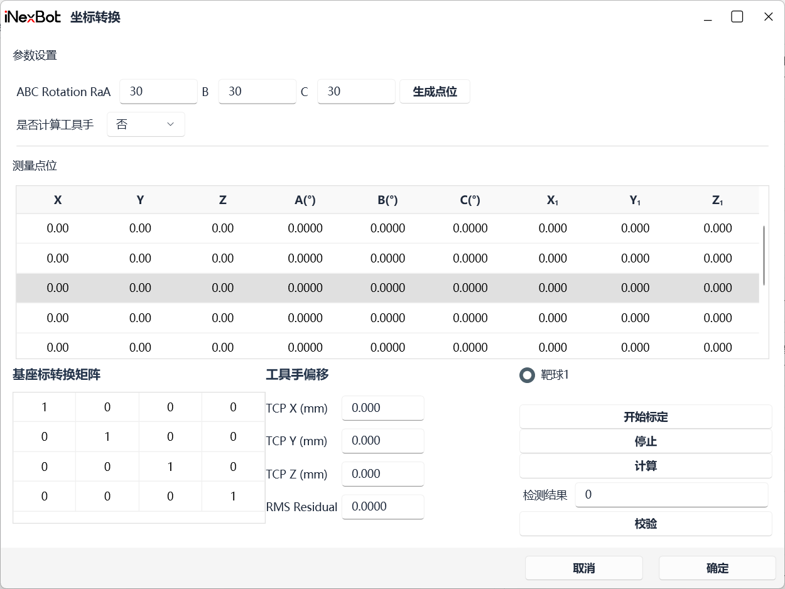

图5　坐标转换（基座标标定）界面

点击【开始】（机器人处于上电状态），机器人及激光标定仪会自动进行标定，标定完成后右下角会有绿色弹窗弹出，如下图所示：

图6　基座标转换成功提示弹窗

标定完成后可以点击【校验】，通常“校验结果”的值在1以内，标定正常。

如果需要计算靶球工具手，在“是否计算工具手”下拉框选择“是”，默认A、B、C姿态30°，如果发生丢光且手动调整还是引光不成功，自行调整A、B、C姿态角度。

标定完成之后点击【确定】。

# 二、十四项测试

通过上述“生成工作空间、确定基座标”等步骤执行后，所有十四项测试的点位自动生成，只需要通过“控制器”或者手动给机器人上使能即可点击“启动”，机器人会自动按照生成的点位信息的轨迹进行运动，机器人运动结束代表当前测试项结束，测试结果同步显示，无需任何手动操作，可直接进行下一项，机器人轨迹运行完成停止后不会自动下电。

## 2.1:位姿准确度和位姿重复性（T 01）

位姿准确度（ATp）是指机器人实际达到的位姿与指令位姿之间的偏差程度；位姿重复性（RTp）是指机器人从不同方向或多次重复运动到同一目标位姿时，各实际位姿之间的一致程度

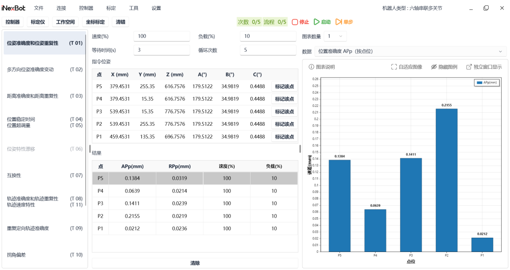

图7　位姿准确度和位姿重复性测试界面

名词解释：

速度：机器运行速度，按照示教器实际显示填写

负载：以“实际负载/机器人负载”按百分比填写

等待时间：踩点等待时间，默认3

循环次数：位姿准确度和位姿重复性的作业文件循环运行次数

标记该点：测试不同点位的位姿准确度和位姿重复性。机器人运动到需要测试点点位，点击‘标记该点’，上电后点击‘启动’

图表数量：显示同一页面展示的图标数量，下拉框可选，最多同时展示3张

数据：位姿准确度和位姿重复性测试项共有“位置准确度 APp（按点位）；位置重复性 RPp（按点位）；位置准确度分量（按点位）；位置重复性分量（按点位）；位置准确度 APp（逐次）；位置重复性 RPp（逐次）；X 向偏差 APx（逐次）；Y 向偏差 APy（逐次）；Z向偏差 APz（逐次）；X 向偏差 RPx（逐次）；Y 向偏差 RPy（逐次）；Z 向偏差 RPz（逐次）；位置误差矢量图；位置准确度 vs 位置重复性”等14张数据图

数据图备注：（以‘位置准确度 APp（按点位）’数据图为例）

图例说明：鼠标单击后会显示相应的文字说明，单击后如下图所示，有明确的作用、数据来源、计算方式等。鼠标再次单击后会图注说明会自动退出

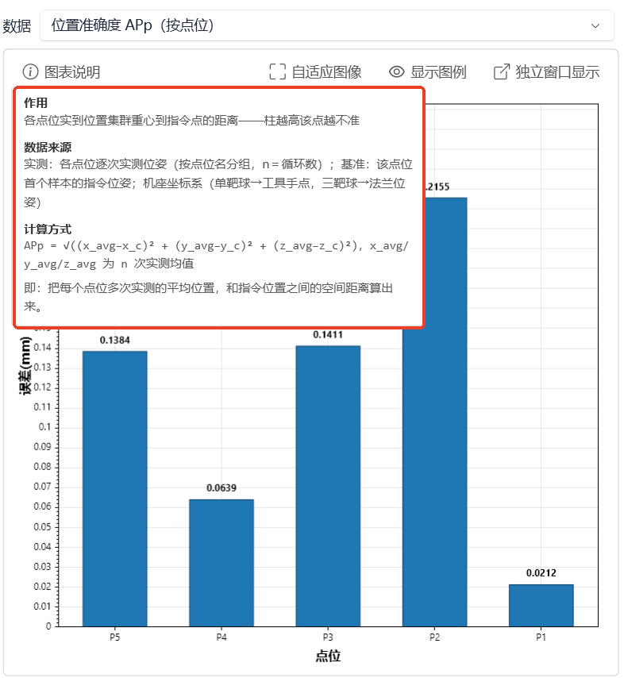

图8　数据图图例说明示例

自适应图像：数据图进行放大、缩小后点击‘自适应图像’会自动适配图像大小

显示图例：点击后显示或不显示图例，如下图所示

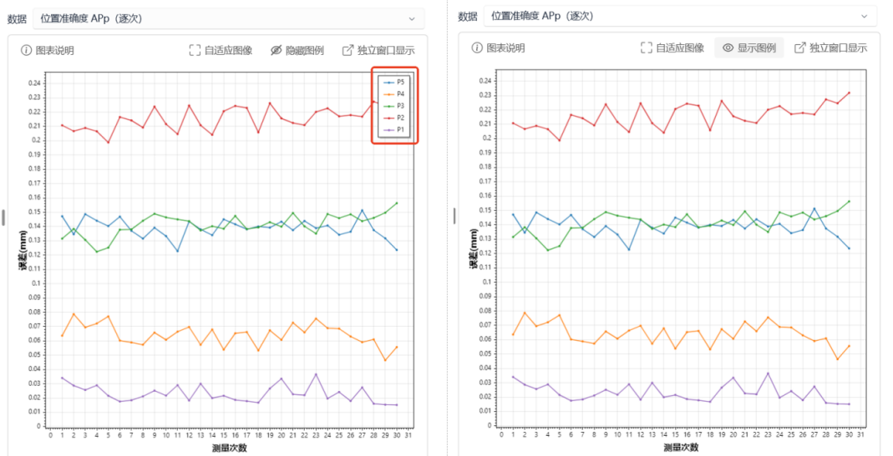

图9　数据图显示图例示例

独立窗口显示：点击后会将当前图标独立显示，如下图所示

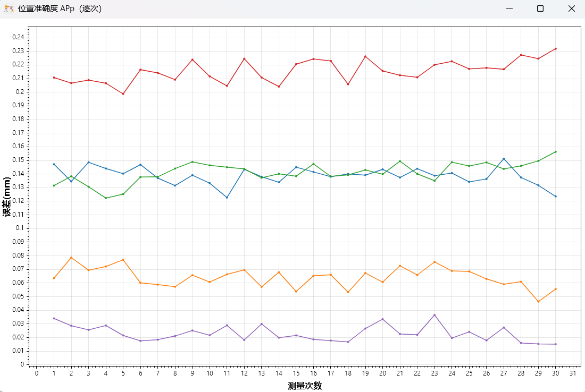

图10　数据图独立窗口显示示例

运行轨迹完成后停止，自动显示本次运行结果，表示运行结束

## 2.2：多方向位姿准确度变动(T 02)

多方向位姿准确度变动（vAPp）是指从不同方向接近同一目标位姿时，机器人实际位姿准确度的变化情况

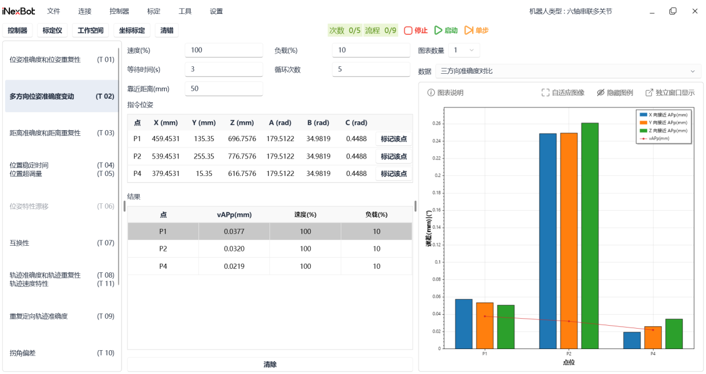

图11　多方向位姿准确度变动测试界面

名词解释：

速度：机器运行速度，按照示教器实际显示填写

负载：以“实际负载/机器人负载”按百分比填写

等待时间：踩点等待时间，默认3

循环次数：多方向位姿准确度变动的作业文件循环运行次数

等待时间：是指从从X、Y、Z多少距离回到某一点的距离

标记该点：测试不同点位的多方向位姿准确度。机器人运动到需要测试点点位，点击‘标记该点’，上电后点击‘启动’

图表数量：显示同一页面展示的图标数量，下拉框可选，最多同时展示3张

数据：多方向位姿准确度变动测试项共有“三方向准确度对比；三方向间距；vAPp（mm）；X 向接近位置偏差（逐次）；Y 向接近位置偏差（逐次）；Z 向接近位置偏差（逐次）”等6张数据图

## 2.3：距离准确度和距离重复性(T 03)

距离准确度（ADp）是指机器人实际移动距离与指令移动距离之间的偏差；距离重复性（RDp）是指多次重复执行相同距离运动时，实际运动距离的一致程度

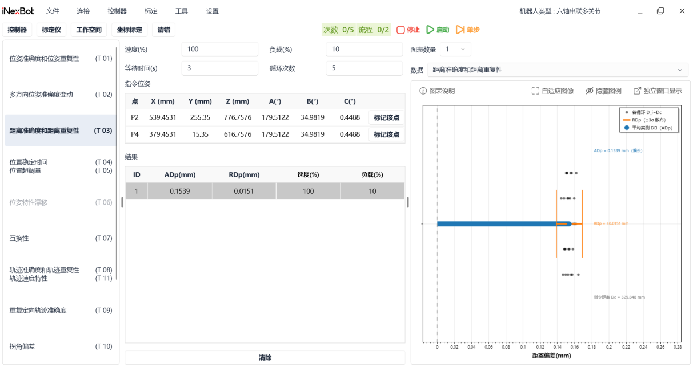

图12　距离准确度和距离重复性测试界面

名词解释：

速度：机器运行速度，按照示教器实际显示填写

负载：以“实际负载/机器人负载”按百分比填写

等待时间：踩点等待时间，默认3

循环次数：距离准确度和距离重复性的作业文件循环运行次数

标记该点：测试不同点位的距离准确度和距离重复性。机器人运动到需要测试点点位，点击‘标记该点’，上电后点击‘启动’

图表数量：显示同一页面展示的图标数量，下拉框可选，最多同时展示3张

数据：距离准确度和距离重复性测试项共有“距离准确度和距离重复性；逐次距离明细”等2张数据图

## 2.4：位置稳定时间(T 04)、位置超调量(T 05)

位置稳定时间（t）是指机器人运动到目标位置后，实际位置进入规定门限带并保持稳定所需要的时间；位置超调量（OV）是指机器人到达目标位置过程中，超过目标位置的最大偏差

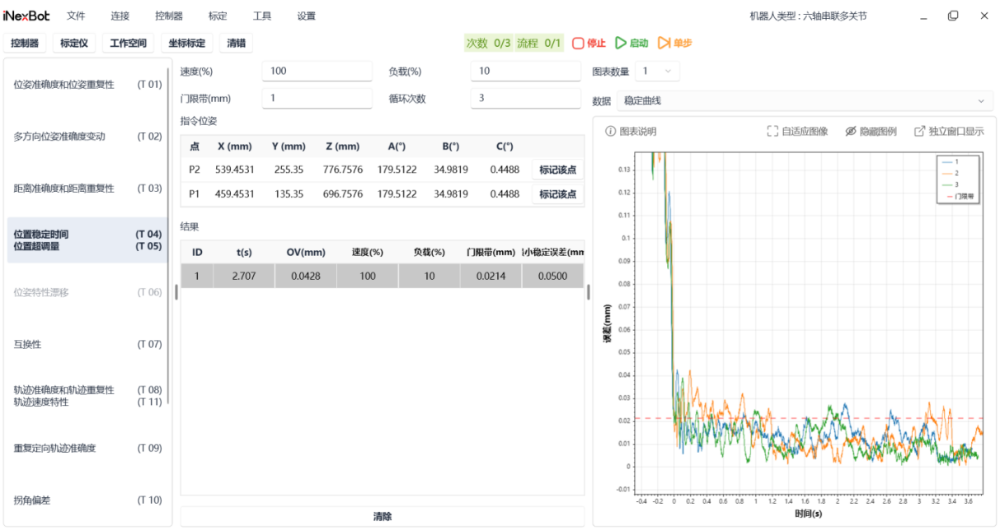

图13　位置稳定时间和位置超调量测试界面

名词解释：

速度：机器运行速度，按照示教器实际显示填写

负载：以“实际负载/机器人负载”按百分比填写

门限带：判定机器人“已经稳定”时所允许的最大位置误差范围

循环次数：位置稳定时间和位置超调量的作业文件循环运行次数

标记该点：测试不同点位的位置稳定时间和位置超调量。机器人运动到需要测试点点位，点击‘标记该点’，上电后点击‘启动’

图表数量：显示同一页面展示的图标数量，下拉框可选，最多同时展示3张

数据：位置稳定时间和位置超调量测试项共有“稳定曲线；位置稳定时间；位置超调量；位置稳定时间 vs 位置超调量”等4张数据图

## 2.5：位姿特性漂移(T 06)

三靶球专属测试项

## 2.6：互换性(T 07)

互换性是指在相同条件下，更换机器人或重新安装后，其达到规定性能的一致程度

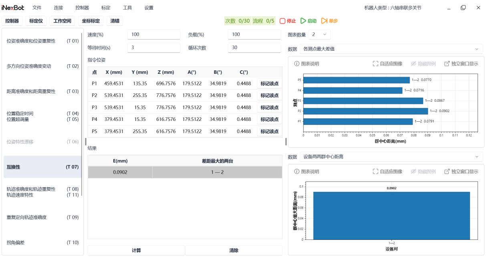

图14　互换性测试界面

名词解释：

速度：机器运行速度，按照示教器实际显示填写

负载：以“实际负载/机器人负载”按百分比填写

等待时间：踩点等待时间，默认3

循环次数：互换性的作业文件循环运行次数

标记该点：测试不同点位的距离准确度和距离重复性。机器人运动到需要测试点点位，点击‘标记该点’，上电后点击‘启动’

图表数量：显示同一页面展示的图标数量，下拉框可选，最多同时展示3张

数据：互换性测试项共有“各测点最大差值、设备两两群中心距离”等2张数据图

## 2.7 ：轨迹准确度和轨迹重复性（T08）、轨迹速度特性（T11）

轨迹准确度（ATp）是指机器人实际运动轨迹与理论指令轨迹之间的偏差程度；轨迹重复性（RTp）是指多次重复执行同一轨迹时，各次实际轨迹之间的一致程度；轨迹速度特性（RV）是指机器人执行规定轨迹时，实际运动速度与指令速度之间的特性及变化情况。轨迹速度重复性(RV)、轨迹速度波动(FV)

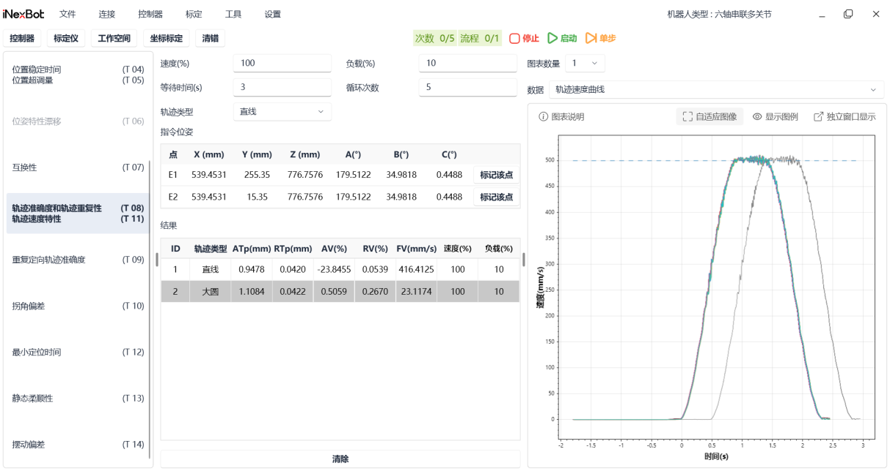

图15　轨迹准确度和轨迹重复性测试界面

名词解释：

速度：机器运行速度，按照示教器实际显示填写

负载：以“实际负载/机器人负载”按百分比填写

等待时间：踩点等待时间，默认3

循环次数：轨迹准确度和轨迹重复性、轨迹速度特性的作业文件循环运行次数

轨迹类型：可下拉选择“直线、大圆、小圆”等三种

标记该点：测试不同点位的轨迹准确度、轨迹重复性、轨迹速度特性机器人运动到需要测试点点位，点击‘标记该点’，上电后点击‘启动’

图表数量：显示同一页面展示的图标数量，下拉框可选，最多同时展示3张

数据：轨迹准确度、轨迹重复性、轨迹速度特性测试项共有“轨迹速度曲线；轨迹准确度；各循环平均速度；轨迹速度准确度；轨迹速度重复性；轨迹速度波动”等6张数据图

## 2.8 ：重复定向轨迹准确度（T09）

必须带上工具手进行测试，工具手可在坐标标定页面勾选获取

重复定向轨迹准确度（ATp）是指在重复执行规定轨迹并保持规定末端姿态条件下，对实际轨迹准确程度进行评价（简称与轨迹准确度相同，国标十四项也是如此，重复定向轨迹准确度与轨迹准确度的差异是带了工具手并且加上姿态进行运行）

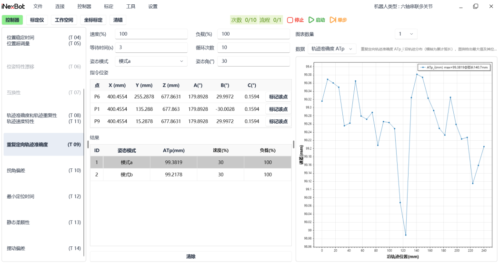

图16　重复定向轨迹准确度测试界面

名词解释：

速度：机器运行速度，按照示教器实际显示填写

负载：以“实际负载/机器人负载”按百分比填写

等待时间：踩点等待时间，默认3

循环次数：重复定向轨迹准确度的作业文件循环运行次数

姿态模式：有“模式a、模式b”两项可选。模式a是指绕Y轴改变姿态；模式b是指绕X、Z轴进行姿态改变

姿态角：指改变姿态的角度变化，默认30度

标记该点：测试不同点位的重复定向轨迹准确度机器人运动到需要测试点点位，点击‘标记该点’，上电后点击‘启动’

图表数量：显示同一页面展示的图标数量，下拉框可选，最多同时展示3张

数据：重复定向轨迹准确度测试项只有轨迹准确度ATp数据图

## 2.9：拐角偏差（T 10）

拐角偏差是指机器人执行包含拐角的轨迹时，实际运动轨迹在拐角区域相对于理论轨迹的偏离程度。CR（Cut Round）为走直线时拐角被削圆的量；CO（Corner Over）为冲过拐角的过冲量；速度下降百分比为过拐角时相对直段稳态速度的下降幅度

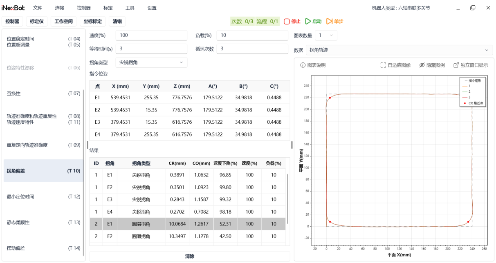

图17　拐角偏差测试界面

名词解释：

速度：机器运行速度，按照示教器实际显示填写

负载：以“实际负载/机器人负载”按百分比填写

等待时间：踩点等待时间，默认3

循环次数：拐角偏差的作业文件循环运行次数

拐角类型：可下拉选择“尖锐拐角、圆滑拐角”等两种。尖锐拐角是以90直角方式进行运行；圆滑拐角是指在90度的基础上以增加平滑以圆角的方式进行运行

标记该点：测试不同点位的拐角偏差机器人运动到需要测试点点位，点击‘标记该点’，上电后点击‘启动’

图表数量：显示同一页面展示的图标数量，下拉框可选，最多同时展示3张

数据：拐角偏差测试项共有“拐角轨迹；圆角误差与超调；拐角速度曲线；圆角误差（逐次）；拐角超调（逐次）”等5张数据图

## 2.10：最小定位时间(T 12)

最小定位时间是指在规定运动距离和精度要求下，机器人从一个位置运动到另一个位置并达到规定定位要求所需的最短时间

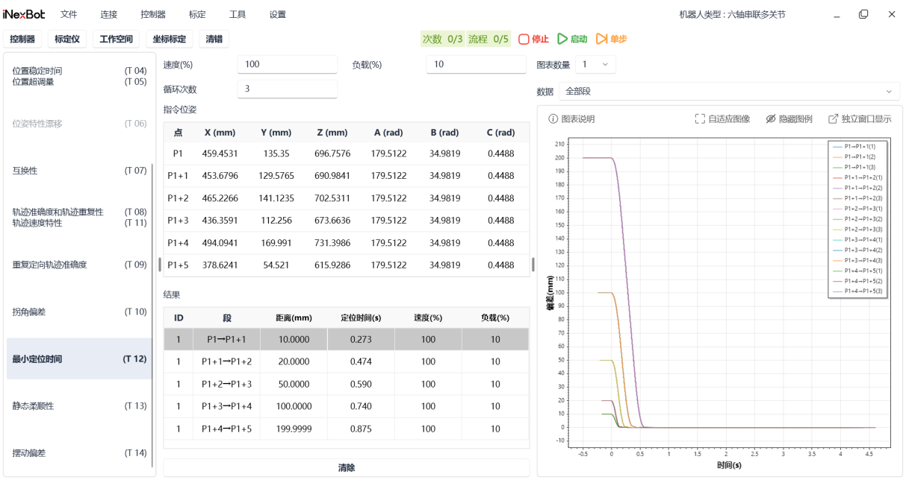

图18　最小定位时间测试界面

名词解释：

速度：机器运行速度，按照示教器实际显示填写

负载：以“实际负载/机器人负载”按百分比填写

循环次数：最小定位时间的作业文件循环运行次数

图表数量：显示同一页面展示的图标数量，下拉框可选，最多同时展示3张

数据：最小定位时间项共有“全部段；各段定位时间；定位时间 vs 段位移；P1→P1+1；P1+1→P1+2；P1+2→P1+3；P1+3→P1+4；P1+4→P1+5；P1+5→P1+6；P1+6→P1+7”等10张数据图（因测试机器人运行范围有限，最大只能到P1+4→P1+5）

## 2.11：静态柔顺性(T 13)

静态柔顺性是指机器人在静态外力（分别有X+、X-、Y+、Y-、Z+、Z-等六个方向分别施加的力）作用下，末端产生位移或姿态变化的程度

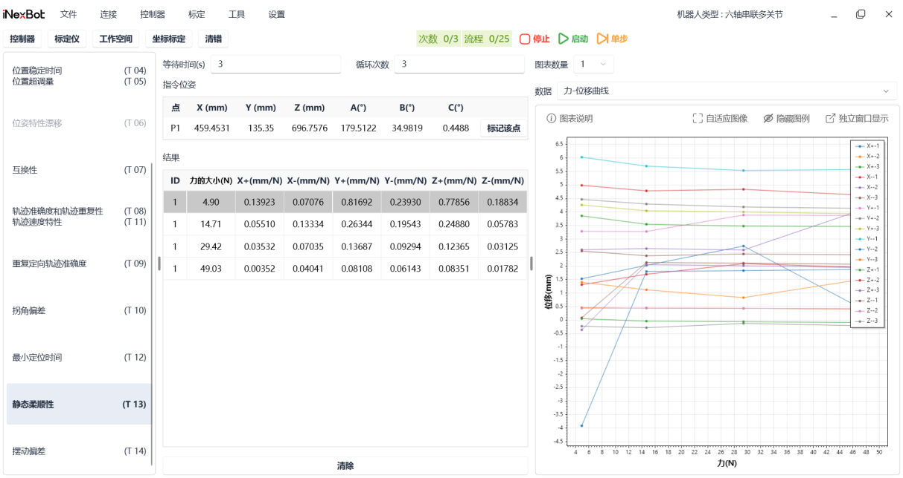

图19　静态柔顺性测试界面

名词解释：

等待时间：踩点等待时间，默认3

循环次数：静态柔顺性的作业文件循环运行次数

图表数量：显示同一页面展示的图标数量，下拉框可选，最多同时展示3张

数据：静态柔顺性测试项共有“力 - 位移曲线；各方向柔顺性；逐级柔顺性”等3张数据图

## 2.12：摆动偏差(T 14)

摆动偏差是指机器人在摆动运动过程中，实际摆动参数与指令摆动参数之间的偏差，用于评估机器人的摆动控制精度。摆动是轨迹上一个或多个运动的组合。WS 为摆幅偏差百分比（实际摆幅相对指令摆幅的偏差），WF 为摆频偏差百分比

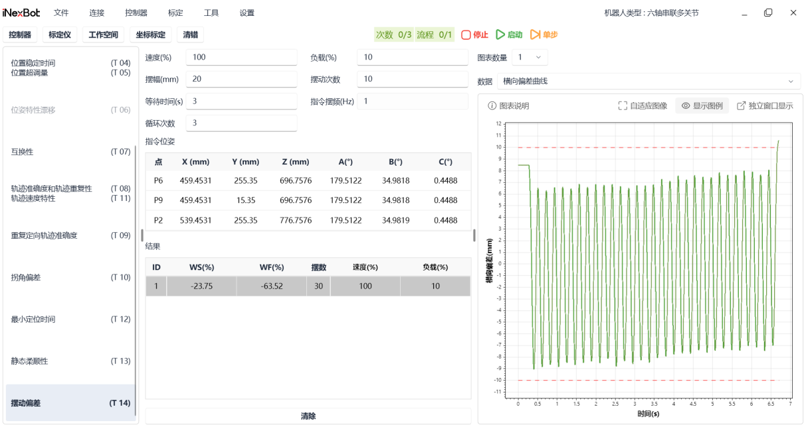

图20　摆动偏差测试界面

名词解释：

速度：机器运行速度，按照示教器实际显示填写

负载：以“实际负载/机器人负载”按百分比填写

摆幅：运行过程中摆动的幅度，以mm为单位

摆动次数：一次运动轨迹摆动的次数

等待时间：踩点等待时间，默认3

指令摆频：运行过程中摆动的频率，以Hz为单位

循环次数：摆动偏差的作业文件循环运行次数

图表数量：显示同一页面展示的图标数量，下拉框可选，最多同时展示3张

数据：摆动偏差测试项共有“横向偏差曲线；沿轴线速度曲线；逐摆摆幅；摆动特性对比”等4张数据图

如果需要生成相应报告，点击文件，点击下拉框的【PDF报告】。

# 3、文件、工具、设置使用

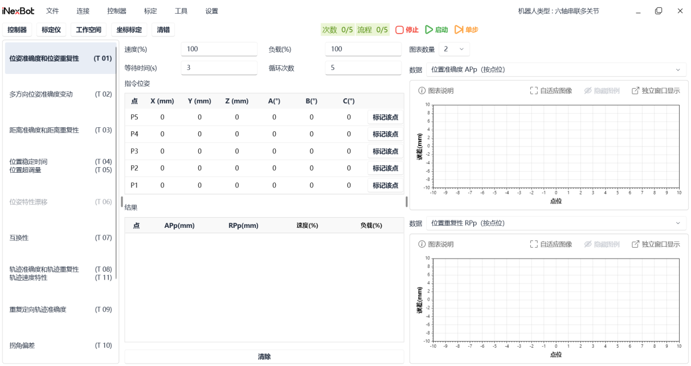

图21　PDF报告导出示例

## 3.1文件：

下拉可选择“加载、保存、PDF报告”（加载：导入以往保存的测试项数据项；保存：将本次测试项保存；PDF报告：将本次的测试项以PDF的方式导出）

连接、控制器、标定等与标定界面红能一样

## 3.2工具：

下拉可选择“数据采集、点云查看器”，数据采集详细功能可阅读标定‘纳博特机器人自动标定系统NexAutoCail标定操作手册’

点云查看器可通过现有测试项及以往测试项数据分析点位。

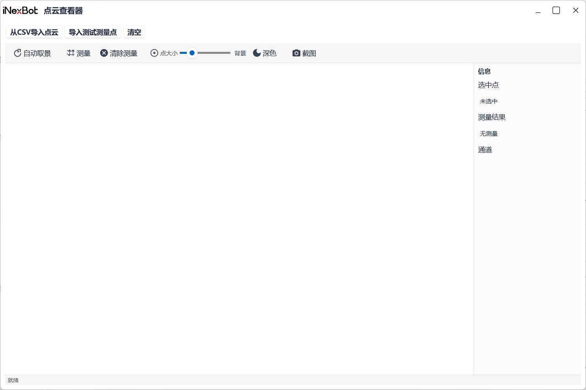

图22　点云查看器主界面

“从CSV导入点云”，通过数据采集功能采集轨迹点位信息进行分析；“导入测试测量点”，根据现有已经测试了的数据进行分析，如下图所示，选择已经测试了的勾选上点击【确定】，鼠标右键选中后用滚轮进行缩放，通过右侧通道勾选再次选择详细信息

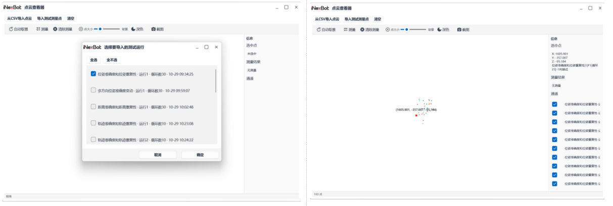

图23　点云导入与分析界面

清空：清空当前导入信息

自动取景：点击后点位信息在界面还原，呈现最开始导入时候的样子

测量：测量点位距离，选择一个点位进行双击后再选择另外一个点位双击，自动计算出两点间的距离

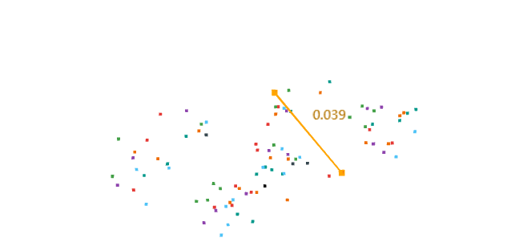

图24　点云测量功能界面

清除测量：将测量信息清除

点大小：调节显示的点位的大小

背景：可进行深色、浅色调节

截图：当前界面进行截图

## 3.3设置：

设置共有语言、标定仪、性能测试模式三个功能模块

### 3.3.1：语言

进行不同语言的切换，目前有中、英两种，切换后需要重启才生效

图25　语言切换设置界面

### 3.3.2：标定仪

修改标定仪单点采集精度，修改后立即生效

图26　标定仪参数设置界面

### 3.3.3：性能测试模式

修改运动过程中的参数及十四项性能测试的基本参数

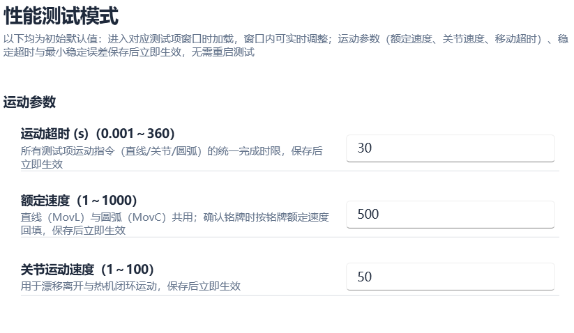

图27　性能测试模式参数设置界面

运动参数：

运动超时：指两点之间允许机器人运行的最大时间，如果机器人运动速度慢可按照实际形况修改

额定速度：同步铭牌库的“额定速度”，指机器人最快运动的速度

关节运动速度：是指机器人从任一位置到达测试点的速度

位姿准确度/重复性、多方向位姿、距离准确度/重复性、轨迹准确度/重复性、重复定向轨迹准确度、稳定时间/超调量、位姿特性漂移、最小定位时间、摆动偏差、拐角偏差、静态柔顺性等展示的信息是基础测试条件，可以在此界面修改或新能测试项修改。

# 国标性能测试项定义及解释

| 序号 | 性能测试项目     | 简单定义                                                           | 通俗理解                                   |
| -- | ---------- | -------------------------------------------------------------- | -------------------------------------- |
| 1  | 位姿准确度      | 机器人实际达到的位姿与指令位姿之间的偏差程度                                         | 机器人“走得准不准”                             |
| 2  | 位姿重复性      | 机器人从不同方向或多次重复运动到同一目标位姿时，各实际位姿之间的一致程度                           | 同一个位置反复走，能不能每次都到得差不多                   |
| 3  | 多方向位姿准确度变动 | 从不同方向接近同一目标位姿时，机器人实际位姿准确度的变化情况                                 | 从不同方向走到同一点，结果会不会不一样                    |
| 4  | 距离准确度      | 机器人实际移动距离与指令移动距离之间的偏差                                          | 让机器人走 500 mm，实际到底走了多少                  |
| 5  | 距离重复性      | 多次重复执行相同距离运动时，实际运动距离的一致程度                                      | 同样走 500 mm，多次走的距离是否一致                  |
| 6  | 位姿特性漂移     | 在规定时间或运行过程中，机器人位姿性能随时间发生的变化                                    | 机器人刚开始测和运行一段时间后，精度有没有慢慢变               |
| 7  | 互换性        | 在相同条件下，更换机器人或重新安装后，其达到规定性能的一致程度                                | 换一台机器人或重新安装后，性能是否基本一致                  |
| 8  | 位置稳定时间     | 机器人运动到目标位置后，实际位置进入规定门限带并保持稳定所需要的时间                             | 机器人到目标位置后，需要多久才能真正“稳住”                 |
| 9  | 位置超调量      | 机器人到达目标位置过程中，超过目标位置的最大偏差                                       | 机器人刹车时“冲过头”了多少                         |
| 10 | 轨迹准确度      | 机器人实际运动轨迹与理论指令轨迹之间的偏差程度                                        | 机器人沿着一条规定路线走，实际轨迹偏了多少                  |
| 11 | 轨迹重复性      | 多次重复执行同一轨迹时，各次实际轨迹之间的一致程度                                      | 同一条轨迹走很多次，每次是不是基本一样                    |
| 12 | 重复定向轨迹准确度  | 在重复执行规定轨迹并保持规定末端姿态条件下，对实际轨迹准确程度进行评价                            | 不仅要求路径走得准，还要求末端姿态保持正确                  |
| 13 | 拐角偏差       | 机器人执行包含拐角的轨迹时，实际运动轨迹在拐角区域相对于理论轨迹的偏离程度                          | 走直线拐弯时，拐角位置有没有“削角”或冲出去                 |
| 14 | 轨迹速度特性     | 机器人执行规定轨迹时，实际运动速度与指令速度之间的特性及变化情况                               | 机器人走轨迹时，速度是否跟得上指令、是否稳定                 |
| 15 | 最小定位时间     | 在规定运动距离和精度要求下，机器人从一个位置运动到另一个位置并达到规定定位要求所需的最短时间                 | 机器人最快多长时间能准确停到目标位置                     |
| 16 | 静态柔顺性      | 机器人在静态外力作用下，末端产生位移或姿态变化的程度                                     | 机器人受到外力后，会“软”多少、偏多少                    |
| 17 | 摆动偏差       | 机器人在摆动运动过程中，实际摆动参数与指令摆动参数之间的偏差，用于评估机器人的摆动控制精度。摆动是轨迹上一个或多个运动的组合 | 机器人做 “左右摇摆” 动作时，摆得到不到位、准不准的问题。（焊接场景为主） |

