---
title: "纳博特机器人自动标定系统 NexAutoCail 标定使用教程"
description: " NexAutoCail系统标定指南"
author: "ShenJL"
date: "2026-10-19"
tags: ["激光", "NexAUtoCail", "精度"]
category: "操作手册"
version: "1.0.0"
language: "zh-CN"
---
# 纳博特机器人自动标定系统 NexAutoCail 标定使用教程

> 规范操作指南

> 目前激光标定仪支持的机型有：七轴串联多关节、七轴串联CBCBCBA、六轴串联多关节、六轴协作、五轴协作、四轴SCARA、四轴SCARA异型一、四轴并联、四轴连杆码垛等机型。

## 一、标定功能

激光标定仪的标定功能主要是校准机器人本体的参数，主要有DH参数、减速比、耦合比、间隙、机器人自身刚度（目前仅支持六轴串联多关节机型）等。

## 二、标定步骤

### 步骤1：软件初始化配置

双击打开软件，选择符合的机器人类型、项目（校准或性能测试）；标定仪类型默认为"API"，标定刚度默认为"否"，刚度标定暂时只支持六轴串联多关节机型。选择好后点击【进入】。

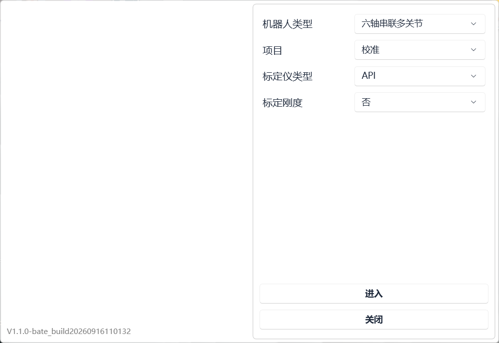

图1　软件初始配置界面

### 步骤2：连接机器人控制器

1. 点击【控制器】，输入连接控制器的IP地址（下图以192.168.2.15为例），点击【连接】。

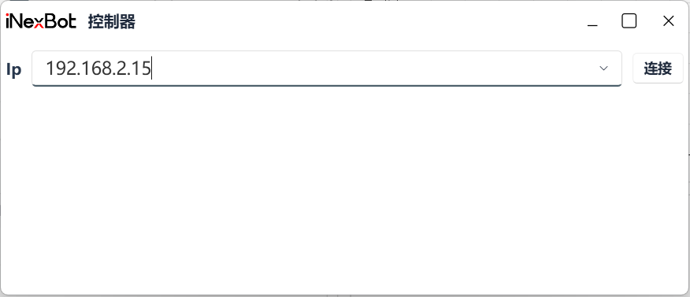

图2　控制器连接弹窗

2. 连接上控制器后，软件会自动读取机器人DH参数，以及当前位置的关节坐标及直角坐标点位信息。

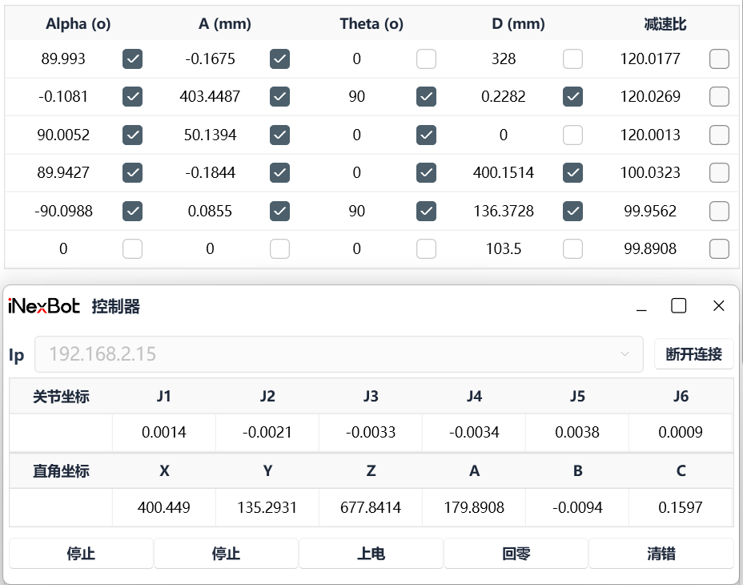

图3　控制器参数读取界面

### 步骤3：连接激光标定仪

1. 点击【标定仪】，点击弹窗中的【连接】。

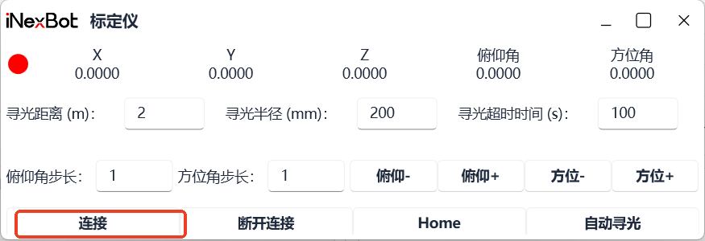

图4　标定仪主界面

2. 点击【连接】后，依次点击【Connect Tracker】、【OK】（IP无需更改，API激光标定仪默认IP为192.168.0.168）。

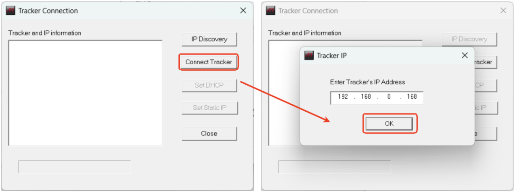

图5　Tracker 连接弹窗

3. 成功连接标定仪后，弹窗内会显示当前激光标定仪靶球的实时位置信息。

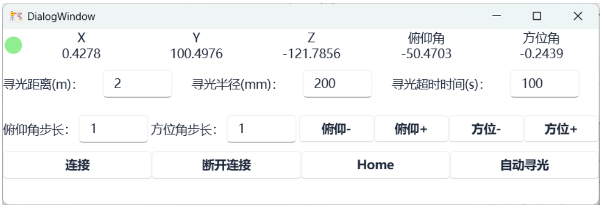

图6　标定仪连接成功界面

> **前置准备**：连接成功控制器和标定仪后，将激光标定仪上的靶球放置于机器人夹爪处，或通过"引光"方式将激光引至机器人夹爪靶球上。

### 步骤4：生成标定测试点（通常为50个点）

点击【测量点生成】，配置各项参数，名词解释如下：

| 参数项 | 说明 |
| --- | --- |
| 点数 | 生成的测试点数。 |
| 姿态变化 | 默认选A，有"无、A、B、C、追踪"五种可选。 |
| 轴限位 | 默认不选择，即不使用限位；可以选择"启用直角限位"或"启用关节限位"，或"启用直角限位与关节限位"。（以直角限位为例：在直角坐标下运动X-、X+、Y-、Y+、Z-、Z+，选择合适的位置，将示教器的值填写在X、Y、Z的反限位、正限位处。） |
| 最小移动距离 | 表示相邻两个点位的空间距离，默认100mm；若机器人本体较小或活动空间范围有限，可相应缩减。 |
| 关节最小移动角度 | 表示相邻两个点位的关节移动角度，默认3度。 |
| 添加单轴运动 | 默认"否"；选择"是"时，在50点基础上增加"轴数×4"的点数（六轴机型选择"是"时，最终点位为50+24=74点）。 |
| 追加 | 默认不勾选；勾选后在原有点位基础上再次增加点位。 |
| 重标记 | 机器人当前关节点位会覆盖选中点的关节点位（选中需要重新标记的点位，机器人运动到位后，点击"重标记"）。 |
| 移动至此 | 选中点位后点击"移动至此"，机器人运动至该点位（需保持机器人上使能）。 |
| 标记 | 在点位列表最后增加当前机器人关节点位信息。 |
| 删除 | 选中需要删除的点位，点击"删除"。 |
| 导入 | 导入点位信息，需为CSV格式文件；表格第一行需增加表头J1~J6，根据实际机器人轴数设置。 |
| 导出 | 将当前点位信息以CSV格式导出。 |

设置好"点数、姿态变化、轴限位、最小移动距离、关节最小移动角度、添加单轴运动"等信息（若设置了轴限位需填好相应数值），点击【生成测试点】；测量点生成完毕后，点击右下角的【确定】。

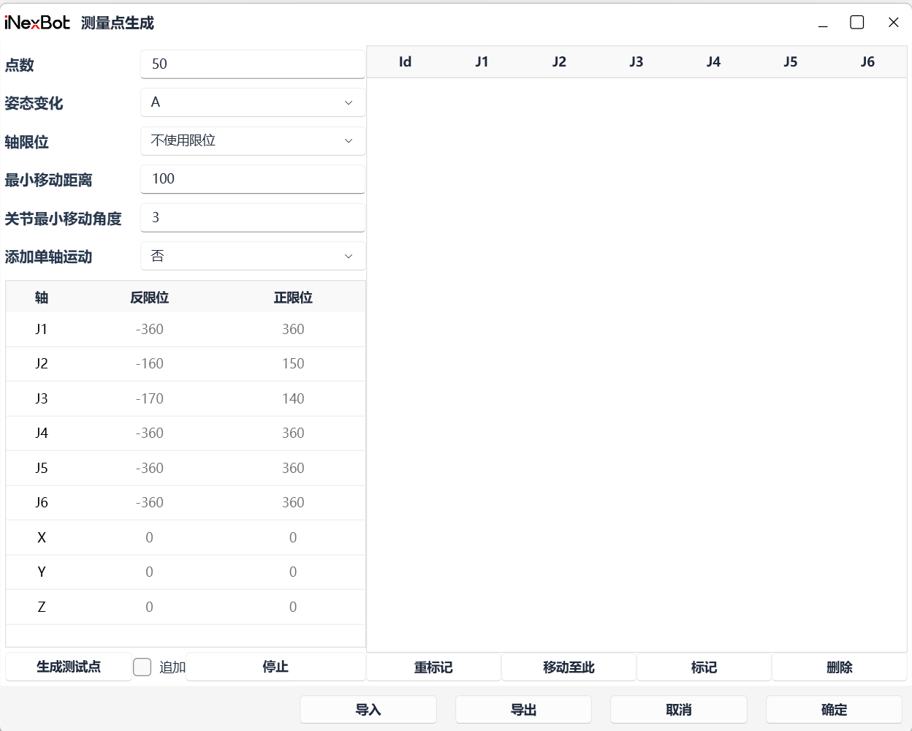

图7　测量点生成界面

图8　点位生成成功提示

### 步骤5：执行标定采集

1. 点位生成完成后点击【启动】，开始自动跑点采集（点击前确保机器人处于上电状态，且激光标定仪的激光打在机器人靶球上）。

2. 标定过程中可使用以下功能：
   - **停止**：停止标定过程
   - **单步**：单步执行点位

图9　标定运行控制界面

3. 测试点跑完后，软件根据勾选的参数项，在校准后参数表格中生成新的校准后参数。（下图以六轴串联多关节机型为例，展示校准后参数截图。）

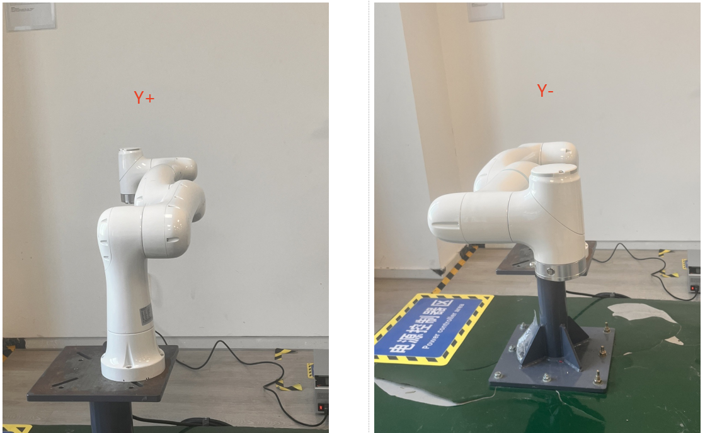

图10　校准后参数表格（六轴串联多关节示例）

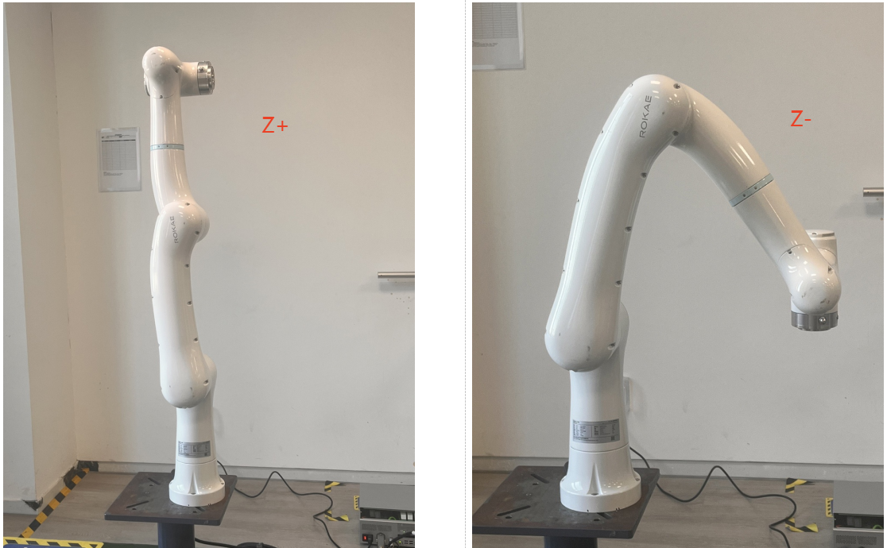

图11　耦合比参数表格

- 如需计算不同的参数信息，自行勾选后点击【计算】重新运算。
- 标定前、标定后的Max、Avg、Rms的合格标准为1以内。
- 图10的右上方折线图的横轴为标定点位编号（共74个标定点），纵轴为该点位下机器人末端的定位误差，单位为毫米（mm）。图中灰色水平直线为零误差基准线，红色折线为校准前误差，蓝色折线为校准后误差；右下方点位图是以三维坐标形式展示本次标定所采集的全部标定点在机器人工作空间中的分布情况，鼠标放置点位红色点位上能读取到该点相对于机器人及标定仪的三维坐标。

### 步骤6：上传标定结果至控制器

计算完成后，依次点击【控制器】、【同步参数到控制器】，将计算后的标定参数下发至机器人控制器。

**同步参数到本地**：将控制器参数同步至软件界面。

图12　同步参数到控制器

### 步骤7：生成测试报告

点击【文件】，点击下拉框中的【PDF报告】，生成本次标定的PDF测试报告。

**保存**：将此次标定过程完整记录保存下来，生成".necal"工程文件；后续可通过【加载】在软件中重新打开。

图13　文件菜单 - PDF报告

## 三、标定软件其他组件使用教程

### 3.1 间隙检测

工业机器人的间隙是指关节传动机构在运动换向过程中，由于齿轮、减速机等机械部件之间存在微小空隙而产生的空行程，会导致机器人实际运动位置与理论位置产生偏差，从而影响定位精度和轨迹精度。通过精准的间隙检测获取实际间隙值，并结合相应的补偿措施，可以有效减小换向过程中的位置误差，进一步提高机器人的运动精度。

进入标定页面，点击"工具"，选择"间隙检测"，进入间隙检测页面。

图14　工具菜单（间隙检测/数据采集入口）

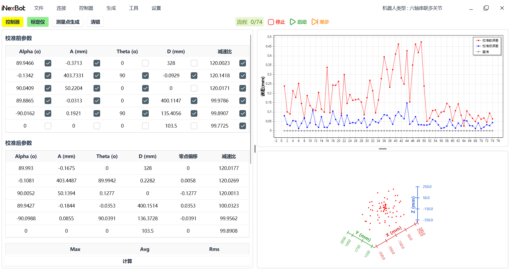

图15　间隙检测页面

**使用方法**：抱持上使能的状态，依次勾选1～6轴（第一次检测建议全部勾选，二次检测的时候勾选补偿后的轴），点击"校准"。

旋转角度和检测次数可自行修改。

**注意点**：

- 间隙检测时速度慢，保持示教模式20%～30%即可。
- 检测过程中不出现丢光现象。
- 检测结果填入，检测出小数点第三位的可以不填入示教器，多个轴检测出小数点第二位甚至更大的结果时需要填入。
- 间隙检测结果填入以及后续间隙标定方法：

  1. 设置/操作参数界面，打开【显示电机坐标位置及标定按钮】

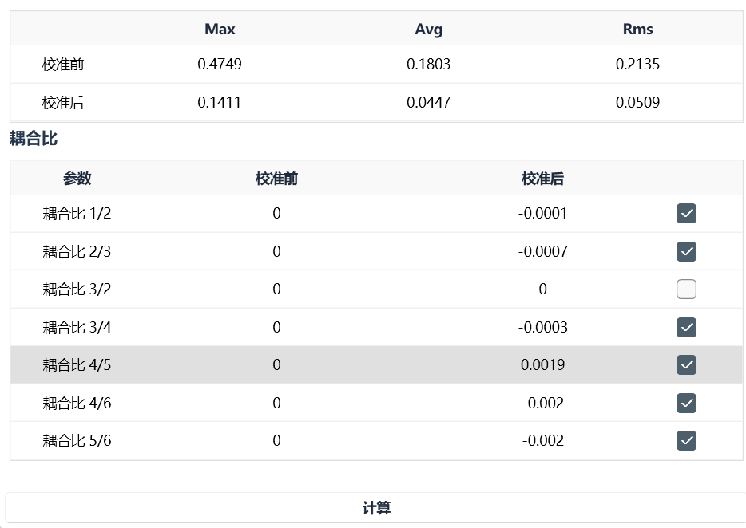

图16　设置/操作参数界面（显示电机坐标位置及标定按钮）

此时在监控/机器坐标界面可以看出多了一个电机位置坐标。

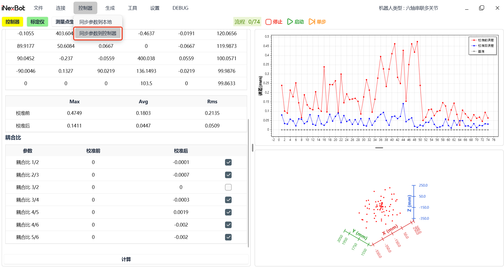

图17　机器坐标界面（新增电机位置坐标显示）

在设置/机器人参数/零点位置界面多了一个【标记无间隙方向】按钮。

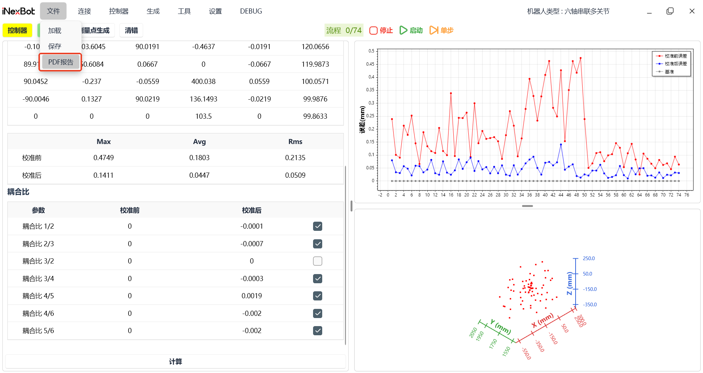

图18　零点位置界面（标记无间隙方向按钮）

  2. 以机器人的一轴为例

在设置/机器人参数/关节参数/其他参数界面中【齿轮反向间隙】设置一个值（例如填：10）。

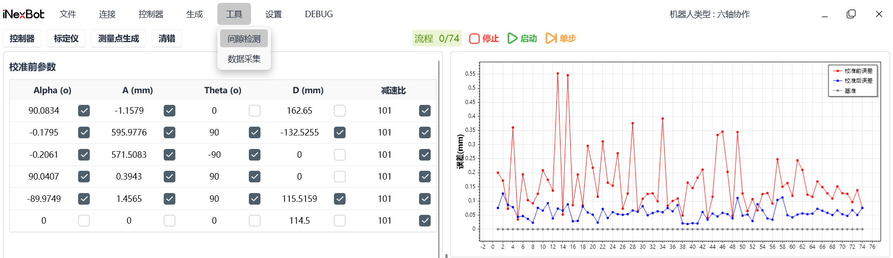

图19　关节参数界面（齿轮反向间隙设置）

齿轮反向间隙有值的时候会出现一个报错，因为还没有进行标定。

  3. 此时到零点位置界面标记无间隙方向

标定方法如下：

a. 动1轴+，因为齿轮反向间隙的值为10，所以电机位置在动1轴的过程中要大于10。

b. 当大于10之后点击【标记无间隙方向按钮】，会有标记成功的消息提示。

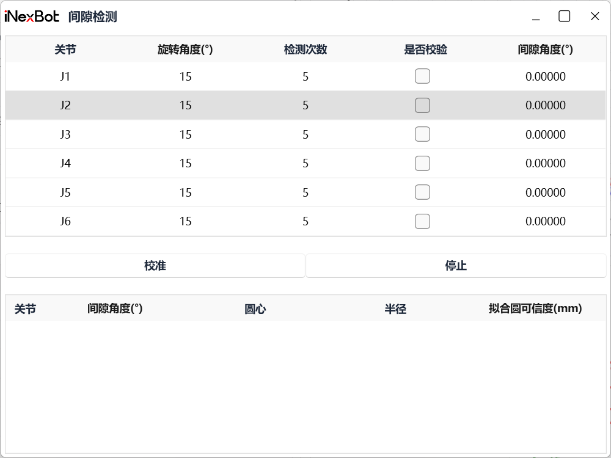

图20　标记无间隙方向后的电机位置坐标

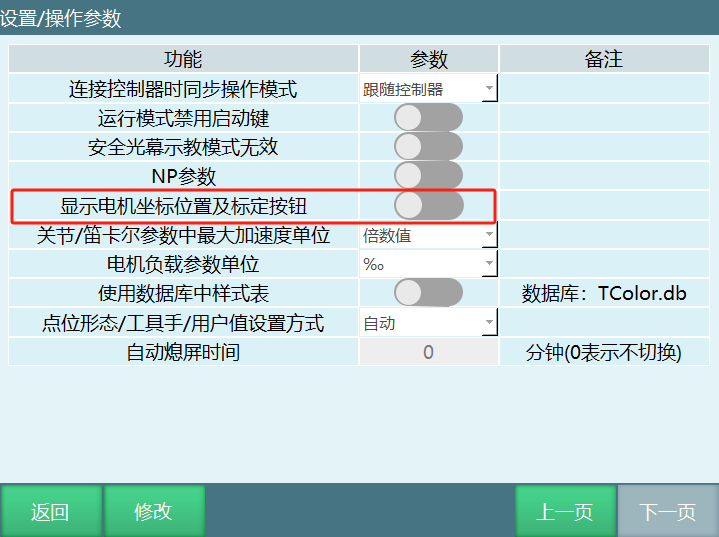

图21　标记无间隙方向成功提示

  4. 验证是否有效果

标记成功之后看监控机器人坐标和电机位置坐标的一轴坐标是否一样。

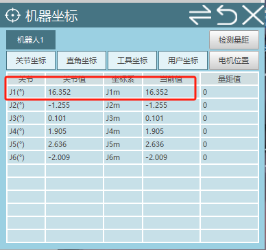

图22　标记后机器人坐标与电机位置坐标对比

上电点动机器人一轴，点动一轴正方向时机器人坐标和电机位置坐标一致。

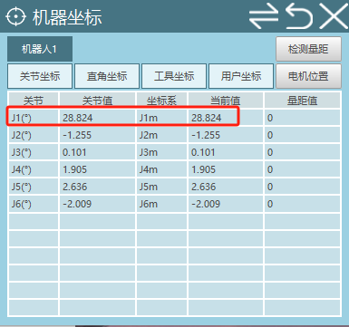

图23　正方向点动：机器人坐标与电机位置坐标一致

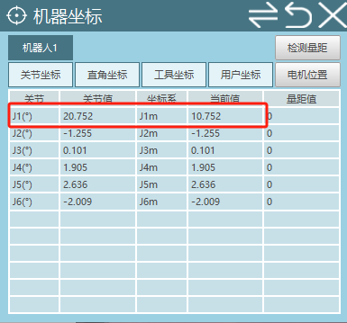

图24　反方向点动：机器人坐标与电机位置坐标相差10

反方向点动一轴时，机器人坐标和电机位置坐标相差10，也就是齿轮反向间隙的值。

### 3.2 数据采集

数据采集共有"连续点采集、单点采集、测距"三种功能。

- **连续点采集**：动态连续采集点位信息，点击"开始"，标定仪会连续踩点；点击"停止"后会停止踩点；点击"导出"，会以CSV的格式进行导出。

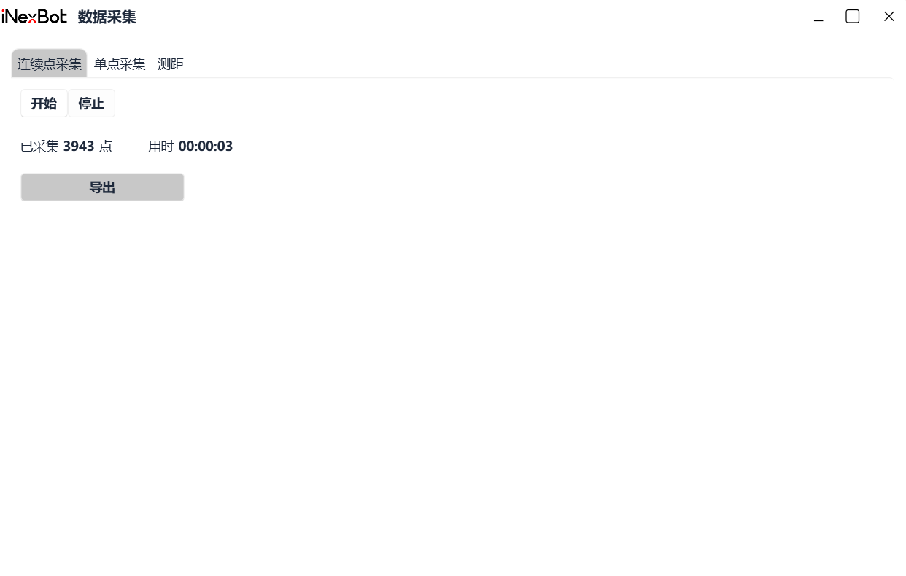

图25　连续点采集界面

- **单点采集**：采集单个点位信息。

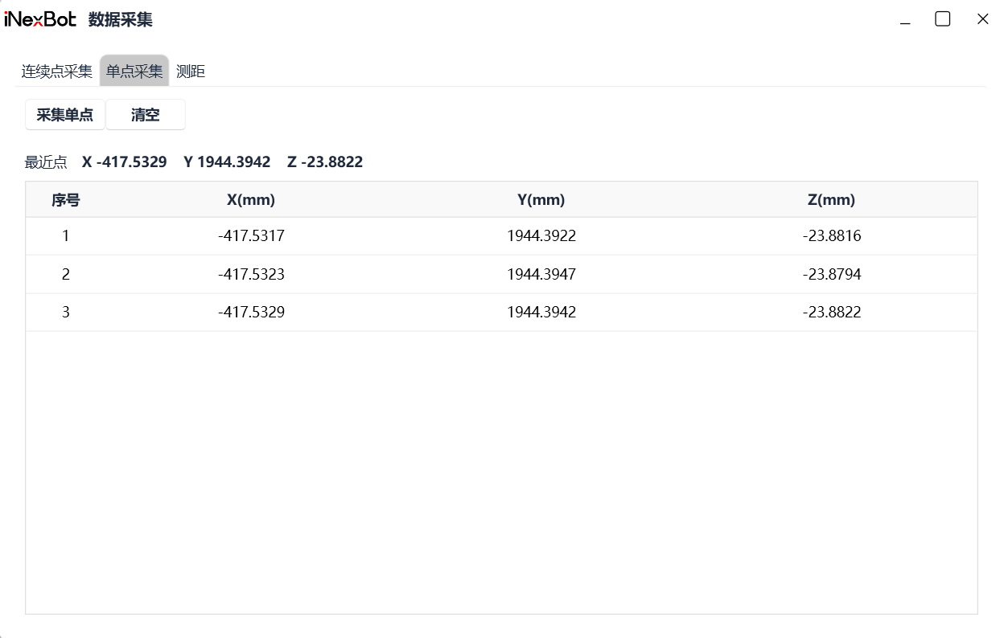

图26　单点采集界面

- **测距**：通过采集A、B两点的点位信息自动进行两点之间直线段距离计算。

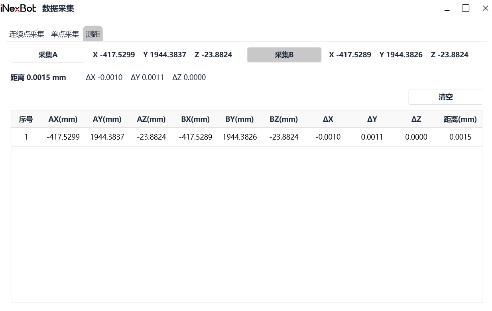

图27　测距界面

### 3.3 设置

设置包含"语言、标定仪、标定模式"三个模块。

- **语言**：目前支持中文、英文互换。

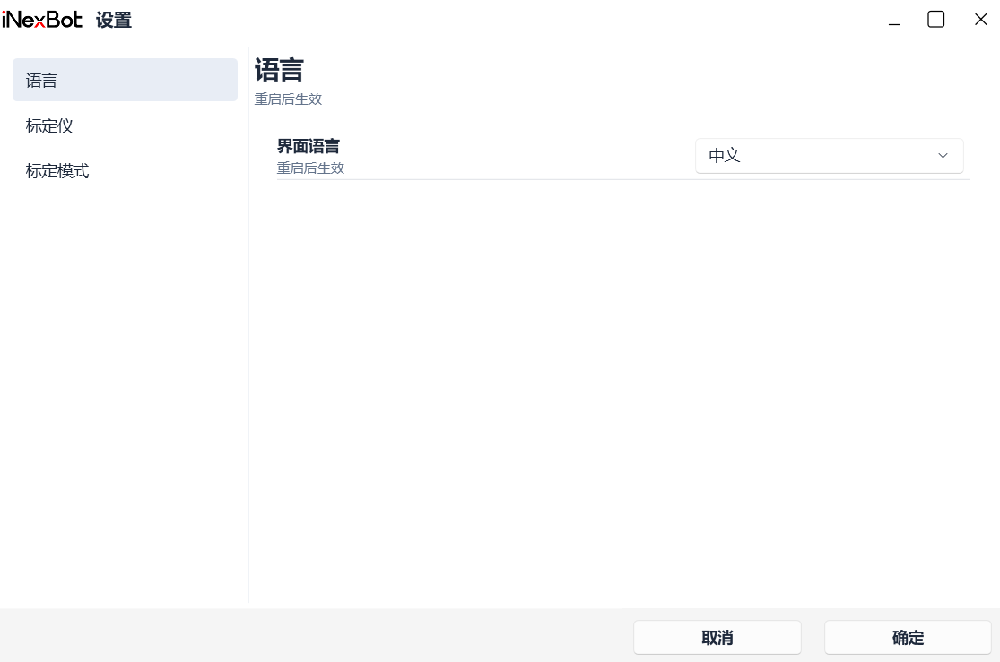

图28　设置-语言界面

- **标定仪**：设置激光标定仪单点测量精度，范围为（0.005～5）。

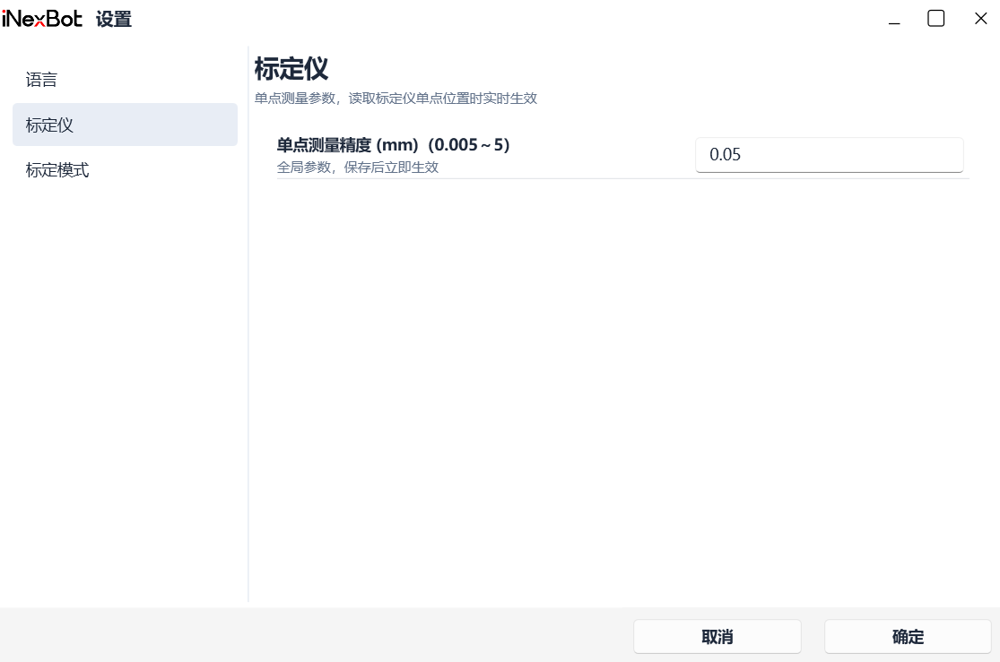

图29　设置-标定仪界面

- **标定模式**：设置标定默认参数，更改后点击保存立即生效。其中"追加首点"用于追加标定点位的过渡点。

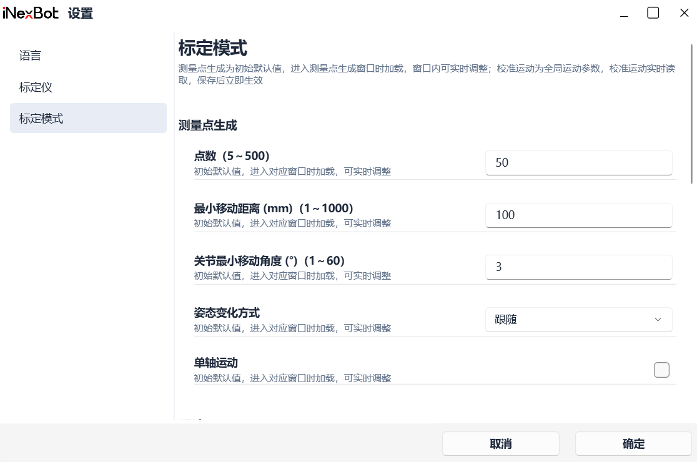

图30　设置-标定模式界面

---

## 操作注意要点

- 示教器上不能选择工具手进行标定或性能测试。
- 标定前先做一次间隙检测。
- 整个标定过程中一定不可以出现"丢光"现象，如果出现丢光提示及时手动引导，引导不成功重新生成点位。
- 标定及测试过程中如果出现人为现象导致控制器断开，需要重启控制器进行连接。
- 轴方向确保正确（确保关节实际运动方向和示教器提示位置一致）。
- 标定仪和电脑的通讯用网线，非必要不使用Wi-Fi。
- 标定前检查标定仪三脚架处水平仪，需要大致水平。
- 标定仪放置地面须平整、质地硬（地板等软地面会影响测量精度）。
- 标定仪引光至机器人之前一定要让标定仪数据稳定（回Home点后等待几秒让数据稳定）。
- 放置在机器人上的夹爪不能出现松动。
- 测试环境尽量稳定（例如不要在风向口，不要直吹等）。
- 标定仪测试过程中周边减少行人走动。
